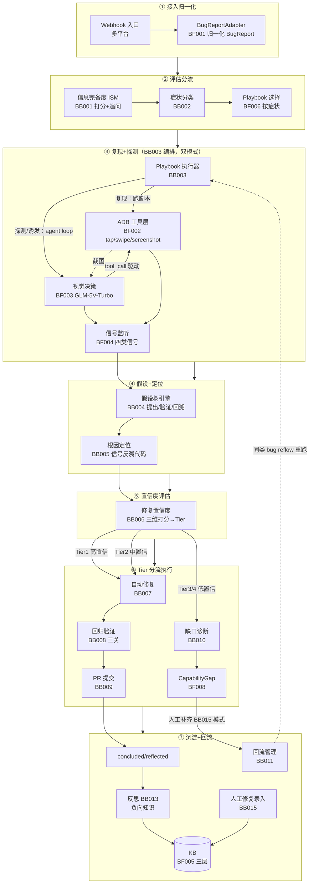
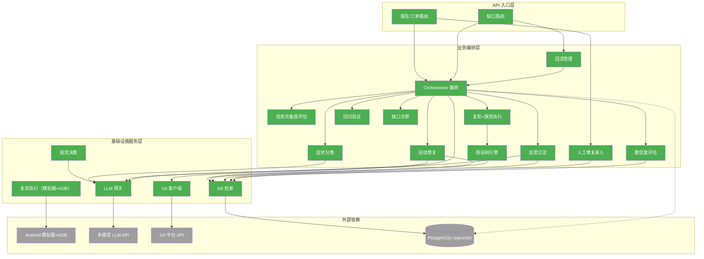
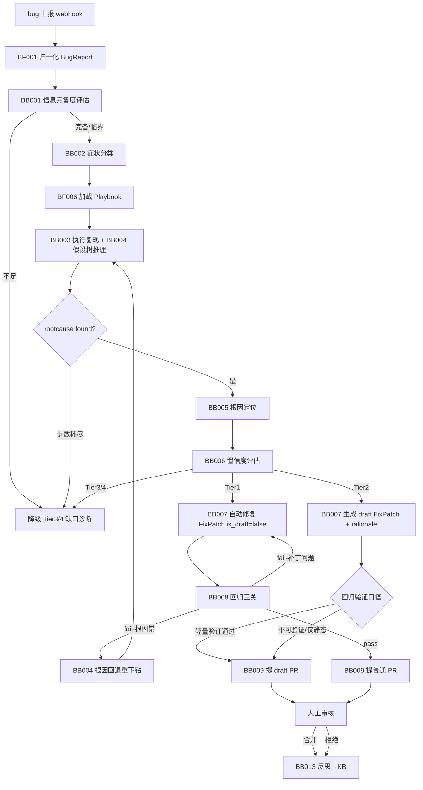
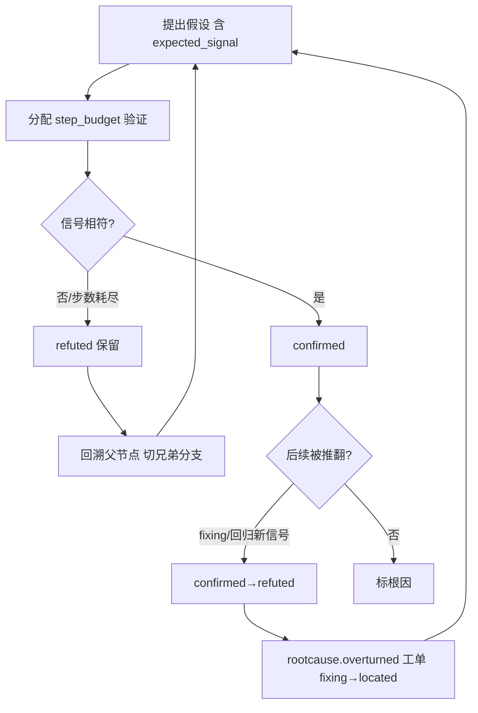

# 客户端 Bug 修复 Agent — 后端设计报告

> 关联设计：前端视图（FB001/FB003/FB004）在本报告第 3.5 节给出页面职责与 API 依赖，组件级细节留待后续 design_frontend 细化。

## 1. 目标

本版本交付一个独立后端 agent 服务，覆盖 analysis 定义的全部 planned 功能节点（BB014 跨 bug 聚合 deferred、FB002 复用外部 PR 界面），端到端实现「bug 上报 → 排查 → 修复 → 验证 → 提 PR → 反思沉淀 → 缺口管理」闭环：

- **基础设施层（BF001-008）**：上报接入适配、复现执行引擎（模拟器+ADB）、视觉决策引擎、信号监听器、KB 存储检索、Playbook 注册中心、锚点库、Capability Gap 存储
- **业务编排层（BB001-015）**：信息完备度评估、症状分类、Playbook 执行器、假设树引擎（含换方向/根因回退）、根因定位、修复置信度评估、自动修复器、回归验证器、PR 提交器、缺口诊断器、缺口回流器、诊断报告、反思 agent、人工修复录入器（BB014 跨 bug 聚合 deferred）
- **API 层（FF001-002）**：报告/工单/trajectory/PR 查询接口、缺口视图接口
- **前端页面（FB001-004）**：诊断报告详情页、缺口视图、信息追问表单（FB002 复用 GitHub/GitLab PR 界面）
- **核心数据骨架**：固化 7 个核心 Schema（BugReport / Playbook / Trajectory / ConfidenceScore / FixPatch / CapabilityGap / KBEntry）+ 1 个验收埋点 Schema（MetricPoint）

**不做什么**：见第 8 节。核心是 BB014 跨 bug 聚合 deferred、自主合并、真机农场。

## 2. 现状分析

全新模块（agent 系统不存在），无既有代码改造。本节简化为技术栈与基础设施说明。

### 已有能力（外部，可复用）

| 能力 | 来源 | 复用方式 |
|------|------|---------|
| 客户端代码仓库 | git（`app/` Kotlin + `flutter_logic/` Dart） | git_client 做 blame / 检索 / 提 PR |
| Android 模拟器 + ADB | Android SDK | subprocess 调 adb，BF002 复现引擎操控 |
| Git 平台 API | GitHub / GitLab | BB009 提 PR、FB002 复用审核界面 |
| 客户端上报平台 | Bugly / Sentry / Crashlytics | BF001 适配器归一化（参数化，不锁死） |

### 基础设施就绪

| 项目 | 状态 | 说明 |
|------|------|------|
| Android 模拟器 | ✅ | 本地 Android SDK 可用；BF002 emulator_pool 管理 |
| ADB | ✅ | platform-tools |
| 多模态 LLM API | ✅ | 经 **New API 网关**（OpenAI 兼容）：文本 glm-5.1 / 视觉 GLM-5V-Turbo（支持图片，已确认）；LLMGateway 参数化（D2），按 prompt_type 路由 |
| PostgreSQL + pgvector | ✅ | 本机 docker-compose 部署（D10）；trajectory 永久保留 + KB 向量检索同库（见 D4） |
| 上报平台 webhook | ✅ | MVP 第一适配器 Sentry；BugReportAdapter 参数化（D8），Bugly/Crashlytics 加 adapter 文件即可 |

### 技术栈

| 维度 | 选型 | 理由 |
|------|------|------|
| 语言 | Python 3.11+ | agent/AI 生态最成熟 |
| Agent 编排 | LangGraph | 原生支持假设树/回溯/状态机，适配 BB004 换方向机制 |
| Web 框架 | FastAPI | FF001/FF002 API + FB 页面 BFF |
| ORM/存储 | SQLAlchemy + PostgreSQL | trajectory 永久保留、关系强 |
| 向量检索 | pgvector | KB 相似度检索同库，避免多存储（D4） |
| 前端 | React + Vite（最小化） | FB001/FB003/FB004 三个页面 |

## 3. 方案总览

### 3.1 项目结构

```
agent/
├── intake/                              🟢 BF001 Bug 上报接入适配器
│   ├── bug_report_adapter.py            抽象基类 + 归一化
│   └── adapters/
│       ├── bugly_adapter.py             🟢
│       └── sentry_adapter.py            🟢
├── reproduce/                           🟢 BF002 复现执行 + ADB 工具层
│   ├── emulator_pool.py                 模拟器启停/分配
│   ├── apk_installer.py
│   ├── adb_tools.py                     ADB 工具层：tap/swipe/input/screenshot/press，底层 subprocess adb；复现脚本 + agent tool-calling 共用
│   ├── reproduce_runner.py              复现模式：确定性顺序跑 Playbook 脚本调 adb_tools
│   └── screenshot_collector.py
├── vision/                              🟢 BF003 视觉决策引擎
│   └── vision_decision_engine.py        多模态看截图→决策下一步
├── signal/                              🟢 BF004 信号监听器
│   ├── logcat_listener.py
│   ├── flutter_error_listener.py
│   ├── process_listener.py
│   └── visual_signal_detector.py
├── kb/                                  🟢 BF005 Knowledge Base 存储
│   ├── stores/
│   │   ├── trajectory_store.py          raw_trajectory 层
│   │   ├── negative_knowledge_store.py  负向知识层
│   │   └── pattern_store.py             pattern 层（仅 BB015 写入）
│   ├── retriever.py                     混合检索：症状过滤 + 根因信号向量
│   └── staleness_checker.py             陈旧失效检测（git commit 绑定）
├── playbook/                            🟢 BF006 Playbook 注册中心
│   ├── registry.py                      按症状检索
│   ├── schema.py
│   └── definitions/
│       ├── crash_playbook.py            崩溃型（MVP 第一个）
│       ├── blank_playbook.py            空白页
│       ├── loading_playbook.py
│       ├── no_response_playbook.py
│       └── data_error_playbook.py
├── anchor/                              🟢 BF007 锚点库
│   └── anchor_library.py                正常截图 + 文字预期
├── gap/                                 🟢 BF008 Capability Gap Tracker 存储
│   ├── gap_store.py
│   └── unlock_value_scorer.py           解锁价值评分
├── assessment/                          🟢 BB001 / BB002 / BB006
│   ├── info_sufficiency_evaluator.py    BB001 ISM
│   ├── symptom_classifier.py            BB002 症状分类
│   └── confidence_evaluator.py          BB006 修复置信度（三维 + KB 模式库）
├── diagnosis/                           🟢 BB003 / BB004 / BB005
│   ├── playbook_executor.py             BB003 编排复现+探测+诱发
│   ├── hypothesis_engine.py             BB004 假设树（含回溯/根因回退/步数预算）
│   └── root_cause_locator.py            BB005 命中信号反向追溯代码
├── fix/                                 🟢 BB007 / BB008 / BB009
│   ├── auto_fixer.py                    BB007 模板→LLM patch→KB 校准
│   ├── regression_verifier.py           BB008 三关：复现序列+既有测试+静态检查
│   └── pr_submitter.py                  BB009 Tier1 直PR / Tier2 draftPR
├── gap_mgmt/                            🟢 BB010 / BB011 / BB015
│   ├── gap_diagnoser.py                 BB010 四类缺口识别
│   ├── reflow_manager.py                BB011 补齐检测 + 同类 bug 回流
│   └── manual_fix_recorder.py           BB015 人工修复结构化录入→KB pattern
├── report/                              🟢 BB012
│   └── diagnosis_report_generator.py    JSON + markdown 双输出
├── reflection/                          🟢 BB013
│   └── reflection_agent.py              独立读 trajectory，提取负向知识+命中线索
├── api/                                 🟢 FF001 / FF002
│   ├── routers/
│   │   ├── report_router.py             FF001 «Module» 报告/工单/trajectory/PR
│   │   └── gap_router.py                FF002 «Module» 缺口列表/补齐
│   └── dtos/
├── schemas/                             🟢 7 核心 Schema + MetricPoint
│   ├── bug_report.py
│   ├── playbook.py
│   ├── trajectory.py
│   ├── confidence.py
│   ├── fix_patch.py
│   ├── capability_gap.py
│   ├── kb_entry.py
│   └── metric_point.py
├── infra/                               🟢 基础设施
│   ├── llm_gateway.py                   多模态 LLM 抽象（参数化 provider）
│   ├── adb_client.py
│   ├── git_client.py
│   ├── db.py                            SQLAlchemy session + pgvector
│   └── config.py                        步数预算/token 预算等参数
├── orchestrator.py                      🟢 LangGraph 主编排（状态机）
└── main.py                              🟢 FastAPI 入口

frontend/                                🟢 最小化 web（FB001/FB003/FB004）
├── src/
│   ├── pages/
│   │   ├── ReportDetail.tsx             🟢 FB001
│   │   ├── GapView.tsx                  🟢 FB003
│   │   └── ClarifyForm.tsx              🟢 FB004
│   ├── api/client.ts
│   └── components/
├── package.json
└── vite.config.ts

tests/
├── unit/
├── integration/
└── e2e/                                 含模拟器端到端最小闭环

docker-compose.yml                       🟢 agent + 前端 + PostgreSQL+pgvector（三容器，同 compose）
Dockerfile                               🟢 agent 镜像（含 adb client，连宿主 adb server）
Makefile                                 🟢 make up：起宿主 adb server + 模拟器 → docker compose up
```

> 全部为 🟢 新增（全新模块）。FB002（PR 审核界面）复用 GitHub/GitLab 原生界面，不在本仓库实现。

### 3.2 系统运行架构鸟瞰（数据流视角）

> 一条 bug 从上报到沉淀的完整流水线，按 7 个阶段泳道展示运行时数据流向。与下方类图（结构关系）、模块依赖图（调用层次）互补：本图回答"数据怎么流转"，另两图回答"类怎么组合、模块怎么调"。



> **图例**：全图节点均为 🟢 新增（MVP 全新模块）。实线 = 运行时主链调用/数据流；虚线 = 回流/截图等异步派生。阶段间粗箭头表示 bug 生命周期推进方向。`concluded`/`reflected` 态经回归反馈可触发 `reflowed` 重跑（见 4.3 regression-feedback 契约）。本图省略 LLMGateway（D2，横切所有 LLM 调用）与 Git 客户端（BB009 内部）以控制复杂度。

### 3.3 类图

```mermaid
graph TD
%% ========== 数据模型（7 Schema + MetricPoint）==========
BR["BugReport «type»<br/>──────────<br/>symptom_type<br/>root_cause / tier<br/>status / trajectory_id"]
PB["Playbook «type»<br/>──────────<br/>symptom_type<br/>judgment_signals<br/>detection_actions<br/>hypothesis_space"]
TR["Trajectory «type»<br/>──────────<br/>root_hypothesis<br/>total_step_budget"]
HP["Hypothesis «type»<br/>──────────<br/>parent_id / expected_signal<br/>step_budget / status<br/>falsifying_signal"]
CS["ConfidenceScore «type»<br/>──────────<br/>info / verify / pattern<br/>kb_pattern_hit / tier"]
FP["FixPatch «type»<br/>──────────<br/>strategy / patch_diff<br/>verification_report"]
CG["CapabilityGap «type»<br/>──────────<br/>gap_type / unlock_action<br/>status / git_anchor"]
KE["KBEntry «type»<br/>──────────<br/>layer / symptom_type<br/>validity_status / git_anchor"]
MP["MetricPoint «type»<br/>──────────<br/>metric_type / value<br/>tier_at_time / period"]

%% ========== 业务编排核心 ==========
ORB["Orchestrator «service»<br/>──────────<br/>LangGraph 状态机<br/>编排全链路"]
PE["PlaybookExecutor «service»<br/>BB003<br/>复现+探测+诱发"]
HE["HypothesisEngine «service»<br/>BB004<br/>假设树/回溯/根因回退"]
RCL["RootCauseLocator «service»<br/>BB005<br/>信号→代码位置"]

%% ========== 修复链 ==========
AF["AutoFixer «service»<br/>BB007<br/>模板→LLM→KB校准"]
RV["RegressionVerifier «service»<br/>BB008<br/>三关验证"]
PRS["PRSubmitter «service»<br/>BB009<br/>Tier1/Tier2 分流"]

%% ========== 评估/分流 ==========
ISM["InfoSufficiencyEvaluator «service»<br/>BB001"]
SC["SymptomClassifier «service»<br/>BB002"]
CE["ConfidenceEvaluator «service»<br/>BB006"]

%% ========== 成长机制 ==========
GD["GapDiagnoser «service»<br/>BB010"]
RFM["ReflowManager «service»<br/>BB011"]
MFR["ManualFixRecorder «service»<br/>BB015"]
RA["ReflectionAgent «service»<br/>BB013"]

%% ========== 基础设施服务 ==========
LLM["LLMGateway «interface»<br/>──────────<br/>vision_decide() / classify()<br/>generate_patch() / reflect()"]
VE["VisionDecisionEngine «service»<br/>BF003<br/>看截图→决策下一步动作"]
RE["ReproduceEngine «service»<br/>BF002 / ADB 工具层<br/>tap/swipe/screenshot/install"]
KBR["KBRetriever «service»<br/>BF005<br/>混合检索+降级"]
STC["StalenessChecker «service»<br/>KB 陈旧检测"]

%% ========== API 入口 ==========
RR["report_router «Module»<br/>FF001<br/>GET /reports / /trajectories"]
GR["gap_router «Module»<br/>FF002<br/>GET /gaps / POST /unblock"]

%% ========== 关系 ==========
ORB -->|"加载"| PE
ORB -->|"评估"| ISM
ORB -->|"分流"| CE
PE -->|"驱动"| HE
HE -->|"读负向知识"| KBR
HE -->|"定位"| RCL
CE -->|"定 tier"| PRS
AF -->|"读 KB 历史"| KBR
AF -->|"产出"| FP
RV -->|"验证"| FP
PRS -->|"提 PR"| FP
RA -->|"读"| TR
RA -->|"写负向知识"| KBR
MFR -->|"写 pattern"| KBR
GD -->|"识别缺口"| CG
RFM -->|"回流"| ORB
HE -.->|"产出"| TR
HE -.->|"含"| HP
PE -->|"用"| PB
VE -->|"调"| LLM
SC -->|"调"| LLM
AF -->|"调"| LLM
RA -->|"调"| LLM
RE -->|"操控模拟器"| BR
KBR -->|"校验"| STC
RR -->|"查"| BR
GR -->|"查"| CG
%% ========== 编排调度边（ORB/PE/CE/PRS/API 触发，补全调用链，消除孤立节点）==========
ORB -->|"编排修复"| AF
ORB -->|"编排分流"| SC
ORB -->|"终态反思"| RA
PE -->|"驱动复现"| RE
PE -->|"视觉决策"| VE
VE -->|"探测/诱发 tool_call"| RE
CE -->|"Tier3/4 触发缺口"| GD
PRS -->|"提PR前验证"| RV
GR -->|"补齐触发回流"| RFM
RR -->|"人工修复录入"| MFR
%% ========== 数据消费虚线（类型层）==========
CE -.->|"产出"| CS
KBR -.->|"检索+写入"| KE
RV -.->|"埋点 representative"| MP

%% ========== 颜色（全部新增，默认四色）==========
style BR fill:#4CAF50,color:#fff
style PB fill:#4CAF50,color:#fff
style TR fill:#4CAF50,color:#fff
style HP fill:#4CAF50,color:#fff
style CS fill:#4CAF50,color:#fff
style FP fill:#4CAF50,color:#fff
style CG fill:#4CAF50,color:#fff
style KE fill:#4CAF50,color:#fff
style MP fill:#4CAF50,color:#fff
style ORB fill:#4CAF50,color:#fff
style PE fill:#4CAF50,color:#fff
style HE fill:#4CAF50,color:#fff
style RCL fill:#4CAF50,color:#fff
style AF fill:#4CAF50,color:#fff
style RV fill:#4CAF50,color:#fff
style PRS fill:#4CAF50,color:#fff
style ISM fill:#4CAF50,color:#fff
style SC fill:#4CAF50,color:#fff
style CE fill:#4CAF50,color:#fff
style GD fill:#4CAF50,color:#fff
style RFM fill:#4CAF50,color:#fff
style MFR fill:#4CAF50,color:#fff
style RA fill:#4CAF50,color:#fff
style LLM fill:#4CAF50,color:#fff
style VE fill:#4CAF50,color:#fff
style RE fill:#4CAF50,color:#fff
style KBR fill:#4CAF50,color:#fff
style STC fill:#4CAF50,color:#fff
style RR fill:#4CAF50,color:#fff
style GR fill:#4CAF50,color:#fff
```



> **图例**：🟢 全部为新增（全新模块，无 🔵改造/⚪不变/🔴删除）。
> **省略说明**：辅助类（emulator_pool / adb_actor / 各 listener / git_client / dtos 等）是服务类的内部实现，不在类图中出现；config.py / main.py / db.py 为基础设施，不画。完整文件清单见 3.1 项目结构。BB004 换方向机制（回溯/根因回退/步数预算）封装在 HypothesisEngine 内部状态机。
>
> **编排调度边说明**：实线 `-->` 含两类运行时调用——（1）服务间协作（如 HE→KBR 读知识库、AF→FP 产出补丁）；（2）编排调度（ORB/PE/CE/PRS/API 触发下游服务）。ORB 为 LangGraph 编排中心，调度 AF（修复）/SC（分流）/RA（反思）；PE 调度 RE（复现，确定性脚本）/VE（视觉决策），探测/诱发模式下 VE 经 tool_call 驱动 RE（agent tool-calling loop，共用 BF002 ADB 工具层）；CE 在 Tier 3/4 时触发 GD（缺口诊断）；PRS 提 PR 前触发 RV（回归验证）；GR 的 POST /unblock 补齐动作触发 RFM（回流）；RR 接收人工修复录入触发 MFR（模式录入）。所有服务节点均有明确触发来源，无孤立节点。
>
> **数据消费虚线说明**（`-.->` 表示产出/消费，非运行时调用）：
> - `CE -.-> CS`：ConfidenceEvaluator 产出 ConfidenceScore（BugReport.confidence_score_id 引用）
> - `KBR -.-> KE`：KBRetriever 检索/写入 KBEntry（RA 写 negative_knowledge 层、MFR 写 pattern 层、HE/AF 读均经 KBR 统一入口）
> - `RV -.-> MP`：MetricPoint 埋点代表——实际多节点写 MP（BB006/BB008/BB011 等按 metric_type 写 effectiveness/safety/growth/cost 维度），仅画 RV 一条作代表避免图乱；完整埋点点位见 4.1 MetricPoint 说明

### 3.4 模块依赖关系图



> **图例**：🟢 本系统新增 / ⚪ 外部依赖（系统边界外）。
> **省略**：config / main.py / db.py / utils 不入图（全局共识）。依赖图只画**跨层调用骨架**，以下节点是上层节点的内部依赖，已在类图（3.3）体现，此处省略以控制箭头数 ≤10：
> - BF001 BugReportAdapter（webhook 入口，归 API 层，主链经 ORB）
> - BF004 信号监听 / BF006 Playbook 注册 / BF007 锚点库 → PlaybookExecutor(BB003) 与 ReproduceEngine(BF002) 的内部依赖
> - BF008 Gap 存储 → GapDiagnoser(BB010)/ReflowManager(BB011) 的内部依赖
> - BB005 根因定位 / BB009 PRSubmitter / BB012 报告生成器 → Orchestrator 编排链上的环节，已在类图
> **API 分层规则**：查询类请求经 Orchestrator（report_router / gap_router 均 `--> ORB`），不直连基础设施层 BF；触发类动作可直达对应业务服务后回流 ORB——`gap_router` POST /unblock 补齐触发 `ReflowManager(BB011)`（`GR --> RFM`），回流后重入编排（`RFM --> ORB`）；`report_router` 人工修复录入触发 `ManualFixRecorder(BB015)`（`RR --> MFR`）。`git_client` 由编排链上的 `PRSubmitter(BB009)` 调用（PRS 已省略，`ORB --> GC` 代表编排链提 PR 动作）。
> **悬空节点检查**：所有节点均有入边或出边。RFM（入：GR / 出：ORB）、MFR（入：RR / 出：KBR）、GC（入：ORB / 出：GITPLAT）均不再悬空，与类图（3.3）调度边一致。
> **阅读**：从上到下 = 请求流向；实线 = 运行时调用，虚线 = 数据产出/持久化。灰色外部依赖只接受入箭头。

### 3.5 前端页面（FB001 / FB003 / FB004）

| 页面 | 节点 | 职责 | 依赖 API | 关键组件 |
|------|------|------|---------|---------|
| 诊断报告详情页 | FB001 | 展示报告 + 假设树可视化（MVP 含）；相似 issue 视图 MVP 不含（见第 8 节） | FF001 `GET /reports/{id}`、`GET /reports/{id}/trajectory` | ReportHeader / HypothesisTree（MVP 含）；SimilarIssues（MVP 不含，后续 RC 补 `GET /reports/{id}/similar-issues` 基于 pgvector） |
| 缺口视图 | FB003 | 按解锁价值排序的缺口列表 + 补齐操作 | FF002 `GET /gaps`、`POST /gaps/{id}/unblock` | GapList（排序）/ UnblockForm |
| 信息追问表单 | FB004 | 结构化选项追问（候选从 KB 派生） | FF001 `GET /reports/{id}/clarify-options`、`POST /reports/{id}/clarify` | ClarifyOptions / ClarifySubmit |
| PR 审核 | FB002 | **复用** GitHub/GitLab 原生 PR 界面 | — | 不在本仓库实现 |

> 前端组件级设计（状态管理、路由、交互细节）留待 design_frontend；本报告锁定 API 契约（见第 4 节）。

### 3.6 职责划分

- **调用方向（严格）**：`API 入口 → Orchestrator → 业务编排(BB) → 基础设施服务(BF) → 外部依赖`。禁止跨层（如 API 直接调 BF）。
- **Orchestrator** 是唯一编排者，持有 LangGraph 状态机，驱动 BugReport 走完 14 态状态机；BB 服务是无状态领域逻辑。
- **HypothesisEngine（BB004）** 封装假设树状态机：换方向（回溯/根因回退）、步数预算、负向知识反查都在此内部闭环，不外泄给 Orchestrator。
- **KB 写入权限（INV-3）**：raw_trajectory / negative_knowledge 层由 BB013 反思 agent 写；pattern 层**仅** BB015 人工录入器写；agent 其他模块禁止写 pattern 层。
- **LLMGateway** 是唯一 LLM 出口：视觉决策/症状分类/修复/反思四类调用统一经此抽象，provider 参数化（见 D2）。

## 4. 数据模型与接口

### 4.1 核心 Schema（7 个 + MetricPoint）

#### BugReport（工单核心）

| 字段 | 类型 | 说明 |
|------|------|------|
| id | str(PK) | |
| raw_report | json | BF001 归一化后的原始上报 |
| source_platform | str | bugly/sentry/... |
| version_code / version_name | str | 客户端版本（INV-1 必携） |
| completeness_score | float | BB001 打分 |
| gaps | json | 信息缺口分类 A/B/C/D |
| symptom_type | str | crash/blank/loading/no_response/data_error |
| root_cause / root_cause_location | str | file:line |
| refuted_rootcause_ids | list[str] | 被推翻的根因（换方向留存） |
| tier | int(1-4) | BB006 分流 |
| confidence_score_id | str FK | ConfidenceScore |
| fix_patch_id | str FK | FixPatch |
| verification_report | json | BB008 三关结果 |
| pr_url / pr_diff | str | BB009 |
| gap_ids | list[str] FK | CapabilityGap |
| reflow_count | int | 回流次数 |
| wont_reflow_reason | str | 超上限 |
| trajectory_id | str FK | Trajectory |
| step_budget_used / token_used | int | 成本埋点 |
| clarify_requested | bool | 临界态追问标记（见说明，非独立状态） |
| status | str | 14 态状态机（见下方枚举；`clarifying` 不是独立状态，见 5.1 说明） |
| concluded_at / merge_commit | | 终态 |

> **BugReport.status 14 态枚举（唯一定义，test/frontend 引用此）**：
> `received` → `assessing` | `degraded` → `reproducing` → `located` → `fixing` → `verified` → `pr_open` | `draft_pr` → `concluded` → `reflected`；分支：`located` → `gap_pending` → `wont_reflow` | `received`（缺口补齐回流）| `reflowed`（已合并后回归，见下）。
>
> 完整列表（14）：`received`, `assessing`, `degraded`, `reproducing`, `located`, `fixing`, `verified`, `pr_open`, `draft_pr`, `gap_pending`, `wont_reflow`, `concluded`, `reflowed`, `reflected`。
>
> **`reflowed` 状态合法迁移（design 期对 analysis 的细化，两条回流路径）**：
> - 路径 A（analysis 已有，缺口补齐回流）：`gap_pending` 经 `bug.reflowed` 事件 → `received`（直接回流重跑，未提 PR）。此路径 analysis 状态流转表行 221 已定义，不引入 `reflowed` 状态。
> - 路径 B（design 新增，已合并后回归）：`concluded` / `reflected` 经人工/线上 `regression-feedback(outcome=regression)` 触发 → `reflowed`（显式状态，INV-3 唯一允许的 `concluded` 后迁移）→ `received`（重跑主链）。
> - **区别**：路径 A 是"缺口未解决、补齐后回流"；路径 B 是"PR 已合并后发现回归、回滚重跑"。`regression-feedback` allowed states 包含 `reflowed` 覆盖路径 B 的回归反馈场景。
> - 关键约束：`concluded` 不可回退除经 `reflowed` 显式触发（INV-3）；`clarifying` 不是独立状态（`assessing` + `clarify_requested=true` 子回路）。
>
> 合法迁移测试基准：analysis 状态流转表（路径 A）+ 本节 `reflowed` 定义（路径 B）。

> **`clarify_requested` 语义**：追问 loop 不新增 BugReport 状态。`status` 保持在 `assessing`，置 `clarify_requested=true` 表示当前卡在 FB004 追问子流程；用户经 `/clarify` 提交答案后复位 `clarify_requested=false`，继续在 `assessing` 内重跑 BB001。这样 14 态主状态机不膨胀，追问只作为 `assessing` 内部的子回路。

#### Playbook（方法论）

| 字段 | 类型 | 说明 |
|------|------|------|
| symptom_type | str(PK 索引) | 5 类 |
| judgment_signals | json | 判定信号 |
| anchor_source | str | 锚点来源（BF007） |
| detection_actions | json | 探测动作集 |
| root_cause_hypothesis_space | json | 根因假设空间（假设种子） |
| triggering_actions | json | 诱发动作集（症状型主动诱发） |
| step_budget_per_hypothesis | int | 单假设验证步数上限 |
| passive | bool | 崩溃型=被动等信号；症状型=主动探测 |

#### Trajectory（排查轨迹树）

| 字段 | 类型 | 说明 |
|------|------|------|
| id | str(PK) | |
| bug_report_id | str FK | |
| root_hypothesis_id | str FK | 假设树根（Hypothesis 自引用树） |
| total_step_used / total_step_budget | int | 全局步数预算（耗尽转缺口诊断） |
| kb_reads | json | 本次排查读了哪些 KB（埋点，供 MetricPoint） |

**Hypothesis 节点**（自引用树，Trajectory 的组成单元）：

| 字段 | 说明 |
|------|------|
| parent_id | 树结构 |
| hypothesis_text | 假设描述 |
| expected_signal | 预测的可证伪信号 |
| verify_action / step_budget / step_used | 验证动作与步数预算 |
| status | proposed/verifying/confirmed/refuted |
| confirming_evidence / falsifying_signal | 验证证据/证伪信号 |
| overturning_signal / overturning_stage | 被推翻时（fixing/verifying/regression） |
| is_rootcause | 是否定为根因 |

> INV-2：refuted 节点（含被推翻的 confirmed）永久保留，作负向知识。

#### ConfidenceScore（修复置信度）

| 字段 | 类型 | 说明 |
|------|------|------|
| bug_report_id | str FK | |
| dim_info_completeness | float | 信息完备度维度 |
| dim_verification_feasibility | float | 验证可行性维度 |
| dim_patternability | float | 模式化程度维度 |
| kb_pattern_hit | json | KB 模式命中情况 |
| tier | int(1-4) | 三维组合→Tier |
| score / rationale | | 校准用 |

#### FixPatch（修复补丁）

| 字段 | 类型 | 说明 |
|------|------|------|
| bug_report_id | str FK | |
| strategy | str | template / llm / history_calibration（按可解决性优先级） |
| is_draft | bool | Tier2=true（draft PR 落点，区别于 Tier1）；统一由 `BugReport.fix_patch_id` 指向本条，draft 与否由此字段区分（不另设 draft_patch 字段） |
| patch_diff | str | |
| target_file / target_lines | str | |
| kb_history_ref | str FK | KB 历史校准引用 |
| attempt_no / strategy_chain | | 尝试历史（F4a 换策略） |
| verification_report | json | 三关结果 |

#### CapabilityGap（能力缺口）

| 字段 | 类型 | 说明 |
|------|------|------|
| id | str(PK) | |
| gap_type | str | 信息/设施/模式/模型 |
| description / source_bug_id | | |
| unlock_action / estimated_unlock_value | | 补齐动作 + 价值评分 |
| linked_bug_ids | list[str] | |
| unblock_evidence / unblocked_at | | |
| resolved_bug_ids / kb_pattern_id | | resolved 终态 |
| invalid_unblock_reason / reflection | | 重识别真实缺口 |
| wont_reflow_reason / reflow_count | | |
| wont_fix_reason / decided_by | | |
| status | str | identified/waiting/unblocked/resolved/invalid_unblock/wont_reflow/wont_fix |
| git_commit_anchor | str | 代码版本绑定（陈旧失效管理 D5） |

#### KBEntry（知识库条目）

| 字段 | 类型 | 说明 |
|------|------|------|
| id | str(PK) | |
| layer | str | raw_trajectory / negative_knowledge / pattern |
| symptom_type | str | 症状索引 |
| root_cause_signals | vector | 根因信号向量（堆栈/代码路径关键词 embedding） |
| content | json | 层相关内容；pattern 层含 trigger_conditions/patch_template/fix_example |
| git_commit_anchor | str | 代码版本绑定 |
| validity_status | str | valid / stale / conflicting（陈旧+冲突标记，盲点 1/5） |
| conflicting_entry_ids | list[str] | 冲突条目 |
| source | str | agent_auto / bb015_manual / bb013_reflection |
| last_revalidated_at | | |

#### MetricPoint（验收埋点，analysis 第 11 条）

| 字段 | 类型 | 说明 |
|------|------|------|
| bug_report_id / trajectory_id | str FK | |
| metric_type | str | effectiveness/safety/coverage/growth/cost |
| value | float | |
| tier_at_time | int | |
| period | str | cold_start / kb_accumulated（基线区分） |
| bucket_dim | str | 分桶维度：`tier` / `gap_type` / null（有效性·覆盖面按 period 桶，成长性按 gap_type，成本按 tier） |
| bucket_value | str | 分桶值 |
| previous_tier / new_tier | int | 成长性专用：缺口补齐前 / 回流后 Tier |
| ref_gap_id / ref_gap_type | str | 成长性专用：关联缺口 |
| timestamp | | |

> **安全性数据来源**：回归反馈经 FF001 入口 `POST /reports/{id}/regression-feedback` 写入（PR 审核期人工拒绝或上线后观测，人工/CI 触发），agent 不自动判定回归——安全性维度的回归事件由外部上报补齐 MetricPoint。**注意**：5.5 安全性维度统计口径只计「已合并 PR 的回归」（分母为合并 PR 数）；PR 审核期被发现回归而拒绝的反馈另走"拒绝 PR 升级缺口"链路（5.1），不混入安全性分母。

#### 边界协议 Schema（analysis 边界接口高敏项，D3 补齐）

##### ManualFixEntry（BB015 人工修复录入 → KB pattern）

| 字段 | 类型 | 说明 |
|------|------|------|
| id | str(PK) | |
| bug_report_id / source_bug_id | str FK | |
| patch_diff | str | 人修 patch（自动抓取自 commit） |
| trajectory_id | str FK | 关联排查轨迹 |
| root_cause_text | str | 根因解释（引导式填写，防噪声） |
| trigger_conditions | json | 触发条件（症状 + 信号特征），pattern 检索用 |
| kb_pattern_id | str FK | 沉淀进的 KBEntry(pattern) 引用 |
| git_commit_anchor | str | 代码版本绑定 |
| recorder / recorded_at | | 录入者 + 时间 |

##### ReproStep（复现序列，BF002 产出，BB008 回归复用）

| 字段 | 类型 | 说明 |
|------|------|------|
| id / trajectory_id | str FK | |
| step_no | int | 序号 |
| action | str | tap/swipe/input/back/wait |
| target_coords / target_text | | 动作目标 |
| expected_signal | json | 预期信号 |
| screenshot_ref | str | 截图引用 |
| actual_signal | json | 实际采集信号 |

##### Signal（BF004 四类信号配置）

| 字段 | 类型 | 说明 |
|------|------|------|
| id | str(PK) | |
| signal_type | str | logcat / flutter_error / process / visual |
| pattern | json | 匹配规则（正则/关键字/视觉特征） |
| severity | str | crash/error/warn/info |
| source_config | json | logcat tag / Flutter channel / 进程指标 / 视觉锚点 |

##### DiagnosisReport（BB012 输出，Tier3/4 产出）

| 字段 | 类型 | 说明 |
|------|------|------|
| id / bug_report_id | str FK | |
| symptom_type / root_cause_analysis | | |
| hypothesis_tree_summary | json | 假设树摘要 |
| capability_gaps | list[str] FK | 识别的缺口 |
| similar_issues | list[str] | 相似历史 issue（Schema 预留，MVP 不填充；见第 8 节） |
| recommended_actions | json | 建议动作 |
| format | str | json / markdown 双输出 |

##### Anchor（BF007 锚点库单元）

| 字段 | 类型 | 说明 |
|------|------|------|
| id / page_id | str | 页面标识 |
| screenshot_ref | str | 正常状态截图 |
| text_expectation | str | 文字预期 |
| visual_features | vector | 视觉特征向量（供 BF003 对照） |
| git_commit_anchor | str | 代码版本绑定 |

### 4.2 关键设计选择

| 决策 | 方案 | 理由 |
|------|------|------|
| 假设树存储 | Hypothesis 自引用树 + Trajectory 聚合 | 支持回溯/根因回退，refuted 永久保留（INV-2） |
| KB 三层同表 | KBEntry.layer 字段区分 | 三层检索接口统一，retriever 按 layer 分流 |
| 根因信号检索 | pgvector 向量 + 症状类型预过滤 | 单维检索噪声大；混合检索命中率高（盲点 3） |
| 成本埋点 | BugReport.step/token + MetricPoint | 验收"成本可控"维度可观测 |

### 4.3 接口契约（FF001 / FF002）

| 方法 | 路径 | 说明 |
|------|------|------|
| GET | `/reports` | 报告列表（分页、按 status/tier 过滤） |
| GET | `/reports/{id}` | 报告详情（FB001） |
| GET | `/reports/{id}/trajectory` | 假设树可视化数据（FB001） |
| GET | `/reports/{id}/clarify-options` | 追问候选（从 KB 派生，FB004） |
| POST | `/reports/{id}/clarify` | 提交追问答案 |
| POST | `/reports/{id}/regression-feedback` | 人工/线上回归反馈（写 MetricPoint；outcome=regression 且 concluded/reflected 时触发 `reflowed`+回流，见下方语义） |
| GET | `/gaps` | 缺口列表（按 estimated_unlock_value 排序，FB003） |
| POST | `/gaps/{id}/unblock` | 提交补齐动作（触发 BB011 回流） |
| POST | `/webhook/{platform}` | BF001 上报入口（内部） |

> 请求/响应 JSON 详细格式在 tasks 阶段按 DTO 定义；本报告锁定路径与语义。错误码统一：400 参数错 / 404 不存在 / 409 状态非法（如 concluded 不可回退除 reflowed）/ 5xx agent 内部错误。
>
> **`POST /reports/{id}/regression-feedback` 语义**：PR 审核期或上线后观测发现该修复引入回归/新 bug 时提交。请求体含 `outcome: regression | safe`、`evidence`（日志/截图/issue 链接）、可选 `bucket_dim`/`bucket_value`（分桶）。服务端先写 `MetricPoint`（`metric_type=safety`，填 `previous_tier`/`new_tier`/`ref_gap_id` 等），用于第 5.5 节安全性维度统计与 Capability Gap 反馈；**再按 outcome 分支决定状态副作用**：
> - `outcome=safe`：仅写 MetricPoint，BugReport 状态不变。
> - `outcome=regression`：写 MetricPoint 后，若当前态 ∈ {`concluded`, `reflected`} 则迁移 `→ reflowed`（INV-3 唯一允许的 `concluded` 后迁移），并触发 ORB 回流重跑（`reflowed → received`，路径 B，见 4.1）；若当前态 ∈ {`pr_open`, `draft_pr`, `reflowed`} 则仅写 MetricPoint（PR 未合并或已在回流中，不重复触发回流，避免幂等冲突）。
>
> **允许状态（5 态，PR 已提交后任一阶段）**：`pr_open`/`draft_pr`/`concluded`/`reflected`/`reflowed`——`reflected` 覆盖"已反思沉淀后才发现线上回归"（路径 B 的 `reflected → reflowed` 触发点，见 4.1 reflowed 定义）；其他 9 态返回 409（未提 PR 不应反馈）。
>
> **响应体**：`{metric_point_id, status_before, status_after, reflow_scheduled: bool}`——`status_after` 反映迁移结果（`outcome=regression` 且 `status_before ∈ {concluded, reflected}` 时为 `reflowed`，其余同 `status_before`）；`reflow_scheduled` 标识是否触发回流调度，供前端决定是否 refetch 报告。

## 5. 核心流程

### 5.1 Tier 1 自动修复主链



**追问 loop（信息临界，D1 闭环，非独立状态）**：C 评估为"临界"→ BugReport 停留在 `assessing`，置 `clarify_requested=true` → 经 FB004 结构化追问（候选从 KB 派生）→ 用户点选提交 → 复位 `clarify_requested=false`，继续在 `assessing` 内重跑 BB001 评估；仍不足则降级。**注意**：`clarifying` 不进入 14 态主状态机，只是 `assessing` 状态内的子回路（由 `clarify_requested` 布尔位标记），避免主状态机膨胀。
**Tier1 vs Tier2 验证口径**：Tier1（高置信）必须过 BB008 回归三关（复现序列回归 + 既有测试 + 静态检查）后才提普通 PR；Tier2（中置信/部分可验证）先由 BB007 产出 `is_draft=true` 的 FixPatch + rationale（含未验证项说明），走**轻量验证**（至少静态检查 + 可验证子集），通过即提 draft PR，完整回归留待人工审核阶段按需触发——因为 Tier2 本就表示自动验证能力不足，强制三关会卡死。两路径最终都进人工审核闸门（INV-2）。
**拒绝 PR 升级缺口**：M 拒绝 → 反思（N）；连续 2 次同类拒绝 → 升级缺口诊断（识别为模式缺口 → BB015 录入）。
**BB003 双执行模式（BF002 ADB 工具层）**：BF002 暴露统一 ADB 工具层（`tap/swipe/input_text/screenshot/install_apk/press_key`，底层 subprocess adb）。①**复现模式**——Playbook 已含复现脚本时，BB003 确定性顺序调用工具跑脚本，BF003 不参与（或仅在关键节点校验截图），省 token、步数可控；②**探测/诱发模式**——Playbook 无明确脚本、需灵活探索 UI 触发 bug 时，BB003 起一个 LangGraph agent loop，BF003（GLM-5V-Turbo）把同一套 ADB 工具当 agent tools 调（看截图→决策下一个 tool_call→执行→采信号→循环），至命中信号或步数耗尽。两模式共用同一 ADB 工具层，差异仅在驱动方（脚本 vs LLM tool-calling）；步数预算（D7）对 agent loop 同样硬约束。

### 5.2 假设树换方向机制（BB004 内部）



> 全局步数预算耗尽 → 不再换方向，转 Tier3/4 缺口诊断。

### 5.3 KB 检索算法契约（KBRetriever，D4/D5/D6/D9 落地）

**输入**：`symptom_type`（症状预过滤）+ `root_cause_query`（根因信号：堆栈/代码路径关键词）+ `layer`（pattern / negative_knowledge）+ `top_k`

**检索流程**（两阶段）：
1. **预过滤**：按 `symptom_type` + `layer` 从 KBEntry 缩小候选集
2. **向量排序**：`root_cause_query` 经 embedding，与候选 `root_cause_signals`（pgvector）算相似度，取 top_k

**有效性过滤**（stale/conflicting，盲点 1/5）：
- `validity_status=stale` 的条目**降权**（相似度 ×0.5），不剔除（stale 仍可能有参考价值）
- `validity_status=conflicting` 的条目**成组返回**，附 `conflicting_entry_ids`，由调用方（BB006/BB007）决策
- `git_commit_anchor` 与当前 HEAD 差异过大 → 触发 StalenessChecker revalidate（标 stale）

**负向知识反查剪枝**（盲点 4 闭环，BB004 用）：
- 输入：候选假设（hypothesis_text + symptom_type + context）
- 检索 negative_knowledge 层：按 symptom_type + 假设方向相似度匹配
- 命中（同症状 + 相似上下文曾被证伪）→ 该假设**降权**（先验 ×0.3）或剪枝
- 阈值：负向匹配相似度 >0.85 剪枝 / 0.6-0.85 降权 / <0.6 不影响

**阈值与降级**（冷启动，MVP 常态）：
- 模式层 top_k 相似度均 <0.5 → 视为"无有效模式"，返回空 + degraded=true，调用方优雅降级（BB004 正常验证；BB006 模式化维度给低分；BB007 走 LLM 直生成不走 KB 校准）
- 冷启动期（pattern 层条目 < N）→ period=cold_start，KB 依赖全走降级路径

**输出**：`List<{entry, similarity, validity_status, conflicting_with?}>` + `degraded: bool`

> 阈值（0.5/0.85/0.3）为 design 默认值，参数化在 config，待校准（open issue）。各阶段读取用途：BB001 派追问候选 / BB004 假设种子+剪枝 / BB005 反查根因 / BB006 判模式化程度 / BB007 套历史 patch。

### 5.4 缺口回流（BB010→BB011）

Tier3/4 → BB010 识别四类缺口 → 写 CapabilityGap（waiting）→ 人工补齐（BB015 模式缺口沉淀 pattern）→ BB011 检测补齐 → 同类 bug reflow → 重跑主链。回流次数超限 → wont_reflow 转人工（防死循环）。

### 5.5 验收维度计算口径（D6 落地）

> MetricPoint 是承载表，本节定义五个维度各自的分子/分母、采样事件、分桶。冷启动判定：pattern 层条目数 < config.N → `period=cold_start`。

| 维度 | 计算口径（分子 / 分母） | 采样事件（写 MetricPoint 的时机） | 分桶 |
|------|----------------------|--------------------------------|------|
| 有效性 | Tier1 PR 被合并数 / Tier1 PR 总数 | `pr.reviewed`（合并/拒绝） | cold_start / kb_accumulated |
| 安全性 | 合并的 agent PR 引入回归数 / 合并的 agent PR 数 | `pr.reviewed` 合并 + 上线后回归反馈 | 同上 |
| 覆盖面 | 进 Tier1/2 的 bug 数 / 全部已处理 bug 数 | `bug.tier_classified` | 同上 |
| 成长性 | 缺口补齐后回流 bug 的 Tier 下移比例（unblocked→reflow 后 Tier < 补齐前） | `gap.unblocked` + 重评 `bug.tier_classified` | 按 gap_type 分桶 |
| 成本可控 | step_used/step_budget ≤1 的 bug 比例 + token 在预算内比例 | `bug.concluded` | 按 tier 分桶 |

> 五个维度在关键事件（pr.reviewed / fix.verified / bug.tier_classified / gap.unblocked / bug.concluded）触发时各写一条 MetricPoint。具体阈值（"覆盖率达标线""成本超标线"）为 design 默认值，参数化待校准。

## 6. 技术决策

| 决策 | 方案 | 理由 |
|------|------|------|
| D1 编排框架 | LangGraph | 原生支持状态机/回溯/人工闸门，匹配 BugReport 14 态 + 假设树换方向 |
| D2 LLM provider | LLMGateway 抽象，走 **OpenAI 兼容协议**对接 New API 网关；文本类（BB002/BB004/BB007/BB013）`model=glm-5.1`，视觉类（BF003）`model=GLM-5V-Turbo`，均经同一 New API base_url，config 切 model 即换 | analysis 待确认 #2；用户已有 New API 网关，统一入口免多 SDK；GLM-5V-Turbo 支持图片输入已确认；LLMGateway 按 prompt_type 路由到对应 model |
| D3 模拟器操控 | Android Emulator + ADB（subprocess）；BF002 封装为 ADB 工具层，复现走确定性脚本 / 探测诱发走 agent tool-calling | MVP 只用模拟器（CON-1）；工具层双模式复用同一 subprocess adb 底座 |
| D4 存储 | PostgreSQL + pgvector（同库） | trajectory 关系强 + KB 向量检索，避免多存储；trajectory 永久保留 |
| D5 KB 陈旧失效 | git_commit_anchor 绑定 + StalenessChecker 定期 revalidate | 代码重构后旧根因定位失效（analysis 盲点 1）；revalidate 失败标 stale |
| D6 KB 检索 | 症状类型预过滤 + 根因信号 pgvector 混合 | 单维噪声大（analysis 盲点 3） |
| D7 步数/token 预算 | config 参数化，design 给默认值：单假设验证 5 步 / 全局排查+修复 30 步 / 单 bug token 50k / F4a 重试 3 次 | CON-3 成本约束；待校准（open issue） |
| D8 上报平台 | BugReportAdapter 参数化；**MVP 第一适配器 Sentry**，Bugly/Crashlytics 后续加 adapter 文件 | analysis 待确认 #1；Sentry 平台无关、本地可搭；归一化抽象先经 Sentry 真实 payload 验证 |
| D9 KB 条目冲突 | `validity_status=conflicting` 成组返回 + 时间戳新优先；旧条目标 `stale` 不删 | analysis 盲点 5 / 待确认 #10（同症状多矛盾根因）；不删保留审计与回溯；由调用方（BB006/BB007）决策（见 5.3） |
| D10 部署形态 | MVP 全本地：**agent + 前端 + PG+pgvector 全走 docker（同一 compose）**；仅 **Android 模拟器宿主机原生**（需 GUI/KVM，不能进容器）；LLM 走远程 New API（glm-5.1/GLM-5V-Turbo） | 部署一致性 + 环境可复现 + 后续易上服务器；agent 容器经 adb 网络桥操控原生模拟器（宿主 `adb -a nodaemon server` + 容器 `adb -H host.docker.internal -P 5037`；mac Docker Desktop 原生支持 host.docker.internal）；`make up` 封装「起 adb server→起模拟器→docker compose up」一键启动 |
| D11 锚点库 MVP 范围 | BF007 建「存储+检索+Schema」能力，**数据冷启动为空**；视觉决策（BF003）降级为纯 LLM 判断（无锚点对照）；到公司后录入锚点数据即激活对照，不改代码 | 用户当前自跑项目无 App 页面样本（待确认 #4 + 用户约束）；能力先建、数据后填；BF003 baseline 准确率下调（见 design_test） |
| D12 解锁价值公式 | `estimated_unlock_value = 同类 bug 历史频率 × 补齐后可修复比例` | analysis 待确认 #7；缺口排序依据；两因子均从 MetricPoint/历史 trajectory 统计 |

**Decision Items**（plan 阶段识别哪些决策必须拆任务、影响范围）：

| ID | Type | Must Plan | Source | Blast Radius |
|----|------|-----------|--------|--------------|
| D1 LangGraph | tech | 是 | design 决策 | 全编排链（Orchestrator / BB004 状态机） |
| D2 LLMGateway 参数化 | boundary | 是 | analysis 待确认 #2（已选 New API：glm-5.1 文本 + GLM-5V-Turbo 视觉） | BF003 / BB002 / BB007 / BB013（所有 LLM 调用） |
| D3 模拟器+ADB | tech | 是 | CON-1 | BF002 复现链 |
| D4 PostgreSQL+pgvector | tech+infra | 是 | design 决策 | 全持久化层 + KB 检索 |
| D5 KB staleness | process | 是 | analysis 盲点1 | KBEntry / KBRetriever / StalenessChecker |
| D6 KB 混合检索 | process | 是 | analysis 盲点3 | KBRetriever / BB004 / BB006 / BB007 |
| D7 预算默认值 | cost | 是 | CON-3 | config / BB004 / BugReport 成本埋点 |
| D8 上报平台参数化 | boundary | 否（适配器已抽象） | analysis 待确认 #1（已选 Sentry） | BF001 adapters（Sentry 适配器在 BF001 内实现） |
| D9 KB 冲突处理 | process | 是 | analysis 盲点5 / 待确认 #10 | KBRetriever / BB006 / BB007（冲突条目调用方决策） |
| D10 部署形态 | infra | 是 | design 决策（用户本机 mac） | docker-compose（agent+前端+PG 三容器）/ adb 网络桥 / 模拟器（宿主原生）/ LLM 网络 |
| D11 锚点库 MVP 范围 | scope | 是 | analysis 待确认 #4 + 用户约束 | BF007 / BF003（视觉决策降级路径）/ BF004 |
| D12 解锁价值公式 | process | 是 | analysis 待确认 #7 | CapabilityGap.score / BB010 / FF002 缺口排序 |
| BB014 deferred | scope | 否 | analysis deferred | KBEntry.layer=aggregated 预留 |

**第三方依赖**：

| 依赖 | 用途 | 状态 |
|------|------|------|
| langgraph | agent 编排 | 需新增（最新稳定版） |
| fastapi | Web 框架 | 需新增 |
| sqlalchemy | ORM | 需新增 |
| pgvector | 向量检索 | 需新增（PostgreSQL 扩展） |
| openai SDK（OpenAI 兼容协议） | LLM 网关对接（D2，base_url 指 New API，model=glm-5.1） | 需新增 |
| pure-python-adb 或 subprocess | ADB | 需新增 |
| react + vite | 前端最小化 | 需新增 |

> 各依赖最新稳定版本号在 tasks 阶段经 web 搜索确认后写入。

## 7. 验收标准

| 验收条件 | 验收方式 |
|----------|----------|
| 服务可启动 | `make up`：宿主起 adb server + 模拟器 → `docker compose up` 起 PG+agent+前端；agent 容器经 `host.docker.internal:5037` adb 桥连模拟器 |
| 崩溃型 Playbook 端到端跑通（Tier1） | e2e：mock bug 上报 → 复现 → 定位 → Tier1 修复 → 回归三关 → **普通 PR**（人工审核合并，`is_draft=false`；不自主合并） |
| Tier2 draft PR 可生成 | e2e：构造中置信 bug → BB007 产 `FixPatch.is_draft=true`+rationale → 轻量验证（静态检查+可验证子集，**不强制三关**）→ BB009 提 draft PR 成功 |
| 换方向机制可验证 | 单测：构造 confirmed 根因被回归信号推翻，断言工单 fixing→located、假设 confirmed→refuted |
| KB 读取优雅降级 | 单测：KB 空库时 BB004/BB006/BB007 不报错、正常降级 |
| 永久保留不变量 | 集成测试：refuted 假设 / concluded 工单 / resolved 缺口不可删除 |
| API 契约 | `pytest tests/integration/api` 全过（含 `/regression-feedback` 写入 MetricPoint） |
| 验收埋点可观测 | 查询 MetricPoint 能算出五个验收维度（冷启动期基线） |
| 前端三页面可用 | 手动：FB001 看报告+假设树、FB003 看缺口排序、FB004 提交追问 |

## 8. 暂不实现

| 功能 | 理由 | 预留扩展 |
|------|------|---------|
| BB014 跨 bug 知识聚合 | 需累积量；先存 raw_trajectory | KBEntry.layer=aggregated 预留；Schema 可消费 |
| FB001 相似 issue 视图（SimilarIssues） | 相似度依赖 KB 累积，MVP 冷启动期无意义；`BugReport.similar_issues` 字段 Schema 预留但 MVP 不填充 | 后续 RC 补 `GET /reports/{id}/similar-issues`（基于 pgvector 跨 BugReport 检索）；frontend SimilarIssues 组件位置预留（见 design_frontend 第 8 节） |
| agent 自主合并 PR | 人在闸门（INV-2），风险高 | PRSubmitter 仅提 PR，合并权留人 |
| 真机农场 | 模拟器覆盖 Flutter 主战场（CON-1） | CapabilityGap 触发后再投入 |
| 锚点库数据录入（BF007 数据层） | 用户当前自跑项目无 App 页面样本，到公司后才有（D11） | BF007 存储+检索+Schema 能力 MVP 建好，数据冷启动为空；BF003 降级纯 LLM 判断；录入锚点后激活对照，不改代码 |
| Flutter integration_test 自动生成 | 性价比低 | — |
| LLM provider 锁定（硬编码单 model） | 已选 New API（文本 glm-5.1 / 视觉 GLM-5V-Turbo），但保持参数化不硬编码 | LLMGateway 抽象，config 切 model |
| 上报平台锁定（硬编码单平台） | 已选默认 Sentry，但保持参数化不硬编码 | BugReportAdapter 参数化 |
| 前端组件级设计 | 本报告锁 API 契约，组件留 design_frontend | API 契约已定，前端可独立推进 |
| 第二/三/四/五个 Playbook 的调优 | 崩溃型先跑通；其余 Playbook 定义已就位，调优待数据 | playbook/definitions 已预留全部 5 类骨架 |

> 表结构已为所有 deferred 项预留扩展空间（layer 字段、gap_type 枚举、Playbook 5 类定义骨架）。
