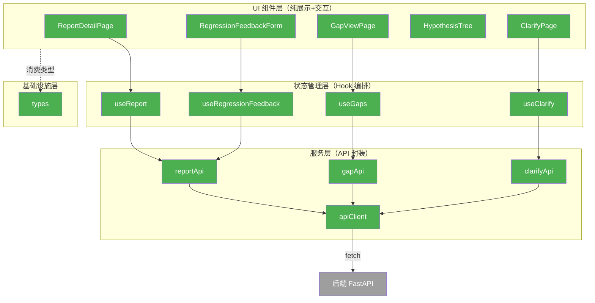
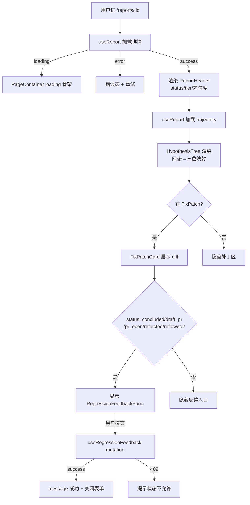
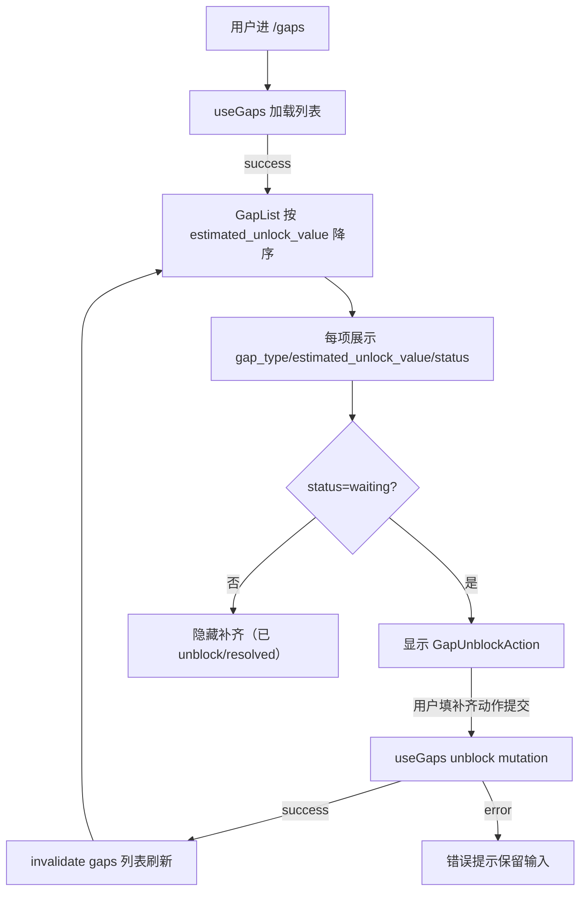
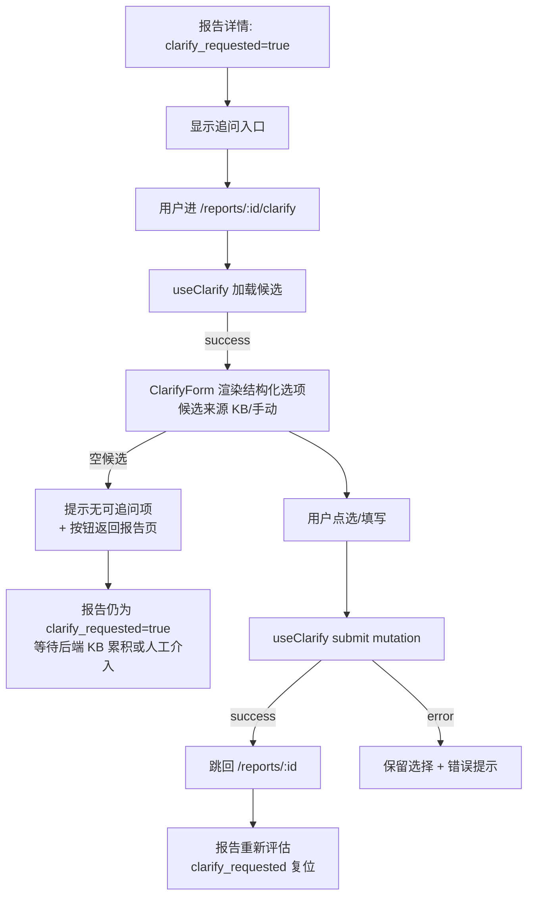

# 客户端 Bug 修复 Agent — 前端设计报告

> 关联设计：[客户端 Bug 修复 Agent 1.0.0 backend](2026-06-16--client-bug-fix-agent-backend.md)

## 1. 目标

本版本交付 agent 系统的最小化前端管理界面（React + Vite），覆盖 analysis 定义的前端业务节点：

- **FB001 诊断报告详情页**：单 bug 的完整排查视图——报告头（状态/tier/置信度/版本）+ 假设树可视化（DTO 四态 proposed/verifying/confirmed/refuted，UI 映射三色）+ 修复补丁 diff + 排查轨迹时间线 + 回归反馈入口
- **FB003 缺口视图**：按 estimated_unlock_value 排序的 Capability Gap 列表 + 补齐动作提交（触发 BB011 回流）
- **FB004 信息追问表单**：信息临界时从 KB 派生的结构化追问候选 + 用户点选提交（驱动 BB001 重评估）
- **FB002 PR 审核界面**：复用 GitHub/GitLab 外部 PR 界面（本前端只做跳转，不实现）

前端只消费 FF001/FF002 暴露的 REST API（见 backend 第 4.3 节契约），不嵌入任何 agent 逻辑。

**不做什么**：见第 8 节。核心是 FB002 外部复用、实时推送、暗黑模式、i18n、报告列表高级筛选。

## 2. 现状分析

全新模块（前端不存在）。本节简化为技术栈与基础设施说明。

### 已有能力（外部，可复用）

| 能力 | 来源 | 复用方式 |
|------|------|---------|
| 后端 API 契约 | backend FF001/FF002（见 backend 第 4.3 节） | services 层 fetch 调用，DTO 一一对应 |
| GitHub/GitLab PR 界面 | Git 平台 | FB002 直接外链跳转 |
| BugReport/Trajectory/Hypothesis Schema | backend 第 4.1 节 | types/ 映射 TypeScript type |

### 基础设施就绪

| 项目 | 状态 | 说明 |
|------|------|------|
| 后端 API | ❌ | 随 backend 同期开发；前端用 mock/MSW 先行 |
| Node 构建环境 | ✅ | Node 20+ 本地可用 |
| 浏览器 | ✅ | 现代浏览器（Chrome/Edge） |

## 3. 方案总览

### 项目结构

```
frontend/
├── index.html                              🟢 Vite 入口 HTML
├── package.json                            🟢 依赖与脚本
├── vite.config.ts                          🟢 Vite 配置（dev proxy → backend）
├── tsconfig.json                           🟢 TS 配置（严格模式）
└── src/
    ├── main.tsx                            🟢 挂载：QueryClientProvider + RouterProvider + AntdApp
    ├── App.tsx                             🟢 根布局 + 侧边导航（报告/缺口）
    ├── routes/                             🟢 路由页面（业务入口）
    │   ├── ReportListPage.tsx              🟢 /reports 报告列表（分页+status/tier 过滤）
    │   ├── ReportDetailPage.tsx            🟢 /reports/:id FB001 报告详情
    │   ├── GapViewPage.tsx                 🟢 /gaps FB003 缺口视图
    │   └── ClarifyPage.tsx                 🟢 /reports/:id/clarify FB004 追问表单
    ├── components/                         🟢 UI 组件层（纯展示 + 交互）
    │   ├── report/
    │   │   ├── ReportHeader.tsx            🟢 状态/tier/版本/置信度徽章
    │   │   ├── HypothesisTree.tsx          🟢 假设树可视化（antd Tree + 自定义 title）
    │   │   ├── FixPatchCard.tsx            🟢 修复补丁 + diff 展示
    │   │   ├── RegressionFeedbackForm.tsx  🟢 回归反馈表单（POST /regression-feedback）
    │   │   └── TrajectoryTimeline.tsx      🟢 排查轨迹时间线
    │   ├── gap/
    │   │   ├── GapList.tsx                 🟢 缺口列表（按 estimated_unlock_value 排序）
    │   │   └── GapUnblockAction.tsx        🟢 补齐操作（POST /gaps/:id/unblock）
    │   ├── clarify/
    │   │   └── ClarifyForm.tsx             🟢 结构化追问表单
    │   └── common/
    │       ├── PageContainer.tsx           🟢 loading/error/empty 三态容器
    │       └── StatusBadge.tsx             🟢 状态徽章（14 态 / tier 1-4）
    ├── hooks/                              🟢 状态管理层（TanStack Query 封装）
    │   ├── useReport.ts                    🟢 报告详情/列表
    │   ├── useGaps.ts                      🟢 缺口列表 + 补齐 mutation
    │   ├── useClarify.ts                   🟢 追问候选 + 提交 mutation
    │   └── useRegressionFeedback.ts        🟢 回归反馈 mutation
    ├── services/                           🟢 服务层（API 封装）
    │   ├── apiClient.ts                    🟢 fetch 封装 + 统一错误处理
    │   ├── reportApi.ts                    🟢 /reports/*
    │   ├── gapApi.ts                       🟢 /gaps/*
    │   └── clarifyApi.ts                   🟢 /clarify-options, /clarify
    ├── types/                              🟢 基础设施层（类型定义）
    │   ├── report.ts                       🟢 BugReport/Trajectory/Hypothesis/FixPatch/ConfidenceScore
    │   ├── gap.ts                          🟢 CapabilityGap
    │   └── api.ts                          🟢 请求/响应 DTO + 错误码
    ├── utils/
    │   ├── format.ts                       🟢 格式化（时间/tier/状态文案）
    │   └── treeBuilder.ts                  🟢 假设扁平列表 → antd treeData 构建
    └── mocks/                              🟢 MSW mock 层（前端独立联调）
        ├── handlers.ts                     🟢 FF001/FF002 端点响应模板
        ├── server.ts                       🟢 node 端启动（vitest 集成测试）
        └── browser.ts                      🟢 浏览器端启动（dev 先行）
```

### 类图

```mermaid
graph TD
%% ========== 页面业务入口 ==========
RLP["ReportListPage «Component»<br/>──────────<br/>/reports 列表<br/>分页+status/tier 过滤"]
RDP["ReportDetailPage «Component»<br/>──────────<br/>FB001 报告详情<br/>组合报告头/假设树/补丁/反馈"]
GVP["GapViewPage «Component»<br/>──────────<br/>FB003 缺口视图<br/>排序+补齐操作"]
CP["ClarifyPage «Component»<br/>──────────<br/>FB004 追问表单<br/>候选渲染+提交"]

%% ========== 核心 UI 组件 ==========
RHD["ReportHeader «Component»<br/>──────────<br/>状态/tier/置信度/版本"]
HT["HypothesisTree «Component»<br/>──────────<br/>假设树可视化<br/>DTO 四态→UI 三色"]
FPC["FixPatchCard «Component»<br/>──────────<br/>补丁 diff+is_draft"]
TT["TrajectoryTimeline «Component»<br/>──────────<br/>排查轨迹时间线"]
RFC["RegressionFeedbackForm «Component»<br/>──────────<br/>POST /regression-feedback"]
GUA["GapUnblockAction «Component»<br/>──────────<br/>POST /gaps/:id/unblock"]
CF["ClarifyForm «Component»<br/>──────────<br/>结构化选项表单"]
PC["PageContainer «Component»<br/>──────────<br/>loading/error/empty 三态"]
SB["StatusBadge «Component»<br/>──────────<br/>14 态/tier 徽章"]

%% ========== Hooks ==========
UR["useReport «Hook»<br/>──────────<br/>报告详情/列表<br/>loading/error/缓存"]
UG["useGaps «Hook»<br/>──────────<br/>缺口列表+补齐<br/>invalidate 刷新"]
UC["useClarify «Hook»<br/>──────────<br/>追问候选+提交"]
URF["useRegressionFeedback «Hook»<br/>──────────<br/>回归反馈 mutation"]

%% ========== 服务层 ==========
RA["reportApi «service»<br/>──────────<br/>/reports/*"]
GA["gapApi «service»<br/>──────────<br/>/gaps/*"]
CA["clarifyApi «service»<br/>──────────<br/>/clarify-options, /clarify"]
AC["apiClient «service»<br/>──────────<br/>fetch 封装+错误统一"]

%% ========== 类型 ==========
BR["BugReport «type»<br/>──────────<br/>status/tier/置信度"]
HP["Hypothesis «type»<br/>──────────<br/>parent_id/status<br/>expected_signal"]
CG["CapabilityGap «type»<br/>──────────<br/>gap_type/estimated_unlock_value/status"]

%% ========== 关系 ==========
RLP -->|"用"| UR
RDP -->|"用"| UR
RDP -->|"渲染"| RHD
RDP -->|"渲染"| HT
RDP -->|"渲染"| FPC
RDP -->|"渲染"| TT
RDP -->|"挂载"| RFC
GVP -->|"用"| UG
GVP -->|"挂载"| GUA
CP -->|"用"| UC
CP -->|"挂载"| CF
RHD -->|"用"| SB
RFC -->|"触发"| URF
UR -->|"调"| RA
UG -->|"调"| GA
UC -->|"调"| CA
URF -->|"调"| RA
RA -->|"经"| AC
GA -->|"经"| AC
CA -->|"经"| AC
HT -.->|"消费"| HP
RDP -.->|"消费"| BR
GVP -.->|"消费"| CG
RLP -.->|"经"| PC
RDP -.->|"经"| PC

style RLP fill:#4CAF50,color:#fff
style RDP fill:#4CAF50,color:#fff
style GVP fill:#4CAF50,color:#fff
style CP fill:#4CAF50,color:#fff
style RHD fill:#4CAF50,color:#fff
style HT fill:#4CAF50,color:#fff
style FPC fill:#4CAF50,color:#fff
style TT fill:#4CAF50,color:#fff
style RFC fill:#4CAF50,color:#fff
style GUA fill:#4CAF50,color:#fff
style CF fill:#4CAF50,color:#fff
style PC fill:#4CAF50,color:#fff
style SB fill:#4CAF50,color:#fff
style UR fill:#4CAF50,color:#fff
style UG fill:#4CAF50,color:#fff
style UC fill:#4CAF50,color:#fff
style URF fill:#4CAF50,color:#fff
style RA fill:#4CAF50,color:#fff
style GA fill:#4CAF50,color:#fff
style CA fill:#4CAF50,color:#fff
style AC fill:#4CAF50,color:#fff
style BR fill:#4CAF50,color:#fff
style HP fill:#4CAF50,color:#fff
style CG fill:#4CAF50,color:#fff
```



> **图例**：🟢 全部为新增（前端全新模块，无 🔵改造/⚪不变/🔴删除）。
>
> **颜色规则**：颜色统一从 `config.json` 的 `design_diagram_colors` 读取（🟢新增/🔵改造/⚪不变/🔴删除）。仓库暂无 `config.json` → 按 skill 默认四色（🟢#4CAF50 / 🔵#2196F3 / ⚪#9E9E9E / 🔴#F44336）。后续 RC 若建立 `config.json`，需在三图统一覆盖本默认色。
> **省略说明**：utils（format/treeBuilder）是纯函数，不入类图；types/api.ts（DTO）是数据载体，仅列核心三个领域 type；main.tsx/App.tsx 为启动/布局入口，不画；antd 原生组件（Table/Form/Tree）是框架层不画；`mocks/`（MSW handlers/server/browser）是开发态/测试态基础设施，不参与运行时业务调用（生产构建剔除），不入业务类图，单独在验收章节「MSW 覆盖清单」详述。

### 模块依赖关系图



> **图例**：🟢 本系统新增 / ⚪ 外部依赖（后端 API，系统边界外）。
> **省略**：config（vite/tsconfig）、main.tsx/App.tsx（启动）、utils（纯函数）不入图——全局共识。
> **阅读方式**：从上到下 = 请求流向（页面 → Hook → API 封装 → fetch → 后端）；虚线 = 类型消费。

### 职责划分

- **分层调用**：`routes/Page → hooks → services/api → apiClient → 后端`，严格单向，禁止反向（apiClient 不感知 Hook，Hook 不感知 Page 内部状态）。
- **UI 组件层**：纯展示 + 用户交互，不直接 fetch；数据全部经 Hook 注入。`HypothesisTree` 等核心展示组件只接收 props，可独立单测。
- **状态管理层（Hook）**：所有 server state 经 TanStack Query 管理（缓存/loading/error/refetch/invalidate）；本地 UI 态（展开/折叠/选中）用 useState + URL params。
- **服务层**：apiClient 是唯一 fetch 出口，统一错误码映射（409 状态非法等 → 友好提示）；reportApi/gapApi/clarifyApi 按领域分组，DTO 与 types 对齐。
- **类型层**：types/ 是前后端契约的前端投影，字段命名与 backend Schema 一一对应（snake_case 保留，避免双向转换误差）。
- **FB002 边界**：PR 审核一律外链 GitHub/GitLab（BugReport.pr_url），前端不内嵌审核 UI。

## 4. 数据模型与接口

### 数据模型（前端 TypeScript type）

从 backend Schema 映射，字段命名保持 snake_case 与后端一致（避免转换）。

| 类型 | 关键字段 | 来源 backend Schema |
|------|---------|-------------------|
| `BugReport` | id, status, tier, symptom_type, root_cause, confidence_score, fix_patch_id, pr_url, clarify_requested | BugReport |
| `Hypothesis` | id, parent_id, hypothesis_text, expected_signal, status(proposed/verifying/confirmed/refuted), falsifying_signal, overturning_signal, is_rootcause, step_budget, step_used | Hypothesis |
| `Trajectory` | id, root_hypothesis_id, hypotheses[], total_step_budget, events[] | Trajectory |
| `FixPatch` | id, strategy, is_draft, patch_diff, target_file, verification_report | FixPatch |
| `ConfidenceScore` | dim_info_completeness, dim_verification_feasibility, dim_patternability, kb_pattern_hit, tier, score | ConfidenceScore |
| `CapabilityGap` | id, gap_type, unlock_action, estimated_unlock_value, status(identified/waiting/unblocked/resolved/invalid_unblock/wont_reflow/wont_fix), linked_bug_ids, git_commit_anchor | CapabilityGap |
| `ClarifyOption` | field_key, question, options[], source(kb/manual) | FF001 DTO |
| `RegressionFeedbackRequest` | outcome(regression/safe), evidence, bucket_dim?, bucket_value? | FF001 DTO |

> **决策**：字段保持 snake_case，命名严格对齐 backend Schema（不擅自改名）。理由：消除前后端命名转换的认知负担和出错点；TS 允许 snake_case 字段。代价：与 JS 惯例（camelCase）不符，但内部工具型界面可接受。
>
> **UI 展示映射**（仅展示层做别名，DTO 不改）：Hypothesis 四态 `proposed/verifying` → 「进行中（灰）」、`confirmed` → 「确认（绿）」、`refuted` → 「证伪（红，保留展示）」；ConfidenceScore 三维 `dim_info_completeness/dim_verification_feasibility/dim_patternability` → UI 短标签「信息/验证/模式」；CapabilityGap `estimated_unlock_value` → UI「解锁价值」。映射集中在 `utils/format.ts`，DTO 层保持后端原名。

### 接口契约（前端消费视角）

引用 backend 第 4.3 节定义，前端补充调用方式与场景：

| API | 前端调用点 | 场景 |
|------|----------|------|
| `GET /reports` | useReport(list) | ReportListPage 分页 + status/tier 过滤 |
| `GET /reports/{id}` | useReport(detail) | ReportDetailPage 报告头 |
| `GET /reports/{id}/trajectory` | useReport(trajectory) | HypothesisTree + TrajectoryTimeline |
| `GET /reports/{id}/clarify-options` | useClarify(options) | ClarifyForm 候选渲染 |
| `POST /reports/{id}/clarify` | useClarify(submit) | ClarifyForm 提交 → 回报告页 |
| `POST /reports/{id}/regression-feedback` | useRegressionFeedback | RegressionFeedbackForm |
| `GET /gaps` | useGaps(list) | GapList 按 estimated_unlock_value 排序 |
| `POST /gaps/{id}/unblock` | useGaps(unblock) | GapUnblockAction → invalidate 刷新列表 |

**错误处理约定**（apiClient 统一）：
- 400 → 表单校验错误（字段级提示）
- 404 → 「报告/缺口不存在」空态
- 409 → 状态非法（如对未提 PR 的报告提交回归反馈）→ 友好提示当前状态不允许
- 5xx → 全局错误通知（antd message）

## 5. 核心流程

### 5.1 FB001 报告详情查看 + 回归反馈



> **关键规则**：回归反馈入口仅在 PR 已提交后阶段显示（与 backend `/regression-feedback` 允许状态对齐：pr_open/draft_pr/concluded/reflected/reflowed，5 态）；假设树 DTO 四态映射 UI 三色（进行中=proposed/verifying 灰、确认=confirmed 绿、证伪=refuted 红），refuted 节点保留展示（负向知识可见，呼应 INV-2 trajectory 永久保留精神）；映射逻辑集中在 utils/format.ts，DTO 层不改名。**提交后行为**：`useRegressionFeedback` 读响应 `{reflow_scheduled}`——`outcome=regression` 且 `reflow_scheduled=true`（原态 concluded/reflected）时 invalidate `GET /reports/{id}` 并 refetch，报告状态翻为 `reflowed`（回流重跑）；`outcome=safe` 或 `reflow_scheduled=false` 时仅刷新 MetricPoint 视图，不 refetch 报告主体（与 backend 4.3 响应体契约对齐）。

### 5.2 FB003 缺口查看 + 补齐



> **关键规则**：列表默认按 estimated_unlock_value 降序（价值高的优先）；补齐成功后用 TanStack Query invalidate 自动刷新，无需手动 reload；unblock 动作对应 backend BB011 回流触发。

### 5.3 FB004 追问闭环



> **关键规则**：追问候选由后端从 KB 派生（backend 第 5.3 节 KB 检索），前端只渲染不做派生逻辑；提交后跳回报告页，后端重跑 BB001（clarify_requested 复位，见 backend BugReport Schema 说明）。
>
> **空候选处理**：MVP 冷启动期 KB 模式条目不足，可能返回空候选数组。前端提示"暂无可追问项"+ 返回按钮；BugReport 仍停留在 `clarify_requested=true`，等待后端 KB 累积或人工介入（不自动轮询，避免无效请求；用户可在 Trajectory 中查看 BB001 缺口说明）。

## 6. 技术决策

### 决策表

| 决策 | 方案 | 理由 |
|------|------|------|
| D1 框架 | React 19.2 + TypeScript 6 + Vite 8 | architecture.md 锁定 React+Vite；用最新稳定版 |
| D2 server state | TanStack Query 5.101 | 自动缓存/loading/error/refetch/invalidate；管理界面以服务端数据为主，无需 Redux |
| D3 路由 | React Router 7.18（库模式） | 生态标准；v7 库模式够用，不引入 framework 模式复杂度 |
| D4 UI 组件库 | Ant Design 6.4 | Tree/Table/Form/Drawer 开箱即用；中文友好；适合内部工具型界面 |
| D5 假设树可视化 | antd Tree + 自定义 title 渲染 | treeData 结构天然匹配 Hypothesis.parent_id；无需 react-flow/d3，复杂度低 |
| D6 本地 UI 状态 | useState + URL search params | 轻量；过滤条件走 URL 可分享/刷新保持；不引入 Zustand |
| D7 mock 层 | MSW（Mock Service Worker） | 拦截网络层而非覆盖 fetch；同一 handlers.ts 可在浏览器（dev 先行）和 vitest（node 环境）复用；契约即代码，前后端对齐直观 |

### 第三方依赖清单

| 依赖 | 用途 | 版本 | 已有/新增 |
|------|------|------|---------|
| react / react-dom | UI 框架 | 19.2.7 | 新增 |
| react-router-dom | 路由 | 7.18.0 | 新增 |
| @tanstack/react-query | server state | 5.101.0 | 新增 |
| antd | 组件库 | 6.4.4 | 新增 |
| typescript | 类型 | 6.0.3 | 新增 |
| vite | 构建 | 8.0.16 | 新增 |
| @vitejs/plugin-react | Vite React 插件 | 6.0.2 | 新增 |
| msw | mock 层（dev + 测试） | 2.14.6 | 新增 |
| vitest | 单元/集成测试 | 4.1.9 | 新增 |

> 版本号均经 `npm view <pkg> version` 确认（2026-06-16 registry 最新稳定版）。

### Decision Items（plan 阶段识别哪些决策必须拆任务）

| ID | Type | Must Plan | Source | Blast Radius |
|----|------|-----------|--------|-------------|
| D1 框架选型 | tech | 否（architecture 已锁） | architecture.md | 全前端 |
| D2 TanStack Query 接入 | tech | 是 | design 决策 | 全 hooks 层 + main.tsx Provider |
| D3 React Router 路由表 | tech | 是 | design 决策 | routes/ 全部 |
| D4 Ant Design 主题/中文配置 | tech | 是 | design 决策 | main.tsx ConfigProvider + 组件层 |
| D5 假设树 treeBuilder 实现 | tech | 是 | design 决策 | HypothesisTree + utils/treeBuilder |
| D6 URL params 过滤 | tech | 否（轻量） | design 决策 | ReportListPage |
| D7 MSW mock 层搭建 | tech | 是 | design 决策 | mocks/ 全部 + main.tsx dev 启用 + vitest setup |

## 7. 验收标准

| 验收条件 | 验收方式 |
|----------|----------|
| 编译通过 | `npm run build` 无错误 |
| 类型检查 | `tsc --noEmit` 无错误 |
| 三页面可访问 | 手动：/reports/:id、/gaps、/reports/:id/clarify 路由可达 |
| loading/error/empty 三态完备 | 手动：断网看 error、空数据看 empty、加载看骨架 |
| 假设树四态渲染 | 手动：mock proposed/verifying/confirmed/refuted 四态节点，三色映射正确，refuted 保留可见 |
| 缺口按 estimated_unlock_value 排序 | 单测：utils 排序 + 手动确认降序 |
| 追问可提交并回报告 | 手动：mock 候选 → 选择 → 提交 → 跳回报告页 |
| 回归反馈可提交 | 手动：mock concluded 报告 → 提交 feedback → 成功提示；未提 PR 报告不显示入口；allowed 5 态（pr_open/draft_pr/concluded/reflected/reflowed）显示入口，其余 9 态隐藏 |
| API 契约对齐 | 与 backend FF001/FF002 第 4.3 节路径/方法/状态码一致（MSW handlers.ts 覆盖全部端点）；contract drift 由 CI 单测 `mocks/handlers.spec.ts` 守住：路径/方法/响应 Schema 与 backend OpenAPI 自动比对 |
| FB002 外链正确 | BugReport.pr_url 点击跳转 GitHub/GitLab |

### MSW 覆盖清单（契约维护责任）

mock 层按 FF001/FF002 端点全量覆盖，handlers.ts 中每个 `http.get/http.post` 对应 backend 第 4.3 节一条 API：

| MSW handler | backend 端点 | 响应模板关键内容 | 用途 |
|-------------|-------------|----------------|------|
| GET /reports | FF001 报告列表 | 分页数组 + status/tier 过滤逻辑 | ReportListPage |
| GET /reports/:id | FF001 报告详情 | 含 confidence_score/tier/fix_patch_id/pr_url | ReportHeader |
| GET /reports/:id/trajectory | FF001 trajectory | hypotheses 四态扁平数组 + events | HypothesisTree + TrajectoryTimeline |
| GET /reports/:id/clarify-options | FF001 追问候选 | ClarifyOption[]，含空候选场景 | ClarifyForm |
| POST /reports/:id/clarify | FF001 提交追问 | 200 + BugReport（clarify_requested=false） | 提交回跳 |
| POST /reports/:id/regression-feedback | FF001 回归反馈 | 200/409（状态非法） | RegressionFeedbackForm |
| GET /gaps | FF002 缺口列表 | 按 estimated_unlock_value 降序 | GapList |
| POST /gaps/:id/unblock | FF002 补齐 | 200 + CapabilityGap（status=unblocked） | GapUnblockAction |

> **契约维护责任**：handlers.ts 是前端单方面的"契约快照"，与 backend 真实实现可能漂移。两类守护：
> 1. **前端 CI**：handlers.spec.ts 校验响应 Schema 自洽（必填字段、枚举值与 backend Schema 文档一致）
> 2. **联调阶段**：通过环境变量 `VITE_USE_MOCK=false` 切到真实后端，跑一遍冒烟，发现漂移即同步 handlers.ts
>
> **MVP 范围内的分工**：MSW 仅用于「后端未就绪时前端先行」与「前端独立单测」，不替代联调；联调必须打真实后端。

## 8. 暂不实现

| 功能 | 理由 | 预留 |
|------|------|------|
| FB001 相似 issue 视图 | backend 4.3 未暴露相似 issue 查询 API；相似度依赖 KB 累积（MVP 冷启动无意义）；与 feature-map FB001 定义存在范围差，建议后续 RC 同步把 feature-map/backend 的「相似 issue」标注 MVP 不含 | backend 后续补 `GET /reports/{id}/similar-issues`（基于 pgvector），frontend SimilarIssues 组件位置预留 |
| FB002 PR 审核界面 | 复用 GitHub/GitLab 外部界面 | pr_url 外链跳转 |
| 实时推送（WebSocket/SSE） | MVP 用手动刷新/轮询 | TanStack Query refetchInterval 预留轮询 |
| 暗黑模式 | 非核心，内部工具 | antd ConfigProvider theme 预留 |
| i18n 国际化 | 内部工具，中文即可 | — |
| 复杂图表/动画 | 性价比低 | — |
| 报告列表高级筛选 | MVP 基础 status/tier 过滤够用 | antd Table filter 预留 |
| 假设树交互编辑 | 只读展示（排查由 agent 驱动） | — |
| 移动端适配 | 桌面端管理界面 | 响应式断点预留 |
