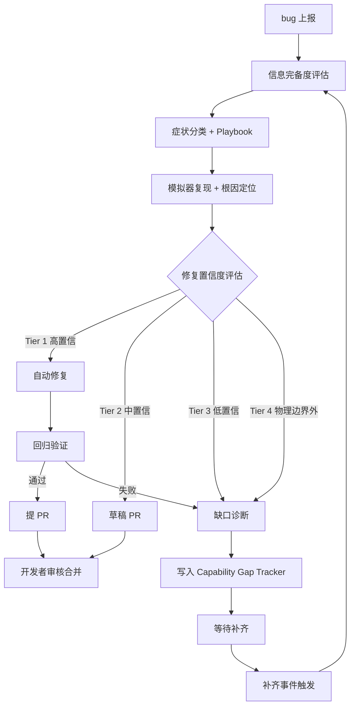
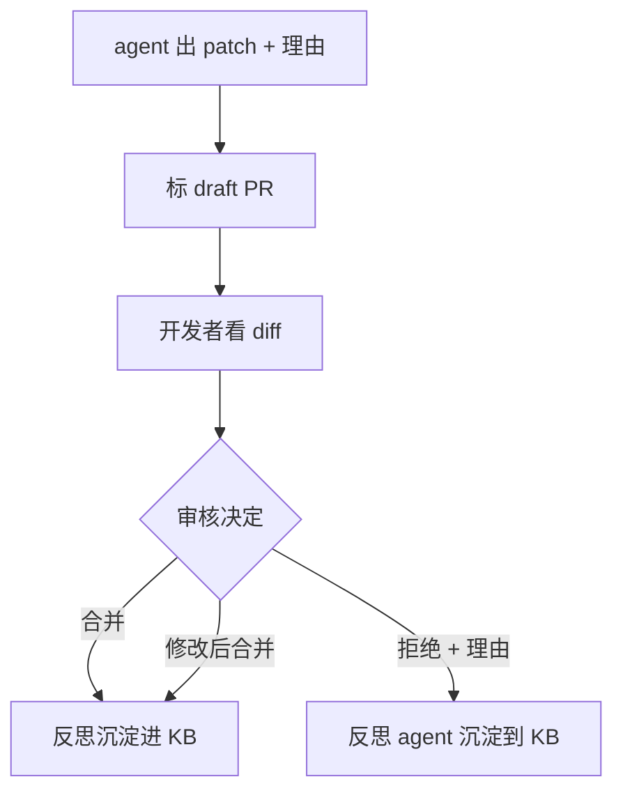
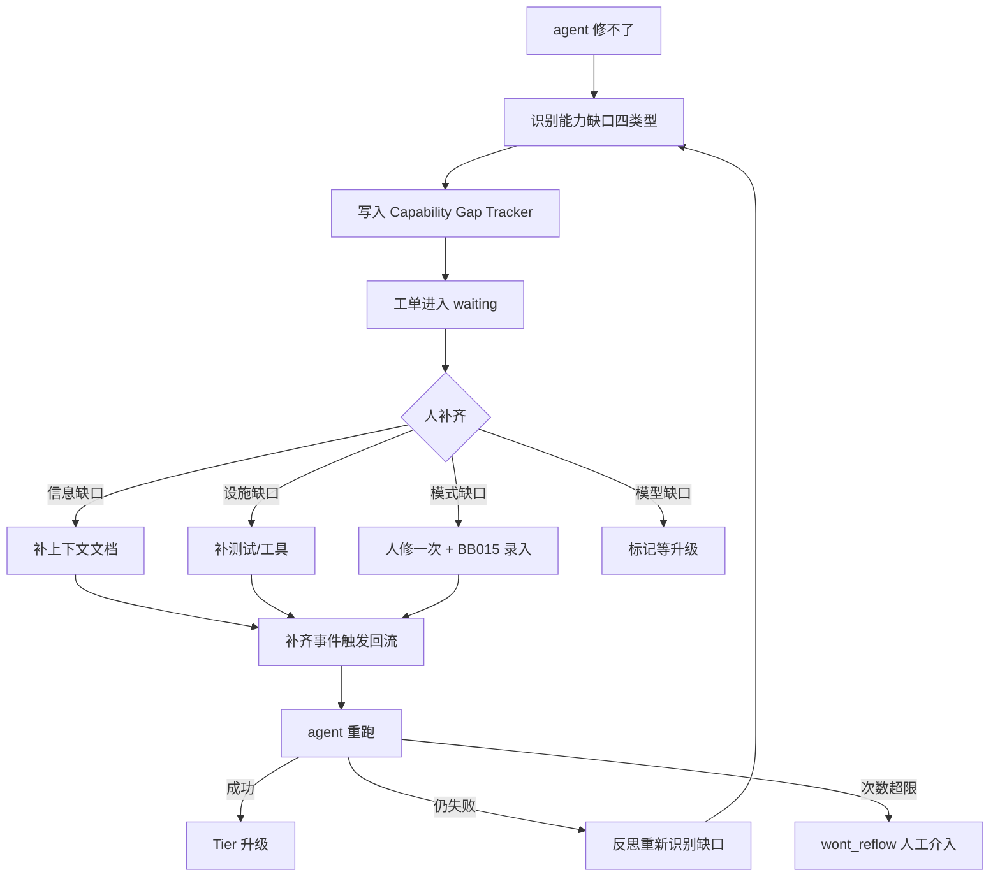
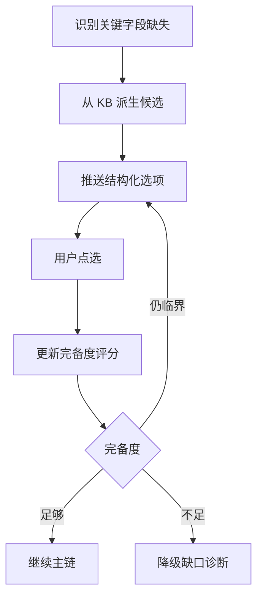
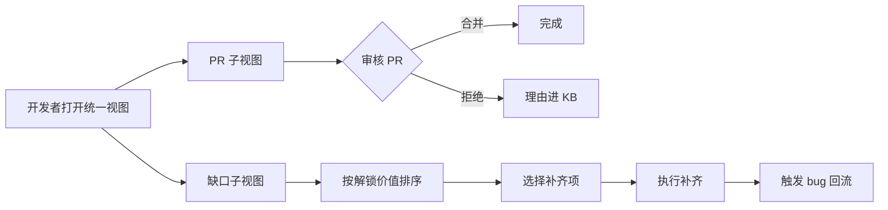
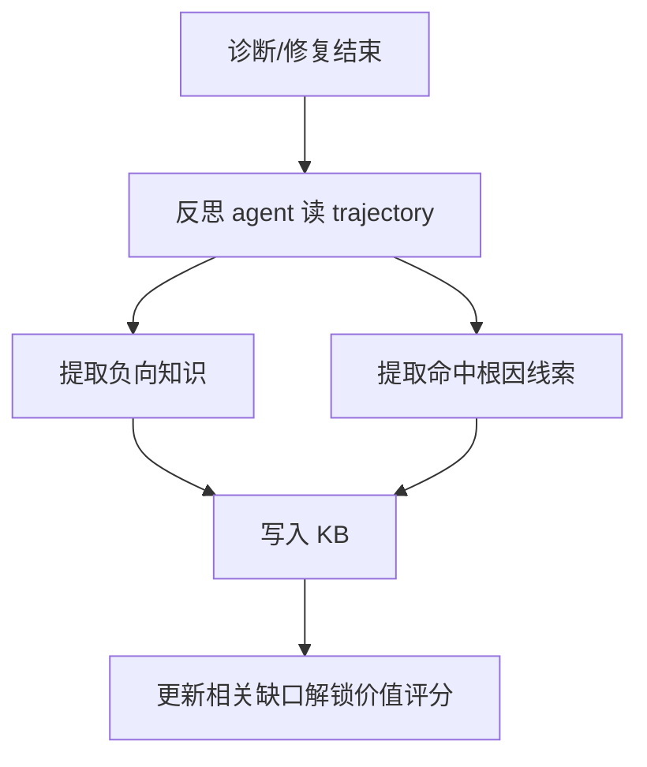

# 客户端 Bug 自动修复 Agent — 功能分析

## 概述

面向 Flutter（主）+ Android 原生（辅）客户端的 bug **自动修复** agent。接收 bug 上报后，自主在模拟器上复现、定位根因，按**修复置信度**分层处理：高置信走完整自动修复闭环（复现→修→验证→PR），中置信走草稿 PR，低置信/不可修复走缺口诊断与回流。核心由**四组件**构成：Playbook（症状→排查方法论）+ Knowledge Base（经验三层沉淀）+ Information Sufficiency Model（bug 级信息补全）+ Capability Gap Tracker（agent 能力级缺口管理）。目标是 agent 越用越准，能力边界随基础设施补齐而动态下移。

## 一、交互链

涉及角色：bug 上报系统（触发方）、开发者（PR 审核与缺口补齐方）、终端用户（信息追问方）、agent 系统自身（反思与沉淀）。

### 场景 1：bug 上报 → Tier 1 自动修复闭环（核心主链）

**用户故事**：作为 bug 上报系统，我想把 bug 推给 agent 后，对高置信 bug 直接拿到已通过验证的 PR，以便开发者只做合并审核不做修复。

bug 进入 → 信息完备度评估 → 症状分类 → 加载 Playbook → 模拟器复现 → 根因定位 → **修复置信度评估** → Tier 1 → 自动修复 → 回归验证（复现序列 + 测试套件 + 静态检查）→ 提 PR → 开发者审核合并 → 反思沉淀。

### 场景 2：Tier 2 → 草稿 PR

**用户故事**：作为开发者，我想对置信度中等的 bug 看到 agent 的修复草稿和理由，由我判断是否采用，以便省去排查时间但保留修复决策权。

agent 出 patch + 理由 + 风险点说明 → 标 draft PR → 开发者看 diff 决定：合并 / 修改后合并 / 拒绝。拒绝时附理由 → 反思 agent 沉淀到 KB。

### 场景 3：Tier 3/4 → 缺口诊断与回流

**用户故事**：作为开发者，我想 agent 修不了的 bug 不要直接放弃，而是告诉我"差什么资源就能修"，以便我有明确投入方向让 agent 持续进步。

agent 修不下去 → **不放弃**，识别能力缺口四类型 → 写入 Capability Gap Tracker（含缺口类型、描述、解锁动作、解锁后预计能修多少同类 bug）→ 工单进入"等待补齐"状态 → 人补齐：
- **信息缺口** → 补上下文文档
- **基础设施缺口** → 补测试设施 / 工具
- **模式缺口** → 人手工修一次 → **BB015 结构化录入**（patch + trajectory + 根因解释）→ 沉淀进 KB
- **模型能力缺口** → 标记等模型升级
→ 补齐事件触发 bug 回流 → agent 用新资源重试 → 修复成功则 Tier 升级；补齐后仍失败则触发反思重新识别缺口（防回流死循环）。

### 场景 4：信息不足追问（ISM 触发）

**用户故事**：作为终端用户，我想反馈模糊时被给具体选项追问，以便我低成本补全关键信息。

agent 识别关键字段缺失 → 从 KB 派生历史高频候选 → 给用户结构化选项（非开放式）→ 用户点选 → 重新评估完备度。

### 场景 5：开发者审核 PR + 补缺口

**用户故事**：作为开发者，我想在一个视图里看到所有待审核 PR 和所有待补齐缺口，以便安排时间投入高价值项。

查看 PR 列表 → 审核/合并/拒绝；查看缺口视图（按"解锁价值"排序）→ 决定补哪些 → 补齐动作触发 bug 回流。

### 场景 6：反思与沉淀

**用户故事**：作为 agent 系统自身，我想每次排查后跑独立反思，把走错路径与命中线索沉淀进 KB，并更新 Capability Gap Tracker 的缺口优先级。

诊断/修复结束 → 反思 agent 读 trajectory → 提取负向知识 + 命中根因线索 → 写入 KB → 同步更新相关缺口的"解锁价值"评分。

## 二、逻辑树

### 事件流 1：bug 接入到分流

| 时刻 | 事件 | 处理 | 产生的新事件 |
|------|------|------|-------------|
| T1 | bug 上报到达 | BF001 归一化为 `BugReport` | `bug.received` |
| T2 | `bug.received` | BB001 信息完备度评估 + 缺口分类 | `bug.assessed` |
| T3 | `bug.assessed` 完备 | BB002 症状分类 | `bug.classified` |
| T3' | `bug.assessed` 临界 | 主动探测或结构化追问 | 回到 T2 |
| T3'' | `bug.assessed` 不足 | 降级走缺口诊断（事件流 3） | `gap.diagnosed` |
| T4 | `bug.classified` | BF006 加载 Playbook | `playbook.loaded` |
| T5 | `playbook.loaded` | BB003 执行复现 + 假设树推理 | `rootcause.found` 或步数耗尽 |
| T6 | `rootcause.found` | BB005 输出根因定位 | `rootcause.located` |
| T7 | `rootcause.located` | **BB006 修复置信度评估** | `bug.tier_classified` |
| T8 | `bug.tier_classified` | 按 Tier 分流到事件流 2 / 场景 2 / 事件流 3 | - |

### 事件流 2：Tier 1 自动修复闭环

| 时刻 | 事件 | 处理 | 产生的新事件 |
|------|------|------|-------------|
| F1 | `bug.tier_classified` = Tier 1 | BB007 选择修复机制（模板/LLM/历史校准） | `fix.patch.generated` |
| F2 | `fix.patch.generated` | 应用 patch 到本地 worktree | `fix.applied` |
| F3 | `fix.applied` | BB008 跑回归：复现序列 + 既有测试 + 静态检查 | `fix.verified` 或 `fix.failed` |
| F4a | `fix.failed`（回归失败信号指向 patch 不完整/副作用） | 同根因换 patch 策略：换机制（模板→LLM→KB 校准），最多 N 次 | 回到 F1 |
| F4b | `fix.failed`（回归失败信号指向根因方向错，如修了 A 还崩 B、或新信号推翻已 confirmed 根因） | **修复阶段换方向**：触发 `rootcause.overturned`，工单 fixing→located，回假设树重下钻 | 转事件流 4 H5 |
| F4 | F4a 重试 N 次仍失败 且 非 F4b | 反思为何失败 → 触发缺口诊断（多半是 KB 缺这类修法） | 转事件流 3 |
| F4' | `fix.failed` 多次且属"模式缺口" | 转 BB015 流程：人工修复录入器结构化录入后沉淀进 KB | `manual.fix.recorded` |
| F5 | `fix.verified` | BB009 提 PR（含 diff + trajectory + 验证报告） | `pr.submitted` |
| F6 | `pr.submitted` | 通知开发者审核 | `pr.reviewed` |
| F7 | `pr.reviewed` 合并 | 触发反思（事件流 4） | `kb.appended` |
| F7' | `pr.reviewed` 拒绝 | 拒绝理由进反思；连续 2 次同类拒绝 → 升级缺口诊断（识别为模式缺口） | - |

### 事件流 3：Tier 3/4 缺口诊断与回流

| 时刻 | 事件 | 处理 | 产生的新事件 |
|------|------|------|-------------|
| G1 | `bug.tier_classified` ∈ {Tier 3, Tier 4} | BB010 缺口诊断器分析"为什么修不了" | `gap.identified` |
| G2 | `gap.identified` | 分类缺口（信息/设施/模式/模型）+ 估算解锁价值 | `gap.recorded` |
| G3 | `gap.recorded` | 写入 Capability Gap Tracker，工单进 waiting | `bug.waiting` |
| G4 | 人工补齐动作（补文档/补测试/人修沉淀） | BB011 检测到补齐事件 | `gap.unblocked` |
| G5 | `gap.unblocked` | 同类历史 bug 触发回流 | `bug.reflowed` |
| G6 | `bug.reflowed` | 重新进入事件流 1 的 T2 | 回到主链 |

### 事件流 4：假设树内部（trajectory 引擎）

| 时刻 | 事件 | 处理 | 产生的新事件 |
|------|------|------|-------------|
| H1 | 当前假设提出（含 `expected_signal` 预测） | 验证器选可证伪动作，分配 `step_budget` | `hypothesis.verifying` |
| H2 | `hypothesis.verifying` | 执行验证（看日志/抓包/dump tree），对比实际信号 vs `expected_signal` | `hypothesis.confirmed`（信号相符） / `hypothesis.refuted`（信号不符 或 `step_budget` 耗尽） |
| H3 | `hypothesis.refuted` | 假设树回溯到父节点、尝试下一兄弟分支（换方向） | 新 `hypothesis.proposed` |
| H4 | `hypothesis.confirmed` | 下钻更细假设 或 标记为根因 | `rootcause.found` |
| H5 | fixing/回归阶段新信号推翻已 confirmed 根因 | 标 confirmed→refuted，回溯假设树重新下钻（修复阶段换方向） | `rootcause.overturned` → 新 `hypothesis.proposed` |

回溯依据是「证伪信号」或「步数耗尽」，不是无脑切分支。整树总步数预算耗尽 → 不再换方向，转 Tier 3/4 缺口诊断。

`refuted` 节点保留为负向知识，不删除。

### 状态流转

**Bug 工单状态机**：

| 实体 | 触发事件 | 前状态 | 后状态 | 关键字段变化 |
|------|---------|--------|--------|------------|
| BugReport | `bug.received` | (none) | received | `raw_report` 写入 |
| BugReport | `bug.assessed` 完备/临界 | received | assessing | `completeness_score`、`gaps` 写入 |
| BugReport | `bug.assessed` 不足 | received | degraded | `completeness_score`、`gaps` 写入（分数低于阈值） |
| BugReport | `bug.classified` | assessing | reproducing | `symptom_type` 写入 |
| BugReport | `rootcause.located` | reproducing | located | `root_cause`、`root_cause_location`（文件:行）写入 |
| BugReport | `bug.tier_classified` = Tier 1 | located | fixing | `tier=1`、`confidence_score` 写入 |
| BugReport | `fix.verified` | fixing | verified | `fix_patch`、`verification_report` 写入 |
| BugReport | `rootcause.overturned`（fixing/回归阶段新信号推翻已 confirmed 根因） | fixing | located（回退重下钻） | 当前 `root_cause` 标 refuted 移入 `refuted_rootcause_ids`、`confidence_score`/`fix_patch` 清空、触发假设树重选根因分支 |
| BugReport | `pr.submitted` | verified | pr_open | `pr_url`、`pr_diff` 写入 |
| BugReport | `bug.tier_classified` = Tier 2 | located | draft_pr | `tier=2`、`confidence_score`、`draft_patch` 写入 |
| BugReport | `bug.tier_classified` ∈ {3,4} | located | gap_pending | `tier∈{3,4}`、`gap_ids` 写入 |
| BugReport | `bug.reflowed`（次数 < 上限 且 补齐有效） | gap_pending | received（回流重跑） | `reflow_count++`；清空 `root_cause`/`confidence_score` 等中间字段 |
| BugReport | `bug.reflowed` 次数 ≥ 上限 或 补齐后重跑仍失败 | gap_pending | wont_reflow（人工介入） | `wont_reflow_reason` 写入 |
| BugReport | `pr.reviewed` 合并 | pr_open / draft_pr | concluded | `concluded_at`、`merge_commit` 写入 |
| BugReport | `kb.appended` | concluded | reflected | `kb_entry_ids` 写入 |

异常回退：fixing 多次失败 → gap_pending（走缺口诊断，不再降级 draft_pr 误导开发者）；fixing 阶段根因被推翻 → located（`rootcause.overturned`，回假设树重下钻，不是原地换 patch 模板）；degraded 可被开发者补信息后回流；`manual.fix.recorded`（F4'）直接进 concluded（人工修复解决 + KB 模式沉淀）。**全局步数预算耗尽**（排查+修复总步数超上限）→ 未 confirmed 根因的转 Tier 3/4 缺口诊断，不允许无限死磕。

**假设节点状态机**（换方向的核心载体）：

| 实体 | 触发事件 | 前状态 | 后状态 | 关键字段变化 |
|------|---------|--------|--------|------------|
| Hypothesis | 假设提出 | (none) | proposed | `hypothesis_text`、`parent_id`（树结构）、`expected_signal`（预测的可证伪信号）写入 |
| Hypothesis | 验证器选动作 | proposed | verifying | `verify_action`、`step_budget`（本假设验证步数上限）写入 |
| Hypothesis | 验证通过 | verifying | confirmed | `confirming_evidence` 写入；可被标 `is_rootcause` |
| Hypothesis | 验证不通过 / 步数耗尽 | verifying | refuted | `falsifying_signal`（证伪信号）写入；节点保留为负向知识 |
| Hypothesis | 后续证据推翻已确认根因 | confirmed | refuted | `overturning_signal`、`overturning_stage`∈{fixing/verifying/regression} 写入；触发根因回退 |

**换方向两条触发路径**（防止在错误方向上死磕）：
1. **排查阶段换方向**：假设验证产生与 `expected_signal` 不符的结果 → 该假设 refuted → 假设树回溯到父节点、尝试兄弟分支（新 `proposed`）。单个假设有 `step_budget`，超了强制 refuted，不允许无限下钻。
2. **修复阶段换方向**（关键，区别于"换 patch 模板"）：fixing/回归阶段出现的新信号推翻已 confirmed 的根因 → `rootcause.overturned` → 工单从 fixing 回退到 located，假设树重新下钻。这是根因方向错了，不是 patch 技巧问题，原地换 LLM patch 模板是浪费。

**全局步数预算**：整个 BugReport 的排查+修复总步数有上限（参数化，design 阶段定）。预算耗尽仍未 confirmed 根因 → 不再死磕，转 Tier 3/4 缺口诊断（多半是信息缺口或模型能力缺口）。

`refuted` 节点（含被推翻的 confirmed）永久保留，作为负向知识防止下次重走死路。

**Knowledge Base 条目状态机**：raw_trajectory → aggregated → pattern（MVP 只到 raw_trajectory）。

**Capability Gap 条目状态机**：

| 实体 | 触发事件 | 前状态 | 后状态 | 关键字段变化 |
|------|---------|--------|--------|------------|
| Gap | `gap.identified` | (none) | identified | `gap_type`∈{信息/设施/模式/模型}、`description`、`source_bug_id` 写入 |
| Gap | `gap.recorded` | identified | waiting | `unlock_action`（建议补齐动作）、`estimated_unlock_value`（解锁价值评分）、`linked_bug_ids` 写入 |
| Gap | `gap.unblocked` | waiting | unblocked | `unblock_evidence`（补齐证据，如新增测试/文档/人工修复 commit）、`unblocked_at` 写入 |
| Gap | `bug.reflowed` 成功修复 | unblocked | resolved（沉淀为 KB 模式） | `resolved_bug_ids`、`kb_pattern_id`（沉淀的模式条目引用）写入；状态终态不可回退 |
| Gap | 补齐后重跑仍失败 | unblocked | invalid_unblock（反思 → 重新识别真实缺口） | `invalid_unblock_reason`、`reflection`（反思结论）写入；回退到 identified 重识别时 `gap_type`/`description` 可被修正 |
| Gap | `bug.reflowed` 次数超上限 | unblocked | wont_reflow（转人工介入） | `wont_reflow_reason`、`reflow_count` 写入 |
| Gap | 长期不补 | waiting | wont_fix（人工标记） | `wont_fix_reason`、`decided_by` 写入 |

异常回退：`invalid_unblock` 不直接关闭条目，而是重识别真实缺口（原识别可能错位），避免补错东西。所有终态（resolved/wont_reflow/wont_fix）历史保留不删除，仅改状态。

### KB 横切读取链路（agent 全程如何读 KB）

KB 不是某个阶段才读，而是**贯穿 bug 解决全程的横切依赖**。KB 存三类内容，agent 按阶段分流读取：

| 阶段 | 读 KB 哪一层 | 用途 |
|------|-------------|------|
| T2 信息评估（BB001）| 模式层（按症状）| 派生追问候选——已知"这类症状的 bug 通常缺什么信息"，给用户结构化选项（场景 4）|
| T5 假设树推理（BB004）| 模式层 + 负向层 | **模式层**：按症状查历史根因分布，作为假设**种子**（先验）；**负向层**：查"这类症状历史上被证伪的根因方向"，对候选假设**降权/剪枝** |
| T6 根因定位（BB005）| 模式层 | 命中信号后，反查历史相似根因的代码位置，辅助定位 |
| T7 置信度评估（BB006）| 模式层 | 看有无历史修复 pattern，定"模式化程度"维度分 |
| F1 修复（BB007）| 模式层（历史 patch）| KB 历史校准——优先套相似根因的历史 patch，高于模板/LLM 直接生成 |

**两个关键读取机制**（design 阶段需给具体算法，analysis 先定需求约束）：

1. **检索维度**（盲点 3）：按「症状类型 + 根因信号（报错堆栈 / 代码路径关键词 / 触发条件）」组合检索。单一维度（只按症状）噪声大、只按堆栈覆盖窄。具体相似度算法 design 定。
2. **负向知识反查闭环**（盲点 4）：假设树提出候选假设后，逐一查负向知识库——若某假设方向曾在**同症状 + 相似上下文**下被证伪，降权或直接剪枝，避免重走死路。反查无结果时不阻塞，正常进入验证。这条链路把 BB013（存负向知识）和 BB004（用负向知识）之间的断环补上。

**冷启动现实**：MVP 阶段模式层几乎为空（只有 BB015 人工录入的少量 pattern），KB 读取价值主要来自单 bug 内 trajectory 的直接复用；跨 bug 模式层的检索价值随累积增长。因此 MVP 阶段 BB004/BB006/BB007 的 KB 查询要做"查不到则优雅降级"，不能强依赖 KB 命中。

## 三、功能编号与网络定位

### 本次新增节点

**后端基础 BF（基础设施 / 数据模型）**

| 编号 | 功能节点 | 简介 |
|------|---------|------|
| BF001 | Bug 上报接入适配器 | 适配多平台 webhook，归一化 `BugReport` |
| BF002 | 复现执行引擎 | 启停模拟器、装 APK、ADB 动作、截图采集 |
| BF003 | 视觉决策引擎 | 多模态模型看截图 → 决策下一步动作 |
| BF004 | 信号监听器 | logcat / Flutter error / 进程 / 视觉四类信号 |
| BF005 | Knowledge Base 存储 | trajectory / 负向知识 / 根因模式的存储检索 |
| BF006 | Playbook 注册中心 | Playbook Schema + 按症状检索 |
| BF007 | 锚点库 | 关键页面正常截图 + 文字预期 |
| **BF008** | **Capability Gap Tracker 存储** | 缺口条目存储、解锁价值评分、回流事件订阅 |

**后端业务 BB（业务逻辑）**

| 编号 | 功能节点 | 简介 |
|------|---------|------|
| BB001 | 信息完备度评估器（ISM） | 关键字段识别、缺口分类、打分 |
| BB002 | 症状分类器 | bug → 症状类型 |
| BB003 | Playbook 执行器 | 编排复现 + 探测 + 诱发 |
| BB004 | 假设树引擎 | 假设提出/验证/回溯/确认状态机 |
| BB005 | 根因定位器 | 命中信号反向追溯代码位置 |
| **BB006** | **修复置信度评估器** | 基于三维标准（信息×验证×模式）+ KB 模式库打分，决定 Tier |
| **BB007** | **自动修复器** | 模板修复 → LLM patch → KB 历史校准，按可解决性优先级 |
| **BB008** | **回归验证器** | 复现序列回归 + 既有测试 + 静态检查三关 |
| **BB009** | **PR 提交器** | Tier 1 直接 PR / Tier 2 draft PR，含 trajectory + 验证报告 |
| **BB010** | **缺口诊断器** | Tier 3/4 时分析"为什么修不了"，识别四类缺口 |
| **BB011** | **缺口补齐回流器** | 检测补齐事件、触发同类 bug 回流 |
| BB012 | 诊断报告生成器 | 结构化 JSON + markdown 双输出 |
| BB013 | 反思 agent | 独立跑 trajectory，提取负向知识与命中线索 |
| BB014 | 知识聚合器 | 周期性聚合 trajectory → 跨 bug 模式（MVP 外） |
| **BB015** | **人工修复录入器** | 人修一次 → 结构化录入（patch + trajectory + 根因解释 + 触发条件）→ 沉淀为 KB 模式条目，解锁同类 bug 自动修复 |

**前端基础 FF**

| 编号 | 功能节点 | 简介 |
|------|---------|------|
| FF001 | 报告与工单 API | 报告/工单/trajectory/PR 查询接口 |
| **FF002** | **缺口视图 API** | 缺口列表、解锁价值排序、补齐动作提交接口 |

**前端业务 FB**

| 编号 | 功能节点 | 简介 |
|------|---------|------|
| FB001 | 诊断报告详情页 | 报告 + 假设树可视化 + 相似 issue |
| FB002 | PR 审核界面 | 复用 GitHub/GitLab PR 界面，附 agent 验证报告 |
| **FB003** | **缺口视图** | 按"解锁价值"排序的缺口列表 + 补齐操作 |
| FB004 | 信息追问表单 | 结构化选项追问（候选从 KB 派生） |

### 前置依赖

| 依赖节点 | 依赖方式 | 是否已有 |
|----------|---------|---------|
| 多模态 LLM API | BF003/BF004/BB002/BB007/BB013 调用 | ❌ 待接 |
| Android 模拟器 + ADB | BF002 调用 | ✅ 本地可起 |
| Bug 上报平台 | BF001 适配 | ❌ 待用户确认 |
| 客户端代码仓库（git） | BB005/BB007/BB009 检索+blame+提交 | ✅ 可访问 |
| Git 平台 API（GitHub/GitLab） | BB009 提 PR | ✅ 可接 |
| 锚点截图库 | BF004/BF007 对照 | ❌ 需人工首次录制 |
| 既有测试套件 | BB008 回归 | ⚠️ 部分有，需评估覆盖度 |

### 边界接口（MVP 必须固化）

| 接口/协议 | 定义方 | 消费方 | 敏感度 |
|-----------|--------|--------|--------|
| `BugReport` Schema | BF001 | BB001/BB002/BB003 | 高（外部输入边界） |
| `Playbook` Schema | BF006 | BB003 | 高（扩展点） |
| `Trajectory` Schema | BB004 | BB007/BB012/BB013/BB014/B 阶段 | 高（C/B 衔接核心） |
| `ConfidenceScore` Schema | BB006 | BB007/BB009/BB010 | 高（分流决策核心） |
| `FixPatch` Schema | BB007 | BB008/BB009 | 高（修复产物） |
| `CapabilityGap` Schema | BB010 | BB011/FF002 | 高（成长机制核心） |
| `ManualFixEntry` Schema | BB015 | BF005/BB007 | 高（模式缺口补齐核心，决定 KB 模式质量） |
| `ReproStep` 协议（视觉→ADB） | BF003 | BF002 | 中 |
| `Signal` 协议（监听器→执行器） | BF004 | BB003 | 中 |
| `DiagnosisReport` Schema | BB012 | FB001/FB002 + B 阶段 | 高 |
| `KBEntry` Schema | BF005 | BB013/BB014 | 中 |
| `AnchorLibrary` Schema | BF007 | BF004 | 中 |

## 四、结论

### 开发顺序建议（MVP 端到端跑通 + 成长机制同步）

1. **基础设施**：BF001（手动 mock 触发先于平台对接）→ BF002 → BF003 → BF004，让"模拟器操作 + 信号采集"最小链路通
2. **第一个 Playbook 端到端**：BF006 + BB003 + BB004 + BB005，选**崩溃型 Playbook**（被动信号最简单）
3. **Tier 1 修复闭环**（关键）：BB006（置信度评估）→ BB007（修复器）→ BB008（回归验证）→ BB009（PR 提交）
4. **Information Sufficiency**：BB001 + BB002
5. **Knowledge Base 单 bug 层 + 反思**：BF005 + BB013，trajectory 必须有
6. **Capability Gap Tracker**（关键）：BF008 + BB010 + BB011 + FF002 + FB003 + **BB015**（人工修复录入器），缺口诊断 + 视图 + 回流 + 模式沉淀
7. **第二个 Playbook**：空白页（症状型，验主动探测 + 视觉判定 + 锚点对照这条更难路径）
8. **前端最小化**：FF001 + FB001 + FB002（可复用平台 PR 界面）

BB014（跨 bug 聚合）MVP 不做，Schema 按"可被消费"设计。

**MVP 阶段 KB 能力边界**（诚实声明）：MVP 阶段 KB 跨 bug 模式层为空（BB014 不做），跨 bug 价值**完全依赖 BB015 人工录入冷启动**——只有人修过的 bug 才会沉淀为可检索的 pattern。因此 MVP 阶段 KB 读取（BB004/BB006/BB007）必须设计为"查不到则优雅降级"，不能强依赖 KB 命中。这是 MVP 可用性的关键约束，直接影响 Tier 1 自动修复命中率。

### 复杂度集中的地方（重点投入）

- **视觉决策引擎 BF003**：Flutter 自绘控件 OCR 失效，准确率决定复现成败
- **症状型信号判定 BF004**：空白/Loading 必须主动探测 + 锚点对照，逻辑最重
- **假设树回溯 BB004**：agent 区别于"脚本"的核心，状态机要严密。难点在"换方向"——排查阶段假设证伪要回溯兄弟分支（靠证伪信号触发，非无脑切），修复阶段根因被推翻要回退重下钻（`rootcause.overturned`，区别于同根因换 patch 模板），且全局步数预算耗尽要转缺口诊断而非死磕
- **修复置信度评估 BB006**：分流准确性决定整个系统的效率与可信度
- **自动修复质量 BB007**：如何避免治标不治本、引入新 bug（核心难题，需要小规模实验确定 LLM 修复的真实命中率）
- **缺口价值排序 BB010**：决定团队投入优先级，需要好的"解锁价值"评估模型
- **人工修复录入的结构化质量 BB015**：决定 KB 模式条目的可用性——录入太随意则 KB 沉淀的是噪声；要让人修完后能低成本结构化（patch 自动抓取、根因引导式填写）

### 暂不实现及理由

| 暂缓项 | 理由 |
|--------|------|
| 自动修复 B 阶段的"自主合并" | 自主合并权风险高，MVP 保留人工审核合并闸门 |
| 真机农场 | 模拟器覆盖 Flutter 主战场；真机由 Capability Gap Tracker 触发后再投入 |
| 跨 bug 知识聚合 BB014 | 需累积量；先存原始 trajectory，量够再做 |
| Flutter integration_test 自动生成 | 对老业务无能为力，性价比低 |
| KB 管理界面 | 后台功能，命令行维护即可 |
| 性能 / 厂商 ROM / 硬件类 bug 的自动修复 | 模拟器复现价值低；通过 Capability Gap Tracker 显式记录，等真机矩阵补齐再回流 |

### 系统验收维度（agent 成功标准）

> analysis 只定义"用哪些维度衡量 agent 成功"，具体指标算法、阈值、埋点归 design。这五个维度**反向约束 design**：必须为"可评估"留接口——如 BB009 提 PR 须带 `trajectory_id` 可追溯合并结果、BF008 须存"缺口补齐前后的 Tier 对比"以测成长性。

| 维度 | 衡量什么 | 成功含义 |
|------|---------|---------|
| 有效性 | Tier 1 提的 PR 被合并的比例 | 修的是对的，不是噪声 |
| 安全性 | 合并的 agent PR 引入回归的比例 | agent 没制造新问题（回归三关 + 人工闸门兜底）|
| 覆盖面 | 进 Tier 1/2 的 bug 占比 vs 全转 Tier 3/4 | agent 真在修 bug，不是只会写诊断报告 |
| 成长性 | Capability Gap 补齐后同类 bug 的 Tier 是否下移 | agent 越用越准（四组件的成长机制真生效）|
| 成本可控 | 单 bug 处理步数 / token 在预算内 | 不会一个 bug 烧爆 |

**冷启动注意**：MVP 阶段 KB 模式层为空，有效性与覆盖面天然偏低属正常。这两个维度的基线应区分"冷启动期"与"KB 累积期"，具体阈值 design 定。

### 关键不确定点（需 design 阶段解决）

1. **触发源平台最终选型**（影响 BF001 适配工作量）
2. **视觉模型选型与 token 成本**（影响 BF003 调用策略和单 bug 成本上限）
3. **步数上限 / 超时阈值**（成本与成功率平衡）
4. **锚点库初始规模与录制方式**（人工录 vs agent 自动跑老版本）
5. **LLM 直接生成 patch 的真实命中率**（需要小规模实验确定 Tier 1 范围；当前 SWE-bench 公开数据 20-30%，客户端场景待测）
6. **修复置信度评估的校准基线**（"置信度 0.8"对应多大实际成功率？需要标注 + 评估）
7. **Capability Gap 的"解锁价值"如何量化**（按同类 bug 历史频率？按估算修复成本？）
8. **KB 模式条目的陈旧失效管理**（盲点 1）：代码重构/文件移动/API 改名后，KB 里旧的根因定位（文件:行）、触发条件会失效。需 design 定失效检测与更新机制（git commit 绑定 + revalidate 策略），否则 KB 用越久越危险
9. **KB 检索的相似度维度与算法**（盲点 3）：按症状 / 根因信号 / 代码路径 / 堆栈 哪个组合检索？影响 BB004/BB006/BB007 能否真正用上 KB
10. **KB 模式条目冲突处理**（盲点 5）：同症状对应多个矛盾根因模式（代码演进导致）时，如何选、如何标记过时、如何合并
11. **系统验收指标的量化与埋点**：五个验收维度（有效性/安全性/覆盖面/成长性/成本可控）的具体计算口径、阈值、冷启动期 vs KB 累积期的基线区分，以及可观测埋点（trajectory_id 追溯、Tier 对比存储等）

R001 的 analysis 至此完成。下一步进入 design 阶段，建议优先固化五个核心 Schema：`Playbook` / `Trajectory` / `ConfidenceScore` / `FixPatch` / `CapabilityGap`——它们决定后续所有任务的边界。
