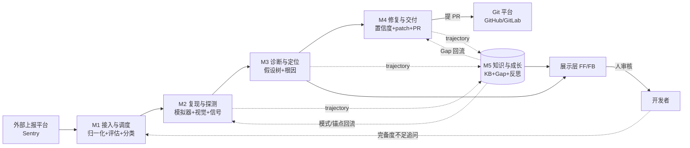

# R001 模块视图（Module Map）

> 这是理解整个客户端 bug 修复 agent 的**认知入口**。读 analysis/design 前先看这里，建立全局骨架，再钻进各模块看细节。
>
> 关联文档：[architecture.md](../architecture.md)（架构基线） · [analysis](analysis/2026-06-16--client-bug-fix-agent.md)（功能网络全貌） · [backend design](analysis/2026-06-16--client-bug-fix-agent-backend.md)（含 7 阶段时序鸟瞰图）

## 怎么看这个系统

当前 analysis 把功能按**代码层**分（基础设施 BF / 业务 BB / API FF / 前端 FB），方便落代码但看不出"一个 bug 怎么流过去"。本视图换一个维度——按**职责和数据流向**归并成 **5 大子系统**，把 29 个散点挂到 5 块骨头上。

- **5 大模块 = 系统的静态器官**（本视图）
- **backend design 第 3.2 节 7 阶段 = 一次处理的动态时序**（血液循环路径）
- 两者互补，不冲突

## 5 大子系统

| 模块 | 职责（一句话） | 功能节点 | 输入 → 输出 |
|------|--------------|---------|------------|
| **M1 接入与调度** | bug 进来，归一化、评估完备度、分类、派活 | BF001 · BB001 · BB002 · Orchestrator | 外部 webhook → 归一化 BugReport + 分类 + 调度决策 |
| **M2 复现与探测** | 在模拟器上把 bug 跑出来，采集证据 | BF002 · BF003 · BF004 · BF006 · BF007 · BB003 | BugReport + Playbook → 复现证据（信号 + 截图序列） |
| **M3 诊断与定位** | 基于证据建假设、下钻、定位根因 | BB004 · BB005 · BB012 | 复现证据 → 根因 + 诊断报告 |
| **M4 修复与交付** | 按根因生成 patch、回归验证、提 PR | BB006 · BB007 · BB008 · BB009 | 根因 → PR（Tier 分流） |
| **M5 知识与成长**（横切） | 沉淀经验、管缺口、反思、回流补齐 | BF005 · BF008 · BB010 · BB011 · BB013 · BB015 | 各模块 trajectory → KB 模式 + Capability Gap + 反思 |

> BB014（跨 bug 聚合）deferred，暂不归属。

### 展示层（挂在 M3/M5 查询接口上）

| 节点 | 说明 | 所属模块视角 |
|------|------|------------|
| FF001 报告与工单 API | 报告/工单/trajectory/PR 查询 | 服务 M3 |
| FF002 缺口视图 API | 缺口列表 + 解锁价值排序 + 补齐提交 | 服务 M5 |
| FB001 诊断报告详情页 | 报告 + 假设树可视化 | 看 M3 |
| FB002 PR 审核界面 | 复用 GitHub/GitLab PR 界面 | 看 M4 |
| FB003 缺口视图 | 按解锁价值排序的缺口列表 + 补齐 | 看 M5 |
| FB004 信息追问表单 | 结构化选项追问 | 看 M1（完备度不足时触发） |

## 模块数据流

**读图**：实线 = 主线数据流（bug 从左到右流过去）；虚线 = M5 横切（从各模块收集经验、回输知识/回流）。

## 模块与开发顺序对应

analysis 的开发顺序建议天然映射到模块实现优先级（先打通主线主干，再补横切成长机制）：

| 顺序 | 内容 | 对应模块 |
|------|------|---------|
| 1 | 基础设施最小链路：BF001→BF002→BF003→BF004 | M1 入口 + **M2** |
| 2 | 第一个崩溃型 Playbook 端到端：BF006+BB003+BB004+BB005 | **M2** + **M3** |
| 3 | Tier1 修复闭环：BB006→BB007→BB008→BB009 | **M4** |
| 4 | Information Sufficiency：BB001+BB002 | **M1** |
| 5 | 成长机制：BB013+BB010+BB011+BB015 | **M5** |

> 顺序 1-2 对应"切片 1（崩溃复现+诊断报告）"——验证 agent 能不能找对根因，这是整个系统的主干能力。

## 每个模块的一句话掌控

- **M1**：守门员——bug 够不够信息处理？分给哪条 Playbook？
- **M2**：演员——在模拟器上把 bug 演出来，录下证据
- **M3**：侦探——证据摆在面前，根因到底在哪
- **M4**：医生——开刀（写 patch）、验血（回归）、交病历（提 PR）
- **M5**：记忆——记住每次排查，下次更快；记住做不到的，等能力补齐
