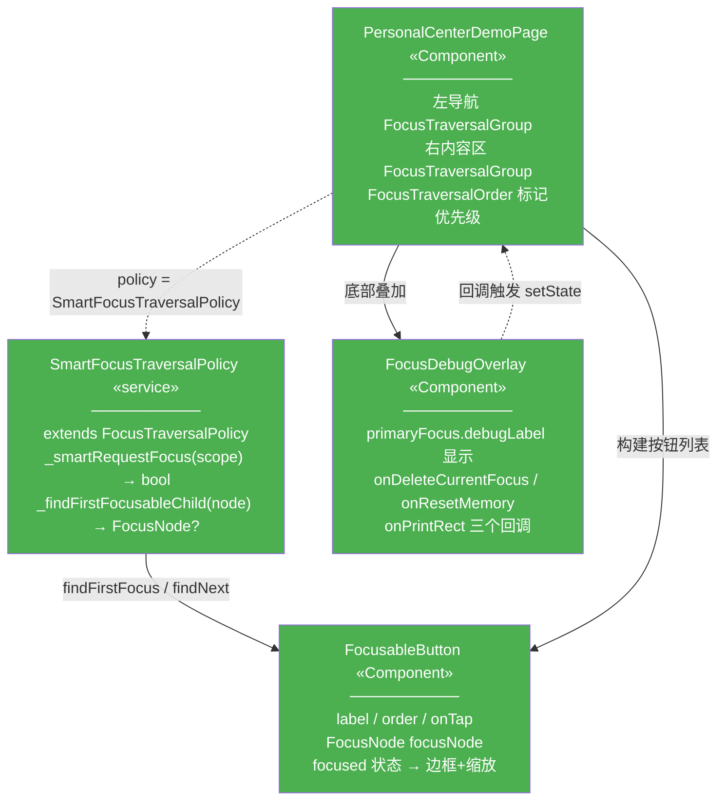
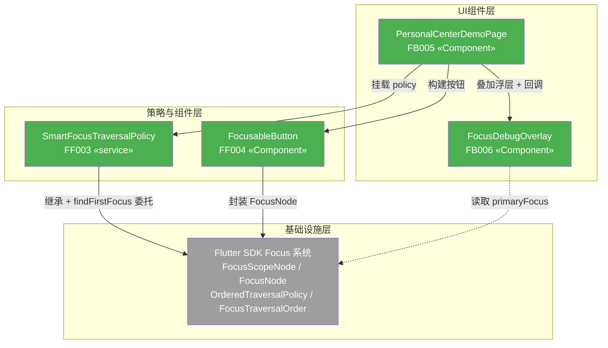
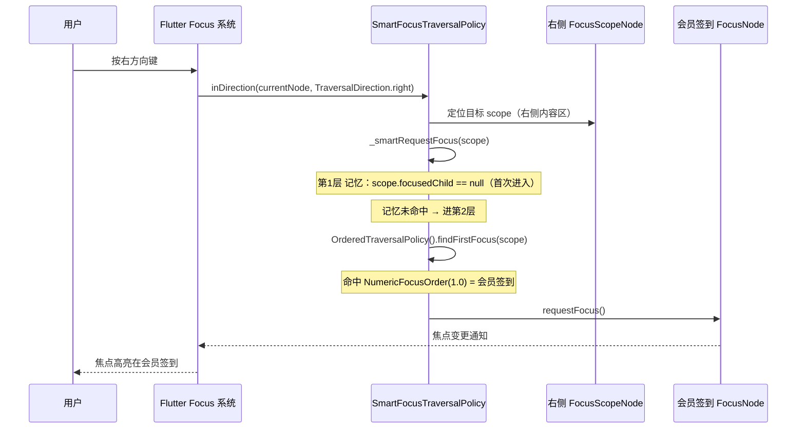
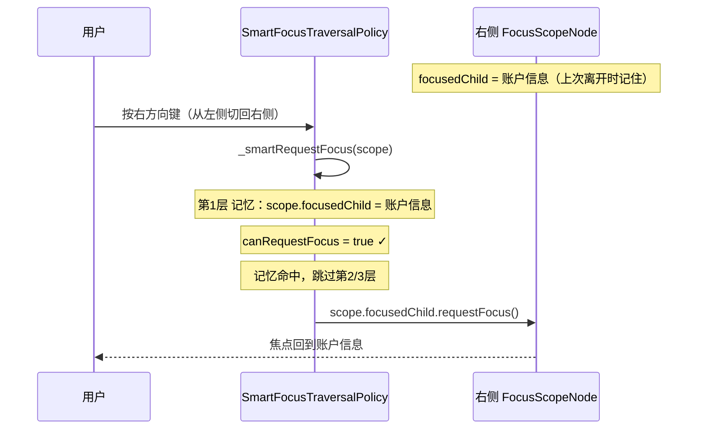
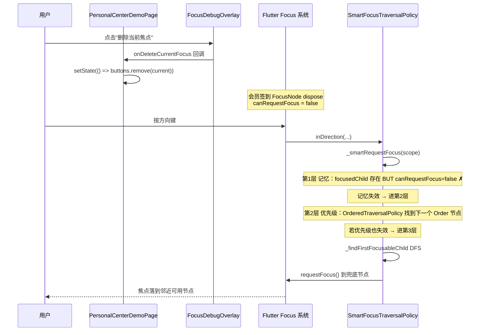

# Flutter 焦点进阶 Demo — 前端设计报告

> 关联文档：[Flutter 焦点进阶 Demo 功能分析](2026-06-26--flutter-focus-demo.md)

## 1. 目标

本版本在 `flutter_logic/` 模块内交付一个**掌机风格焦点策略验证 demo**，用最小可运行的页面验证"记忆 > 优先级 > 物理兜底"三层降级焦点策略。

交付 4 个产物：

- **FF003 SmartFocusTraversalPolicy** — 自定义 `FocusTraversalPolicy` 子类，封装三层降级决策引擎
- **FF004 FocusableButton** — 统一封装的可聚焦按钮组件（`FocusNode` + 焦点高亮样式）
- **FB005 PersonalCenterDemoPage** — 个人中心风格掌机页面（左导航 + 右内容区，`FocusTraversalGroup` 嵌套）
- **FB006 FocusDebugOverlay** — 焦点调试浮层（实时 `primaryFocus` 打印 + 删除节点/重置记忆/打印 Rect 三个调试动作）

验证 3 个场景：优先级引导（首次进入）、焦点记忆（跨区域切换）、健壮兜底（动态删除节点）。

## 2. 现状分析

### 已有能力

| 能力 | 来源 | 复用方式 |
|------|------|---------|
| Flutter Focus 系统 | Flutter SDK | 继承 `FocusTraversalPolicy`、使用 `FocusScopeNode.focusedChild` / `OrderedTraversalPolicy` / `FocusTraversalOrder` |
| Add-to-App 模块骨架 | `flutter_logic/` | 在 `lib/` 下新增 focus/pages/debug 三个子目录 |
| Material 组件库 | Flutter SDK | `Scaffold` / `AppBar` / `Column` / `Container` 搭建页面骨架 |

### 需要改造的卡点

| 卡点 | 文件:行 | 问题 |
|------|---------|------|
| 入口指向 counter demo | `flutter_logic/lib/main.dart:24` | `home: MyHomePage(...)` 是默认计数器，需改为 `PersonalCenterDemoPage` |

### 不需要改的文件

| 文件 | 原因 |
|------|------|
| `flutter_logic/pubspec.yaml` | 无新增依赖（纯用 Flutter SDK 内置 Focus 系统，不引入状态管理框架） |
| `flutter_logic/.ohos/` / Android/iOS 宿主配置 | demo 独立 `flutter run`，不集成 Add-to-App 主工程 |
| `app/` (Android 原生主工程) | 不涉及原生通信（无 MethodChannel） |

### 基础设施就绪

| 项目 | 状态 | 说明 |
|------|------|------|
| Flutter SDK | ✅ | `pubspec.yaml` 声明 `sdk: ^3.6.2`，Focus 系统 API 稳定 |
| `flutter_logic/` 模块 | ✅ | 可独立 `flutter run` 运行 |
| 状态管理框架 | ⚠️ 未锁定 | demo 内用 `setState`，不影响架构层决策（见技术决策 D1） |

## 3. 方案总览

### 项目结构

```
flutter_logic/lib/
├── main.dart                         🔵 改造：入口指向 PersonalCenterDemoPage
├── focus/
│   ├── smart_focus_policy.dart       🟢 FF003 SmartFocusTraversalPolicy（策略引擎）
│   └── focusable_button.dart         🟢 FF004 FocusableButton（可聚焦按钮组件）
├── pages/
│   └── personal_center_page.dart     🟢 FB005 PersonalCenterDemoPage（个人中心页面）
└── debug/
    └── focus_debug_overlay.dart      🟢 FB006 FocusDebugOverlay（调试浮层）
```

每个文件一句话职责：
- `main.dart` — app 入口，挂载 demo 页面
- `smart_focus_policy.dart` — 三层降级决策引擎（记忆 > 优先级 > 兜底）
- `focusable_button.dart` — 统一封装 `FocusNode` + 焦点高亮样式（边框 + 缩放）
- `personal_center_page.dart` — 左导航 + 右内容区布局，`FocusTraversalGroup` 嵌套
- `focus_debug_overlay.dart` — 浮层显示 `primaryFocus` 状态 + 三个调试动作按钮

### 类图



**图例**：
- 🟢 新增（#4CAF50）：4 个文件全部新建
- 🔵 改造（#2196F3）：`main.dart`（不在类图中，入口文件省略）
- `FocusNode` / `FocusScopeNode` / `FocusTraversalPolicy` 等 Flutter SDK 内置类不在类图中（基础设施）
- 实线 = 运行时调用，虚线 = 配置/回调

### 模块依赖关系图



**图例与阅读方式**：
- 🟢 新增（#4CAF50）/ ⚪ 不变（#9E9E9E，Flutter SDK）
- 箭头从上到下 = 请求流向（UI 层 → 策略层 → 基础设施层）
- 实线 = 运行时调用，虚线 = 数据读取
- `main.dart` / `pubspec.yaml` / config 不在图中（全局共识）
- 灰色 SDK 节点只有入箭头，无出箭头（外部依赖边界）

### 职责划分

- **FF003 SmartFocusTraversalPolicy** — 纯策略逻辑，无 UI 依赖。被 `FocusTraversalGroup.policy` 持有，在方向键事件触发时被 Flutter 焦点系统回调。三层降级决策的单一职责。
- **FF004 FocusableButton** — UI 组件 + `FocusNode` 生命周期管理。接收 `label / order / onTap`，根据 `focused` 状态切换边框颜色与缩放比例。不关心策略引擎。
- **FB005 PersonalCenterDemoPage** — 页面组装者。构建左导航 + 右内容区的 `FocusTraversalGroup` 嵌套结构，用 `FocusTraversalOrder` 标记右内容区按钮的优先级，底部叠加 `FocusDebugOverlay`。
- **FB006 FocusDebugOverlay** — 只读 + 调试动作触发。实时显示 `FocusManager.instance.primaryFocus.debugLabel`，提供三个调试回调（删除当前焦点 / 重置记忆 / 打印 Rect）。不直接操作 Focus 树，通过回调让页面层 `setState`。

**调用方向约束**：
- `FB005 → FF003`（挂载 policy）+ `FB005 → FF004`（构建按钮）+ `FB005 → FB006`（叠加浮层）
- `FF003` 不反向调用任何 UI 组件（纯被回调）
- `FB006 → FB005`（通过回调，虚线）
- **禁止** `FF004` / `FF003` 反向依赖 `FB005` / `FB006`（基础设施层不依赖 UI 层）

## 4. 数据模型与接口

### 数据模型

本 demo 无持久化数据，仅有内存中的 `FocusNode` / `FocusScopeNode` 树（由 Flutter SDK 管理）。核心数据结构是 `SmartFocusTraversalPolicy` 的决策输入输出：

| 决策输入 | 类型 | 来源 |
|---------|------|------|
| `targetScope` | `FocusScopeNode` | Flutter 焦点系统传入（方向键触发时） |
| `targetScope.focusedChild` | `FocusNode?` | Flutter SDK 自动维护（记忆字段） |
| `focusedChild.canRequestFocus` | `bool` | Flutter SDK（节点 dispose 后变 false） |
| `OrderedTraversalPolicy().findFirstFocus(scope)` | `FocusNode?` | Flutter SDK（找最小 `NumericFocusOrder`） |

| 决策输出 | 类型 | 含义 |
|---------|------|------|
| 返回值 | `bool` | 是否成功找到焦点（用于 `findFirstFocus` / `inDirection` 回调） |
| 副作用 | `target.requestFocus()` | 实际触发焦点迁移（R002-FIX005 后改为 `requestFocusCallback(node, alignment: 0.5)` 恢复 SDK ensureVisible 链路） |

### 接口契约

**FF003 SmartFocusTraversalPolicy**：

```dart
/// 自定义焦点遍历策略：记忆 > 优先级 > 物理兜底
class SmartFocusTraversalPolicy extends FocusTraversalPolicy {
  /// 核心：三层降级决策
  /// 1. 记忆：targetScope.focusedChild != null && canRequestFocus
  /// 2. 优先级：OrderedTraversalPolicy().findFirstFocus(targetScope)
  /// 3. 兜底：_findFirstFocusableChild 递归 DFS
  bool _smartRequestFocus(FocusScopeNode targetScope);

  /// 递归寻找第一个 canRequestFocus=true 的子节点（DFS）
  FocusNode? _findFirstFocusableChild(FocusNode node, int depth);

  /// 重写 FocusTraversalPolicy 的 findFirstFocus（进入 scope 时触发）
  @override
  FocusNode? findFirstFocus(FocusNode currentNode, {bool ignoreCurrentFocus = false});

  /// 重写 inDirection（方向键移动时触发）
  @override
  bool inDirection(FocusNode currentNode, TraversalDirection direction);

  /// 调试用：清空指定 scope 的记忆（FB006 重置记忆按钮触发）
  void resetMemory(FocusScopeNode scope);
}
```

**FF004 FocusableButton**：

```dart
/// 可聚焦按钮组件：封装 FocusNode + 高亮样式
class FocusableButton extends StatefulWidget {
  final String label;
  final FocusOrder? order;      // 传给 FocusTraversalOrder
  final VoidCallback? onTap;
  final bool enabled;

  const FocusableButton({
    super.key,
    required this.label,
    this.order,
    this.onTap,
    this.enabled = true,
  });

  @override
  State<FocusableButton> createState() => _FocusableButtonState();
}
```

**FB006 FocusDebugOverlay 回调接口**：

```dart
class FocusDebugOverlay extends StatelessWidget {
  /// 删除当前持有焦点的按钮（场景 3 注入）
  final VoidCallback onDeleteCurrentFocus;
  /// 清空右侧 scope 的记忆（反复验证场景 1）
  final VoidCallback onResetMemory;
  /// 打印当前 scope 的 Rect（可视化区域边界）
  final VoidCallback onPrintRect;

  const FocusDebugOverlay({
    super.key,
    required this.onDeleteCurrentFocus,
    required this.onResetMemory,
    required this.onPrintRect,
  });
}
```

### 关键设计选择

| 决策 | 方案 | 理由 |
|------|------|------|
| 焦点高亮样式 | 边框颜色变化 + 1.05 倍缩放 | 掌机屏幕中等尺寸，边框 + 缩放比阴影更醒目 |
| 优先级标记方式 | `FocusTraversalOrder(order: NumericFocusOrder(n))` | Flutter 官方推荐，与 `OrderedTraversalPolicy` 配合 |
| 记忆字段 | 复用 `FocusScopeNode.focusedChild`（SDK 自动维护） | 无需自建记忆存储，SDK 已内置 |
| 兜底搜索算法 | DFS 递归（`_findFirstFocusableChild`） | 简单可靠，demo 节点数 < 20，无性能问题 |

## 5. 核心流程

### 场景 1：首次进入右侧内容区（验证优先级引导）



**边界条件**：若右侧内容区无任何 `FocusTraversalOrder` 标记，第 2 层返回 null → 进第 3 层物理兜底。

### 场景 2：跨区域来回切换（验证焦点记忆）



### 场景 3：动态删除当前焦点节点（验证健壮兜底）



**时机控制**：`setState` 后节点 dispose 是异步的（下一帧）。demo 中删除按钮的回调用 `WidgetsBinding.instance.addPostFrameCallback` 确保节点确实从树中移除后再让用户按方向键（实际用户操作有自然延迟，不严格依赖此机制，但调试浮层的"删除"动作需保证 `setState` 完成）。

## 6. 技术决策

### 决策表

| 决策 | 方案 | 理由 |
|------|------|------|
| **D1 状态管理** | demo 内用 `setState`，不引入 Provider/Bloc/Riverpod | demo 只有 1 个页面 + 调试浮层，`setState` 足够；框架选择影响 `architecture.md` INV-1 未锁定项，不在本 demo 范围 |
| **D2 策略引擎实现** | 继承 `FocusTraversalPolicy`，重写 `findFirstFocus` + `inDirection` | Flutter 官方扩展点；`FocusTraversalGroup.policy` 接受任意 `FocusTraversalPolicy` 子类 |
| **D3 优先级层复用** | 内部用 `OrderedTraversalPolicy().findFirstFocus(scope)` 而非自写排序 | 复用 SDK 已实现的 `NumericFocusOrder` 排序逻辑，减少 bug 面 |
| **D4 记忆层复用** | 直接读 `FocusScopeNode.focusedChild`，不自建记忆 map | SDK 已自动维护此字段（节点获得焦点时更新，scope 切换时保留），自建会双重 source of truth |
| **D5 兜底搜索** | 自写 `_findFirstFocusableChild` DFS 递归 | SDK 的 `ReadingOrderTraversalPolicy` 是几何排序，不保证"第一个可聚焦"，DFS 更可预测 |
| **D6 焦点高亮** | `Focus` widget 的 `builder` 回调读 `hasFocus`，切换 `Container.decorations` | 无需手动管理 `FocusNode`，`Focus` widget 自动创建并挂载 |
| **D7 调试浮层位置** | `Stack` + `Positioned(bottom)` 叠加在页面底部 | 不遮挡内容区的焦点高亮，且调试按钮本身不抢焦点（`canRequestFocus: false`） |

### 第三方依赖清单

| 依赖 | 用途 | 已有/需新增 |
|------|------|------------|
| 无 | 纯用 Flutter SDK 内置 Focus 系统 | ✅ 已有 |

> 本 demo **不引入任何第三方包**。`pubspec.yaml` 无需修改。

## 7. 验收标准

| 验收条件 | 验收方式 |
|----------|----------|
| Flutter 编译通过 | `cd flutter_logic && flutter analyze`（无 error） |
| demo 可启动 | `cd flutter_logic && flutter run`，进入个人中心页面 |
| 场景 1：优先级引导 | 进入页面 → 焦点在左侧导航 → 按右键 → 焦点精准落在 `NumericFocusOrder(1.0)` 的"会员签到"上（非顶部装饰） |
| 场景 2：焦点记忆 | 焦点在右侧"会员签到" → 按下键到"账户信息" → 按左键回左侧 → 按右键回右侧 → 焦点回到"账户信息"（非"会员签到"） |
| 场景 3：健壮兜底 | 焦点在某按钮 → 点调试浮层"删除当前焦点" → 按方向键 → 焦点自动落到邻近可用节点，不丢失 |
| 调试浮层正确显示 | `primaryFocus.debugLabel` 实时更新；"重置记忆"按钮清空 `focusedChild` 后，再次按右键应重新走优先级层（回到"会员签到"） |
| 焦点高亮可见 | 获得焦点的按钮显示边框 + 1.05 倍缩放，失去焦点时恢复 |

## 8. 暂不实现

| 功能 | 理由 | 架构预留 |
|------|------|---------|
| Widget 测试自动化 | demo 优先靠肉眼验证 + 调试浮层；若后续沉淀为可复用组件库再补测试 | 无（测试不影响架构） |
| 状态管理框架（Provider/Bloc/Riverpod） | demo 用 `setState` 足够；框架选择影响 architecture.md INV-1 未锁定项 | 无 |
| TV 遥控器实体键映射 | Flutter `FocusNode` 默认处理方向键，键盘方向键即可模拟掌机 | 无 |
| `FocusNode.autofocus` 与策略引擎的冲突处理 | 边界优化，demo 假设进入区域时由方向键触发 | 无 |
| 与 Android 原生 MethodChannel 通信 | demo 独立 `flutter run`，不集成 Add-to-App 主工程 | 无 |
| 多级 `FocusScope` 嵌套（超过 2 层） | demo 只验证"左侧导航 ↔ 右侧内容区"两个同级 scope | `SmartFocusTraversalPolicy` 设计上支持任意层级嵌套（递归），但不专门测试 |
| 真实业务数据 / 接口对接 | 纯焦点策略验证，用静态数据 | 无 |
| 焦点动画过渡（AnimatedContainer） | demo 优先验证逻辑正确性，视觉动画可后续优化 | `FocusableButton` 的样式切换用 `AnimatedContainer` 包裹即可扩展 |
