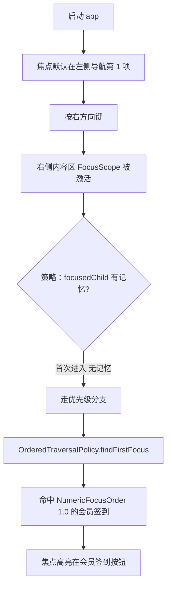
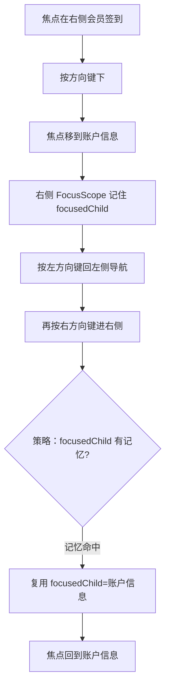
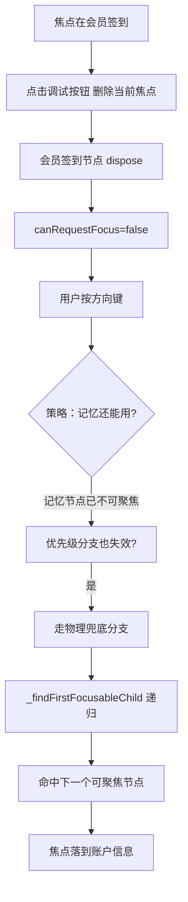

# Flutter 焦点进阶 Demo — 功能分析

## 概述

> **用户原始需求**：用户提出"写一个 Flutter 焦点相关的 demo"，并提供了完整技术方案（焦点记忆 + 优先级 + 几何兜底的三层降级策略代码骨架、`FocusTraversalOrder` UI 配置示例、三个验证步骤 A/B/C）。本 analysis 基于该方案进行结构化转译，无独立 brainstorm 文档。

在掌机 UI 场景下（实体方向键 + 按键导航，屏幕中等尺寸、单手握持），Flutter 原生焦点系统的默认行为是"几何就近"，无法满足三类诉求：跨区域来回切换时忘记上次位置、首次进入区域时焦点落在装饰图标而非核心功能、动态移除节点时焦点丢失。

本 demo 验证一套"**记忆 (Memory) > 优先级 (Priority) > 物理兜底 (Fallback)**"三层降级的智能焦点策略。通过自定义 `FocusTraversalPolicy` + `FocusTraversalOrder` 标签，在 `flutter_logic/` 模块内搭建一个个人中心风格的掌机 demo 页面，覆盖三个验证场景：优先级引导、焦点记忆、健壮兜底。

> **定位**：这是技术验证型 demo（playground），不集成进 Add-to-App 主工程，不涉及 MethodChannel 通信，不涉及后端。目标是用最小的页面验证策略引擎的正确性。

### 页面组织决策

三个场景在**同一个 `PersonalCenterDemoPage` 内**完成验证，不拆成独立子页面：

- **场景 1（首次进入优先级）与场景 2（跨区域记忆）合在主页面**：两者本质是同一段连续交互的先后阶段——场景 1 的结束状态（焦点落在"会员签到"）就是场景 2 的开始状态（从"会员签到"按下键移到"账户信息"）。强行拆开反而失真。
- **场景 3（健壮兜底）通过 `FocusDebugOverlay` 浮层的"删除当前焦点节点"按钮触发**：这是异常注入，不是正常交互流，用调试入口注入最自然，无需独立子页面。
- **浮层还提供"重置记忆"按钮**（清空 `focusedChild`，方便反复验证场景 1）和**实时 `primaryFocus` 打印**（肉眼确认焦点落点）。

## 一、交互链

### 场景 1：首次进入区域，验证优先级引导

**用户故事**：作为掌机用户，我第一次用方向键从左侧导航切到右侧内容区时，希望焦点自动落在最核心的"会员签到"按钮上，而不是内容区顶部的装饰图标，以便用最短路径完成签到。

操作路径：app 启动 → 焦点默认在左侧导航第 1 项 → 按右方向键尝试进入右侧内容区 → 右侧 `SmartFocusTraversalPolicy` 触发 → 发现无记忆 → 用 `OrderedTraversalPolicy` 找到 `NumericFocusOrder(1.0)` 的节点 → 焦点落到"会员签到"。

**验证点**：焦点精准落在 `NumericFocusOrder(1.0)` 的按钮上，**不是**内容区顶部的装饰图标或物理第一个 Widget。

### 场景 2：跨区域来回切换，验证焦点记忆

**用户故事**：作为掌机用户，我在右侧内容区浏览到"账户信息"后，按左方向键切回左侧导航查看别的菜单，再按右方向键切回右侧内容区，希望焦点还停在"账户信息"上，以便继续刚才的操作，而不是每次都回到"会员签到"重来。

操作路径：焦点在右侧"会员签到" → 按下方向键移到"账户信息" → 右侧 FocusScope 记住 `focusedChild="账户信息"` → 按左方向键焦点回到左侧导航 → 再按右方向键 → 策略发现 `focusedChild` 有记忆且 `canRequestFocus=true` → 直接复用记忆 → 焦点回到"账户信息"。

**验证点**：焦点回到"账户信息"，**不是**重新回到"会员签到"。

### 场景 3：动态删除当前焦点节点，验证健壮兜底

**用户故事**：作为掌机用户，当当前持有焦点的按钮被界面动态移除（例如数据刷新导致列表项消失）时，我希望焦点自动落到邻近的可用节点上，不要发生焦点丢失或跳到未知位置，以便继续操作。

操作路径：焦点在"会员签到" → 点击调试区的"删除当前焦点"按钮 → "会员签到" 节点被 `dispose`，`canRequestFocus=false` → 用户按方向键 → 策略的兜底分支触发 `_findFirstFocusableChild` 递归寻找 → 焦点落到下一个可用节点（如"账户信息"）。

**验证点**：焦点系统不丢失，自动落到邻近可聚焦节点。

---

## 二、逻辑树

> ⚠️ 本节事件流表记录的是 R002-FIX005 **修复前**的语义（直接 `requestFocus()`）。
> FIX005 把跨 scope 路径的 4 处 `.requestFocus()` 改为
> `requestFocusCallback(node, alignment: 0.5)`，恢复 SDK 的
> `Scrollable.ensureVisible` 链路。详见
> [focus-ensurevisible-policy-lift 根因分析](2026-06-27--focus-ensurevisible-policy-lift.md)。

### 事件流：智能焦点策略的三层降级

每当用户按方向键、或代码主动调用 `FocusNode.requestFocus()` 到一个 `FocusScopeNode` 时，`SmartFocusTraversalPolicy._smartRequestFocus(targetScope)` 被触发，按固定优先级降级。

| 时刻 | 事件 | 处理 | 产生的新事件 |
|------|------|------|-------------|
| T1 | 用户按方向键 / 代码 `requestFocus()` | Flutter 焦点系统调用 `FocusTraversalPolicy.findFirstFocus` 或 `findNext` | 进入目标 FocusScope 的策略决策 |
| T2 | 目标 scope 调用 `_smartRequestFocus(targetScope)` | **第 1 层：记忆** — 检查 `targetScope.focusedChild != null && canRequestFocus` | 命中：`focusedChild.requestFocus()` → T5；未命中 → T3 |
| T3 | 记忆未命中 | **第 2 层：优先级** — `OrderedTraversalPolicy().findFirstFocus(targetScope)` 找 `NumericFocusOrder` 最小的节点 | 命中且 != targetScope：`priorityFirst.requestFocus()` → T5；未命中 → T4 |
| T4 | 优先级也未命中 | **第 3 层：物理兜底** — `_findFirstFocusableChild(targetScope)` 递归 DFS 找第一个 `canRequestFocus=true` 的节点 | 命中：`fallback.requestFocus()` → T5；极端兜底：`targetScope.requestFocus()` 自身 |
| T5 | 目标 FocusNode 获得焦点 | Flutter 更新 `FocusManager.instance.primaryFocus` | 触发 `FocusNode` 的 listeners、`onFocusChange` 回调；FocusScope 自动更新 `focusedChild` |

**异常流说明**：
- 第 1 层"记忆"命中的节点在 T2 时刻是 `canRequestFocus=true`，但实际聚焦前的极短窗口内被 `dispose` → Flutter 内部会重新走兜底（依赖 `FocusManager._applyFocusChange` 的回退机制）。本 demo 不专门测试这种竞态，只测"已 dispose 后再按方向键"的稳态场景。
- 第 3 层兜底若 targetScope 内一个可聚焦子节点都没有 → `targetScope.requestFocus()` 让 scope 自身持有焦点，避免 `primaryFocus=null`。

### 状态流转

核心实体：`FocusScopeNode`（右侧内容区 scope）与 `FocusNode`（各按钮）。

| 实体 | 触发事件 | 前状态 | 后状态 | 关键字段变化 |
|------|---------|--------|--------|-------------|
| 右侧 FocusScope | 场景 1 首次进入 | `focusedChild=null` | `focusedChild=会员签到` | focusedChild 从 null → 非空 |
| 右侧 FocusScope | 场景 2 用户按下方向键 | `focusedChild=会员签到` | `focusedChild=账户信息` | focusedChild 在兄弟节点间迁移 |
| 右侧 FocusScope | 场景 2 用户切走再回来 | `focusedChild=账户信息` | `focusedChild=账户信息`（不变） | **记忆命中**：字段值保持 |
| FocusNode(会员签到) | 场景 3 点击删除 | `canRequestFocus=true` | `canRequestFocus=false`（节点 dispose，从树中移除） | 节点生命周期结束 |
| 右侧 FocusScope | 场景 3 记忆节点失效后按方向键 | `focusedChild=会员签到`(已失效)` | `focusedChild=账户信息`(兜底命中) | focusedChild 从失效节点 → 兜底节点 |
| 全局 `FocusManager.primaryFocus` | 任意时刻 | 旧节点 | 新节点 | debug 浮层实时打印此值 |

**回退规则**：策略三层是严格顺序，不并行尝试；上一层失败才进下一层。这种"短路降级"保证可预测性。

---

## 三、功能编号与网络定位

### 本次新增节点

| 编号 | 功能节点 | 前缀含义 | 简介 |
|------|---------|---------|------|
| FF003 | SmartFocusTraversalPolicy | 前端基础 | 自定义 `FocusTraversalPolicy` 子类，实现"记忆 > 优先级 > 物理兜底"三层降级；封装 `_smartRequestFocus` 与 `_findFirstFocusableChild` |
| FF004 | FocusableButton | 前端基础 | 统一封装的可聚焦按钮组件：接管 `FocusNode`、根据 `focused` 状态切换高亮样式（边框/缩放），对外暴露 `label / order / onTap` |
| FB005 | PersonalCenterDemoPage | 前端业务 | 个人中心风格掌机 demo 页面：左导航（菜单项）+ 右内容区（多按钮，含 `NumericFocusOrder` 标签）；`FocusTraversalGroup` 嵌套结构验证跨区域切换 |
| FB006 | FocusDebugOverlay | 前端业务 | 焦点调试浮层：实时打印 `primaryFocus.debugLabel` 与当前 scope 的 `focusedChild`；提供三个调试动作——"删除当前焦点节点"（场景 3 注入）、"重置记忆"（清空 `focusedChild`，反复验证场景 1）、"打印 Rect"（可视化区域边界） |

> 编号说明：FF（前端基础）= 可在 demo 外复用的通用能力；FB（前端业务）= 个人中心 demo 专属的页面/组件。BF/BB 前缀本次不使用（纯前端 demo 无后端）。

### 前置依赖

| 依赖节点 | 依赖方式 | 是否已有 |
|----------|---------|---------|
| Flutter SDK Focus 系统 | FF003 继承 `FocusTraversalPolicy`、使用 `FocusScopeNode.focusedChild` / `OrderedTraversalPolicy` | ✅ 已有（Flutter 内置） |
| `flutter_logic/` 模块 | FF004 / FB005 / FB006 的代码载体 | ✅ 已有（Add-to-App 模块，`lib/main.dart` 目前是 counter demo） |
| Material 组件 | FB005 的页面骨架（Scaffold / AppBar / Column） | ✅ 已有（Flutter 内置） |
| 状态管理框架 | FB006 的调试状态切换 | ⚠️ **未锁定**（见"暂不实现"，demo 内用 `setState` 即可，不影响架构层决策） |
| **FF003 SmartFocusTraversalPolicy** | 本次新增的策略引擎，无内部依赖（仅依赖 Flutter SDK Focus 系统） | ❌ 否（本次新建） |
| **FF004 FocusableButton** | 本次新增的可聚焦按钮组件，无内部依赖（封装 `FocusNode` + 高亮样式） | ❌ 否（本次新建） |
| **FB005 PersonalCenterDemoPage** | 依赖 **FF003**（策略引擎挂在 `FocusTraversalGroup.policy`）+ **FF004**（用 `FocusableButton` 构建按钮列表） | ❌ 否（本次新建） |
| **FB006 FocusDebugOverlay** | 依赖 **FB005**（通过调试事件回调触发页面层 `setState` 移除节点 / 清空记忆）；读取全局 `FocusManager.primaryFocus`（Flutter 内置，无依赖 FF003） | ❌ 否（本次新建） |

### 边界接口

| 接口 / 协议 | 定义方 | 消费方 | 敏感度 |
|-------------|--------|--------|--------|
| `SmartFocusTraversalPolicy extends FocusTraversalPolicy` | FF003 | FB005（挂在 `FocusTraversalGroup.policy`） | 高（策略引擎是 demo 的核心产物，API 稳定后可被其他页面复用） |
| `SmartFocusTraversalPolicy._smartRequestFocus(FocusScopeNode) → bool` | FF003 | Flutter 焦点系统（通过 `findFirstFocus` / `inDirection` 回调间接触发） | 中（私有方法，但逻辑入口固定） |
| `FocusableButton({required String label, FocusOrder? order, VoidCallback? onTap})` | FF004 | FB005（构建按钮列表） | 中（组件 API，后续可能扩展 `icon / enabled`） |
| `FocusDebugOverlay` 对外调试事件（"删除当前焦点节点" / "重置记忆" / "打印 Rect"） | FB006 | FB005（页面层接收事件并 `setState` 移除节点或清空 focusedChild） | 低（demo 专用，非生产 API） |

---

## 四、结论

> **架构约束声明**：本 RC 不涉及 `architecture.md` 任何不变量 / 禁止模式 / 约束的变更（不涉 MethodChannel、不集成 Add-to-App 主工程、不涉后端、不锁定 Flutter 状态管理框架）。`architecture_md_updates=false`，后续 design / plan 阶段无需回写 architecture.md。

### 开发顺序建议

1. **FF003 SmartFocusTraversalPolicy**（策略引擎）— 先有引擎才能验证策略。核心代码量小（~60 行 Dart），但逻辑关键，需配单元测试覆盖三层降级的每一条分支。
2. **FF004 FocusableButton**（可聚焦按钮组件）— 引擎之外的可视化载体。封装 `FocusNode` + 高亮样式，让 demo 的焦点路径肉眼可见。
3. **FB005 PersonalCenterDemoPage**（个人中心页面）— 组装 FF003 + FF004，搭出左导航 + 右内容区的掌机横屏布局，用 `FocusTraversalOrder` 标记优先级。
4. **FB006 FocusDebugOverlay**（调试浮层）— 最后叠加。验证场景 3 必须有"删除当前焦点节点"的入口。

### 复杂度集中的地方

- **FF003 的三层降级逻辑**：策略引擎的正确性是整个 demo 的命脉。每一层的"命中/未命中"判断都要严谨，尤其是第 1 层记忆节点的 `canRequestFocus` 检查（节点 dispose 后此字段变 false，是场景 3 的关键）。
- **FB005 的 `FocusTraversalGroup` 嵌套结构**：左右两个区域必须各自是独立的 `FocusTraversalGroup`，否则策略引擎拿不到正确的 `targetScope`。这是 demo 容易写错的地方。
- **场景 3 的时机控制**：删除节点 → 按方向键，中间需要保证 `setState` 完成、节点确实从树中移除后再触发方向键事件。Demo 里可能需要 `WidgetsBinding.instance.addPostFrameCallback`。

### 暂不实现的部分及理由

| 功能 | 理由 |
|------|------|
| 状态管理框架（Provider / Bloc / Riverpod）选择 | demo 内只用 `setState` 足够；框架选择影响 architecture.md INV-1 的"Flutter 层状态管理"未锁定项，不在本 demo 范围 |
| 真实业务数据 / 接口对接 | 纯焦点策略验证，用静态数据 |
| 掌机实体键映射 | Flutter 的 `FocusNode` / `KeyboardListener` 默认处理方向键，demo 用键盘方向键即可模拟掌机方向键 |
| `FocusNode.autofocus` 与策略引擎的冲突处理 | 属于边界优化，本 demo 的策略引擎假设进入区域时由方向键事件触发；`autofocus` 场景留待后续 |
| 与 Android 原生 MethodChannel 通信 | 本 demo 位于 `flutter_logic/` 模块内但独立 `flutter run` 运行，不集成进 Add-to-App 主工程 |
| 多 `FocusScope` 嵌套超过 2 层的场景 | demo 只验证"左侧导航 ↔ 右侧内容区"两个同级 scope；超过 2 层的树状导航（如三级菜单）留待后续 |
| 单元测试 / widget 测试自动化 | demo 优先靠"肉眼验证 + 调试浮层"；若后续要沉淀为可复用组件库再补测试。**注**：若 plan-review 阶段判定测试为硬性条件，plan 阶段需补 widget 测试任务 |
