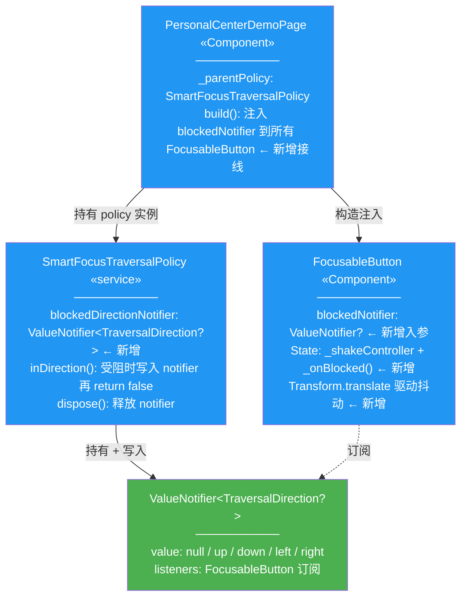
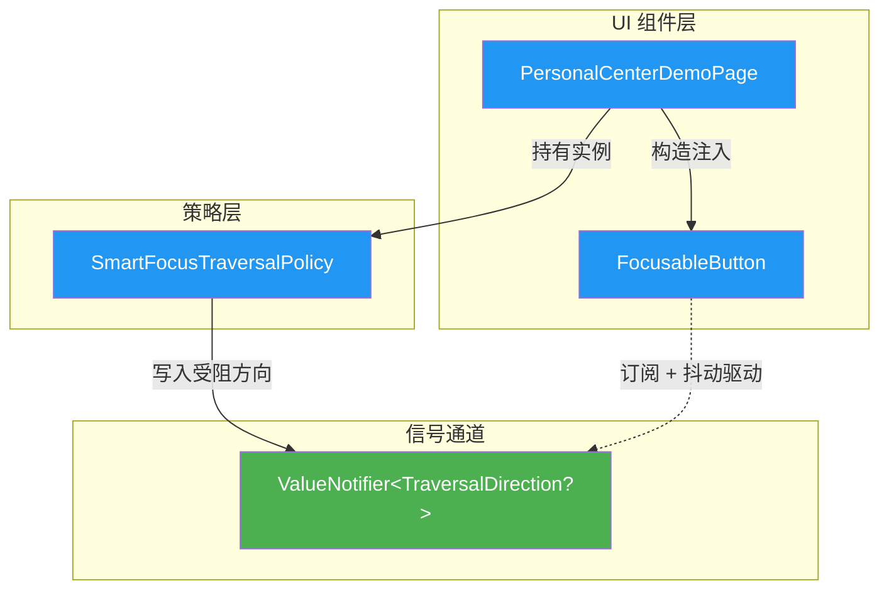
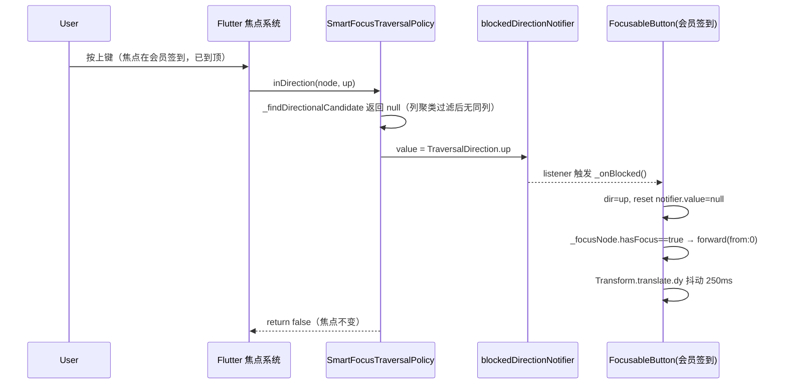
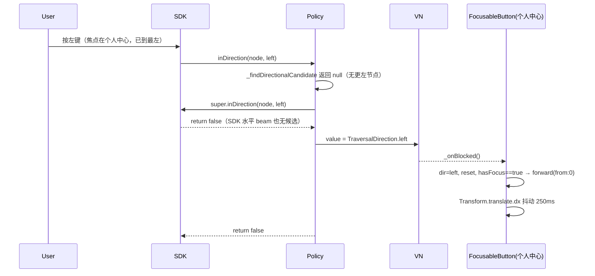
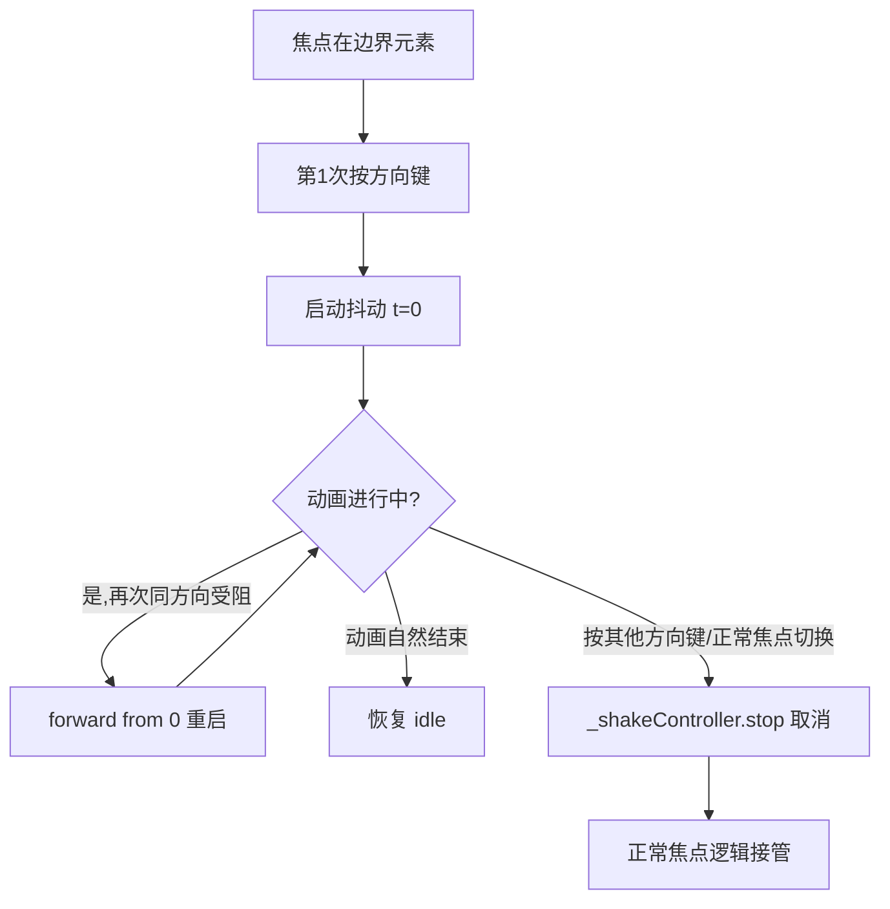

# 焦点边界受阻抖动反馈 — 前端设计报告

> 关联分析：[焦点边界受阻抖动反馈 分析](2026-06-27--focus-boundary-shake-feedback.md)

## 1. 目标

本版本交付两个功能节点：

- **FF005 FocusBoundaryNotifier**：在 `SmartFocusTraversalPolicy.inDirection` 返回 false 前，写入受阻方向信号（`ValueNotifier<TraversalDirection?>`），供 widget 订阅响应
- **FB008 FocusableButton 抖动反馈**：`FocusableButton` 新增可选 `blockedNotifier` 参数；当订阅到方向信号且自身是 primaryFocus 时，按方向感知启动一次水平/垂直轻微抖动动画（约 250ms，±4px，3 周期），受阻期间同方向重复按键重启动画（非堆叠）

不做：触觉反馈（HapticFeedback）、跨页面通用化（InheritedWidget/Provider）、无障碍可配置开关。

## 2. 现状分析

### 已有能力

| 能力 | 来源 | 复用方式 |
|------|------|---------|
| 方向键受阻判定点 | `smart_focus_policy.dart:177-181` | 在两条 return false 路径前注入 `notifier.value = direction` |
| `FocusableButton` 可聚焦组件骨架 | `focusable_button.dart` | State 内新增 notifier 订阅 + AnimationController |
| `FocusableButton` 已有 FocusNode 生命周期管理 | `focusable_button.dart:49-76` | 复用 dispose 流程，叠加 controller.dispose + listener.removeListener |
| `_parentPolicy` 实例（页面级单例） | `personal_center_page.dart:52` | 在 build 时把 `parentPolicy.blockedDirectionNotifier` 传给所有 FocusableButton |
| `Transform.translate` + `AnimatedBuilder` 动画原语 | Flutter SDK | 抖动视觉驱动 |

### 需要改造的卡点

| 卡点 | 文件:行 | 问题 |
|------|---------|------|
| 垂直方向无候选直接 return false，无信号 | `smart_focus_policy.dart:177-180` | 受阻事件不可观察，widget 无法感知 |
| 水平方向 super.inDirection 返回 false 后无信号 | `smart_focus_policy.dart:181` | 同上，水平边界受阻同样无反馈 |
| `FocusableButton` 无 notifier 入参 | `focusable_button.dart:24-31` | 无法接收 policy 信号 |
| `FocusableButton` 无动画 controller | `focusable_button.dart:37-76` | 无法驱动抖动 |
| `PersonalCenterDemoPage` 未把 notifier 接到按钮 | `personal_center_page.dart:215-218` | 需在 FocusableButton 构造时注入 `parentPolicy.blockedDirectionNotifier` |

### 不需要改的文件

| 文件 | 原因 |
|------|------|
| `lib/main.dart` | 入口与主题不变 |
| `lib/home_page.dart` | 入口列表不变 |
| `lib/debug/focus_debug_overlay.dart` | 调试浮层不变（抖动是即时视觉反馈，不需调试开关） |
| SDK `focus_traversal.dart` | 只读引用，不改 SDK |

### 基础设施就绪

| 项目 | 状态 | 说明 |
|------|------|---------|
| `SmartFocusTraversalPolicy` 可改造 | ✅ | 本仓库代码，可直接新增字段 |
| Flutter 动画原语 | ✅ | `AnimationController` / `CurvedAnimation` / `AnimatedBuilder` 内置 |
| Widget 测试框架 | ✅ | `flutter test` + `flutter_test` 包，已用于 R002 43 个测试 |

## 3. 方案总览

### 项目结构

```
flutter_logic/lib/
├── focus/
│   ├── smart_focus_policy.dart   🔵 新增 blockedDirectionNotifier 字段 + 2 处写入点
│   └── focusable_button.dart     🔵 新增 blockedNotifier 入参 + State 内 controller/listener/抖动渲染
├── pages/
│   └── personal_center_page.dart 🔵 FocusableButton 构造时注入 parentPolicy.blockedDirectionNotifier
├── debug/focus_debug_overlay.dart ⚪ 不变
├── main.dart                     ⚪ 不变
└── home_page.dart                ⚪ 不变

flutter_logic/test/focus/
├── boundary_notifier_test.dart   🟢 新增（FF005 单元测试）
├── focusable_button_shake_test.dart 🟢 新增（FB008 单元测试）
└── boundary_shake_integration_test.dart 🟢 新增（集成测试：端到端场景）
```

### 类图



> 图例：
> - 🔵 蓝（#2196F3）：改造的现有文件
> - 🟢 绿（#4CAF50）：新增的信号通道
> - 省略：`debug/focus_debug_overlay.dart`、`main.dart`、`home_page.dart`（不变，不参与本次依赖）
> - `ValueNotifier` 是 SDK 类型，本设计新增的是它的**实例**（绿色），表示新增信号通道

### 模块依赖关系图



> 图例：
> - 🔵 改造：三个现有文件
> - 🟢 新增：信号通道（ValueNotifier 实例）
> - 省略 config/main/utils：本 demo 无全局配置文件，`main.dart` 为启动入口不参与运行时依赖
> - 阅读方式：从上到下 = 构造注入与事件流方向

### 职责划分

- **`SmartFocusTraversalPolicy`**（FF005）：只负责"判定受阻 + 写入信号"，不关心谁消费、怎么抖。信号是一次性的（写入后由消费方立即 reset），避免重入
- **`FocusableButton`**（FB008）：只负责"订阅信号 + 自己是 primaryFocus 时启动方向感知抖动"。不知道信号来自哪个 policy
- **`PersonalCenterDemoPage`**：负责把页面级 policy 的 notifier 接到所有 FocusableButton。是 policy 与 widget 的装配点
- **依赖方向**：PCDP → SFTP（持有），PCDP → FB（注入），SFTP → VN（写入），FB → VN（订阅）。禁止 FB 反向依赖 SFTP（保持 widget 通用性）

## 4. 数据模型与接口

### 数据模型

| 决策 | 方案 | 理由 |
|------|------|------|
| 信号通道类型 | `ValueNotifier<TraversalDirection?>` | Flutter 原生，零依赖；null 表示无受阻，非 null 表示某方向受阻 |
| 信号生命周期 | 一次性（消费方读取后立即置 null） | 避免重入触发；防抖靠 widget 侧 `forward(from: 0)` 实现，不靠 notifier 状态机 |
| 抖动方向感知 | `TraversalDirection.up/down → 垂直`；`left/right → 水平` | 与受阻方向物理一致，用户直觉 |
| 抖动幅度 | ±4px | 足够可见，不突兀，不超出 scroll viewport clip 边界（与 R002-FIX002 教训一致：动画位移不能导致 border 被裁） |
| 抖动时长 | 约 250ms（3 周期 sin） | 短促可感知，不阻塞下一次按键 |
| 防抖策略 | 动画进行中再次受阻 → `forward(from: 0)` 重启 | 幂等、无堆叠；与 analysis 场景 3 一致 |
| 异常路径 | 抖动中按其他方向键 → `_shakeController.stop()` 取消 | 让位给正常焦点切换，避免视觉混乱 |

### 接口契约

**FF005 — `SmartFocusTraversalPolicy.blockedDirectionNotifier`**

```
字段：final ValueNotifier<TraversalDirection?> blockedDirectionNotifier;
初始化：构造时创建 = ValueNotifier<TraversalDirection?>(null);
释放：policy 无 dispose 生命周期（页面级 final 字段），由页面在 dispose 时调用 blockedDirectionNotifier.dispose()
```

**写入点（2 处）**：

```dart
// 路径 1：垂直方向无候选（smart_focus_policy.dart:177-180 区块）
if (direction == TraversalDirection.up ||
    direction == TraversalDirection.down) {
  blockedDirectionNotifier.value = direction;   // ← 新增
  return false;
}

// 路径 2：水平方向 super 也找不到候选（smart_focus_policy.dart:181 区块）
final result = super.inDirection(currentNode, direction);
if (!result) {
  blockedDirectionNotifier.value = direction;   // ← 新增
}
return result;
```

| 字段 | 定义方 | 消费方 | 敏感度 |
|------|--------|--------|--------|
| `blockedDirectionNotifier.value` | FF005（policy 写入） | FB008（FocusableButton 订阅） | 中：写入时机必须严格在 `inDirection` return false 之前 |

**FB008 — `FocusableButton.blockedNotifier` 入参**

```
入参：final ValueNotifier<TraversalDirection?>? blockedNotifier;
默认：null（不订阅，行为与 R002 完全一致，向后兼容）
```

State 内新增：

| 成员 | 类型 | 职责 |
|------|------|------|
| `_shakeController` | `AnimationController` | duration=250ms；驱动抖动 |
| `_shakeAnimation` | `Animation<double>` | CurvedAnimation（sin 波形近似） |
| `_onBlocked()` | 方法 | notifier listener 回调：读取 value → reset → 若 hasFocus 则 `forward(from: 0)` |
| `_handleDirectionKey` | 方法 | 在 build 中检测其他方向键 → stop 抖动 |

> 编号追溯：FF005 → `smart_focus_policy.dart`；FB008 → `focusable_button.dart` + `personal_center_page.dart` 装配点

## 5. 核心流程

### 流程 1：垂直边界受阻抖动（场景 1）



业务规则：
- `notifier.value` 必须在 policy `return false` **之前**写入，保证 listener 在焦点状态未变时触发
- `_onBlocked` 内先 reset 再 forward，避免同一 value 被多次消费
- 只有 `_focusNode.hasFocus == true` 才启动抖动——避免非焦点按钮误抖

### 流程 2：水平边界受阻抖动（场景 2）



### 流程 3：连续按键防抖（场景 3）



边界条件：
- 重启幂等：`forward(from: 0)` 对正在运行的 controller 会重置 progress，不堆叠
- 取消时机：FocusableButton 通过 FocusNode listener 监听 hasFocus 变化，失焦时立即 stop
- 异常路径覆盖：widget 在抖动中 unmount → dispose 时 `_shakeController.dispose()` + `notifier.removeListener(_onBlocked)`，无 leak

## 6. 技术决策

| 决策 | 方案 | 理由 |
|------|------|------|
| 信号通道：policy 持有 ValueNotifier | 选 A（构造注入） | 与现有 `_parentPolicy` 模式一致；显式、可测试；不引入 Provider/InheritedWidget 过度设计 |
| 抖动曲线：sin 波形 | `Curves.easeInOut` + `Tween(begin:-1,end:1)` 配合 `sin(pi*3*t)` | 3 周期近似 sin；零外部依赖 |
| 抖动渲染：Transform.translate | 直接对 child 做 translate | 不改 Container margin/decoration，避免与 R002-FIX002 的 border clip 教训冲突；translate 在 clip 内进行（±4px 远小于 margin:2 的内缩空间） |
| 防抖实现：forward(from:0) | AnimationController 原生能力 | 幂等，无需自定义状态机 |
| 其他方向键取消：FocusNode.hasFocus listener | 复用现有 Focus 系统 | 失焦即 stop，无需额外 KeyEvent 拦截 |

第三方依赖：无新增。全部使用 Flutter SDK 内置 API。

## 7. 验收标准

| 验收条件 | 验收方式 |
|----------|----------|
| 编译通过 | `flutter analyze`（flutter_logic/）无 error |
| FF005 单元测试：notifier 写入时机正确 | `flutter test test/focus/boundary_notifier_test.dart`：mock policy inDirection 路径，断言 value 在 return false 前被写入；reset 后 value=null |
| FB008 单元测试：方向感知抖动 | `flutter test test/focus/focusable_button_shake_test.dart`：(1) primaryFocus 时收到 up → controller 运行 + dx=0/dy≠0；(2) 收到 left → dx≠0/dy=0；(3) 非 primaryFocus 收到信号 → 不抖；(4) 动画中再次信号 → forward(from:0) 重启；(5) unmount → controller disposed + listener removed |
| 集成测试：端到端受阻抖动 | `flutter test test/focus/boundary_shake_integration_test.dart`：在 PersonalCenterDemoPage 中焦点到"会员签到"按上键，断言 Transform.translate 在 250ms 窗口内非零位移；250ms 后归零；焦点 debugLabel 仍为"会员签到" |
| 集成测试：连续按键防抖 | 同文件第二个测试：连按 3 次上键（间隔 80ms），断言无动画堆叠（controller 不创建多个实例），最后一次后 250ms 自然结束 |
| 向后兼容 | 不传 blockedNotifier 时，FocusableButton 行为与 R002 完全一致（已有 43 个测试不受影响） |
| 视觉验收（手动） | `flutter run`，焦点到边界按钮按方向键，肉眼确认抖动可见、方向正确、不导致 border 被裁 |

## 8. 暂不实现

| 功能 | 理由 | 预留扩展 |
|------|------|---------|
| 触觉反馈（HapticFeedback.lightImpact） | iOS/Android 差异大，需独立 RC 验证 | `_onBlocked` 内预留 hook 点，后续 RC 可加一行 `HapticFeedback.lightImpact()` |
| 跨页面通用化（InheritedWidget/Provider） | 当前 demo 单页面够用 | notifier 通过构造注入，未来改 InheritedWidget 不破坏 FocusableButton 接口 |
| 无障碍可配置开关 | 需配合系统 reduce-motion 设置 | blockedNotifier 为可选入参，后续 RC 可在不传时全局关闭 |
| 多 policy 实例协调 | 当前页面单 policy | 每个 policy 持有独立 notifier，天然隔离；多页面时各页面注入各自己的 notifier 即可 |
| 抖动参数（幅度/时长/曲线）外部可配 | OI-1 待 visual-verify 后微调 | 当前硬编码常量，visual-verify 后若需调参再提补丁 |

---

## AcceptanceSpec（可验收性规约）

> 本设计涉及 UI 交互（抖动反馈），按 xlfoundry-design 规约额外产出 AcceptanceSpec，作为 plan → implementer → visual-verify 约束链的"预期"源头。

稳定标识清单、视觉验收标准、交互断言详见独立 YAML：

[`2026-06-27--focus-boundary-shake-feedback-acceptance-spec.yaml`](2026-06-27--focus-boundary-shake-feedback-acceptance-spec.yaml)
