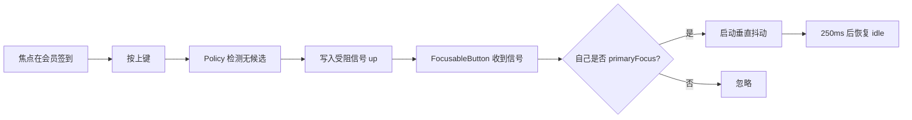

# 焦点边界受阻抖动反馈 — 功能分析

## 概述

当用户按方向键导航到焦点区域的边界（如右内容区顶部按上键、左导航底部按下键）时，当前 `SmartFocusTraversalPolicy.inDirection` 返回 false，焦点不变。**用户感知不到任何反馈**，不知道"已经到边了，再按也没用"。

本功能为：焦点受阻时，当前持有焦点的元素触发一次轻微抖动动画（水平/垂直方向感知），告知用户"此方向已无下一个目标"。

## 一、交互链

### 场景 1：垂直边界受阻抖动

**用户故事**：作为掌机用户，我在右内容区顶部按上键时，想看到当前按钮向上抖动一下，以便知道"已经到顶了，再按上键没用"。

操作过程：
1. 焦点在右内容区"会员签到"（最顶部按钮）
2. 按上键
3. "会员签到"按钮向上轻微抖动（±2px 垂直方向，3 次循环，~250ms）
4. 抖动期间忽略同方向重复按键
5. 焦点保持不变



### 场景 2：水平边界受阻抖动

**用户故事**：作为掌机用户，我在左导航最左边按左键时，想看到当前按钮向左抖动一下，以便知道"已经到最左了"。

操作过程同场景 1，但抖动方向为水平。

### 场景 3：连续按键防抖

**用户故事**：作为掌机用户，我连按方向键时不想看到抖动卡顿堆叠。

- 抖动动画期间再按同方向键 → 重启动画（从头开始，不堆叠）
- 抖动期间按其他方向键 → 立即取消抖动，正常走焦点逻辑

## 二、逻辑树

### 事件流：边界受阻抖动反馈

| 时刻 | 事件 | 处理 | 产生的新事件 |
|------|------|------|-------------|
| T1 | 用户按方向键 | FocusNode 收到 KeyEvent | 触发 `FocusNode.focusInDirection(direction)` |
| T2 | focusInDirection | 调用 `SmartFocusTraversalPolicy.inDirection(node, dir)` | 进入策略判断 |
| T3 | `_findDirectionalCandidate` 返回 null（垂直）或 super 返回 false（水平） | 无候选 | 准备返回 false |
| T4 | **新增**：返回 false 前，写入 `FocusBoundaryNotifier.value = direction` | notifier 触发监听器 | 通知订阅者 |
| T5 | inDirection 返回 false | 焦点不变 | — |
| T6 | `FocusableButton._onBlocked()` 被调用 | 检查 `_focusNode.hasFocus && notifier.value != null` | 若是当前焦点 → 启动抖动 |
| T7 | AnimationController.forward(from: 0) | Transform.translate 驱动按钮位移 | 视觉抖动 |
| T8 | notifier.value 被 reset 为 null（T6 后立即） | 防止下次重复触发 | — |
| T9 | 动画结束（~250ms） | controller 自然停止 | 状态恢复 idle |

### 状态流转

| 实体 | 触发事件 | 前状态 | 后状态 | 关键字段变化 |
|------|---------|--------|--------|-------------|
| `FocusBoundaryNotifier` | T4 写入 | `value = null` | `value = direction` | 通知 listeners |
| `FocusBoundaryNotifier` | T8 reset | `value = direction` | `value = null` | 防重置 |
| `FocusableButton` | T6 启动 | `shaking = false` | `shaking = true` | `_shakeAxis = horizontal/vertical` |
| `FocusableButton` | T9 完成 | `shaking = true` | `shaking = false` | 动画状态归零 |

**异常流**：
- 多次按方向键（防抖）：T6 时若 `shaking == true`，调用 `forward(from: 0)` 重启而非累加，自然幂等
- widget 在抖动中 unmount：dispose 时移除监听 + dispose controller，避免 leak
- 多 policy 实例：每个 `SmartFocusTraversalPolicy` 持有独立 notifier，互不干扰

## 三、功能编号与网络定位

### 本次新增节点

| 编号 | 功能节点 | 前缀含义 | 简介 |
|------|---------|---------|------|
| FF008 | FocusBoundaryNotifier | 前端基础 | 焦点受阻信号通道：policy 写入方向，widget 订阅响应。`ValueNotifier<TraversalDirection?>` 类型 |
| FB008 | FocusableButton 抖动反馈 | 前端业务 | FocusableButton 订阅 notifier，primaryFocus 时启动方向感知的水平/垂直抖动 |

### UI 功能稳定标识预清单

| 功能编号 | 稳定标识预清单 | 说明 |
|---------|--------------|------|
| FB008 | `personal_center.*.focus_button`（泛指所有 FocusableButton 实例） | 抖动作用于所有 FocusableButton，不限定具体页面 |

### 前置依赖

| 依赖节点 | 依赖方式 | 是否已有 |
|----------|---------|---------|
| FF003 SmartFocusTraversalPolicy | 在 inDirection 返回 false 前写入 notifier | ✅ R002 released |
| FF004 FocusableButton | 在 State 内订阅 notifier + 启动动画 | ✅ R002 released |

### 边界接口

| 接口/协议 | 定义方 | 消费方 | 敏感度 |
|-----------|--------|--------|--------|
| `FocusBoundaryNotifier`（`ValueNotifier<TraversalDirection?>`） | FF008 | FB008 / 后续其他反馈消费者 | **中**：value 写入时机必须严格在 `inDirection` return 之前；reset 必须在动画启动后立即执行 |

## 四、设计要点

### 1. 信号通道选型对比

| 方案 | 优势 | 劣势 | 适合度 |
|------|------|------|-------|
| **A. policy 持有 ValueNotifier** | 显式、可测试、与现有 `_parentPolicy` 模式一致 | widget 需要拿到 policy 引用（构造函数注入） | ✅ **推荐** |
| B. 全局静态 notifier | 接线最简 | 多 policy / 多页面冲突 | ❌ |
| C. InheritedWidget / Provider | 作用域清晰 | 接线复杂，对 demo 偏重 | ⚠️ 过度设计 |
| D. 自定义 Intent/Action 在 KeyEvent 层 | widget 自治 | 重复实现"是否边界"判断，与 policy 可能不一致 | ❌ |

**结论**：选 A。`SmartFocusTraversalPolicy` 暴露 `blockedDirectionNotifier` 字段；`FocusableButton` 增加可选 `blockedNotifier` 参数。

### 2. 受阻检测点的覆盖

当前 `inDirection` 有两个 return false 路径，都要写入 notifier：

```dart
// 路径 1：垂直方向无候选（line 177-180）
if (direction == TraversalDirection.up ||
    direction == TraversalDirection.down) {
  _blockedNotifier.value = direction;  // 新增
  return false;
}

// 路径 2：水平方向 super 也找不到候选
final result = super.inDirection(currentNode, direction);
if (!result) {
  _blockedNotifier.value = direction;  // 新增
}
return result;
```

### 3. 抖动动画参数

- **幅度**：±2px（足够可见，不突兀）
- **方向**：
  - 受阻 direction ∈ {up, down} → 垂直抖动（Transform.translate.dy）
  - 受阻 direction ∈ {left, right} → 水平抖动（Transform.translate.dx）
- **次数**：3 个完整周期（约 250ms @ 12Hz）
- **曲线**：sin 波形（使用 `Curves.easeInOut` 配合 `Tween<double>(begin: -1, end: 1)` × `sin` 函数）
- **实现**：`AnimationController` + `AnimatedBuilder` + `Transform.translate`

### 4. notifier reset 时机

写入后立即 reset（T8）：
```dart
void _onBlocked() {
  final dir = _notifier.value;
  if (dir == null || !_focusNode.hasFocus) return;
  _notifier.value = null;  // 先 reset，避免重入
  _startShake(dir);
}
```

这样保证：单次按键只触发一次抖动，不依赖动画结束回调。

## 五、结论

- **开发顺序**：FF008（信号通道）→ FB008（动画订阅），FF008 是 FB008 的硬依赖
- **复杂度集中**：信号通道的时序协调（写入时机 + reset 时机 + 防抖），动画本身简单
- **暂不实现**：
  - 跨页面通用化（InheritedWidget）：当前 demo 单页面够用，不引入 Provider 体系
  - 触觉反馈（HapticFeedback）：iOS/Android 差异大，留作后续 RC
- **功能节点数**：2 个（FF008 + FB008），≤ 15，无需拆分 RC
- **建议归入新 RC**：R004（焦点受阻抖动反馈），无前置 RC 依赖，可独立开发验证
