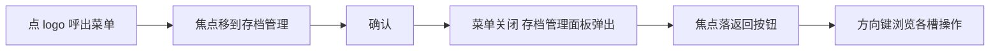

# 横版手柄「存档管理」二级页面 — 功能分析

## 概述

横版手柄页（`landscape_page.dart`）的菜单中「存档管理」(`MenuAction.saveManagement`) 当前在 `_selectMenuItem` 中**无处理**——点击后菜单关闭，无二级页弹出。codex 已用同模式实现了「切换布局」二级页（`LayoutSwitchOverlay`，d8b690cf）。本 RC 续做「存档管理」二级页 `SaveManagementOverlay`：一个浅色 picker-panel（443×282）浮在横版手柄之上，含返回按钮、快速存档区（1 槽）、手动存档区（2 槽，save/load/delete 操作），且为**有状态 demo**——删除真移除槽位、保存/读取有反馈。

### 架构约束识别

- **遵循 INV-1（Flutter Add-to-App 不变量）**：完全在 `flutter_logic/` 模块内，无跨层通信
- **不修改 architecture.md**：是 landscape 横版页的增量二级页，与 `LayoutSwitchOverlay` 同层同级，不引入新架构层
- **复用既有能力**：`FocusRing`、`FocusableActionDetector` 模式、`MenuAction` 枚举、横版手柄框架、`_dismissOverlays`/`_backToMenu` 状态机

## 一、交互链（用户平面）

### 场景 1：打开存档管理并浏览

**用户故事**：作为掌机玩家，我在横版游戏中想查看当前存档，以便决定读取哪个进度。

操作过程：
1. 游戏中点底部 logo 按钮 → 呼出横版菜单（`MenuOverlay`）
2. 方向键将焦点移到「存档管理」卡片 → 按 Enter/确认
3. 菜单消失，`SaveManagementOverlay` 弹出（蒙层 + 中央浅色面板）
4. 焦点自动落在面板左上「返回」按钮
5. 方向键下移 → 焦点进入快速存档区的「删除」按钮，再下 → 手动存档槽的操作按钮

### 场景 2：删除一个手动存档槽（有状态）

**用户故事**：作为玩家，我想删除某个不需要的手动存档，以便腾出槽位。

操作过程：
1. 焦点移到某手动槽的「删除」按钮 → 确认
2. 该槽位从列表移除，下方槽位上移收缩
3. 焦点重分配到相邻槽的同列按钮（避免焦点丢失）

### 场景 3：保存/读取手动存档（有状态）

**用户故事**：作为玩家，我想对某手动槽保存当前进度或读取已存进度，以便续玩。

操作过程：
1. 焦点移到某手动槽「保存」按钮 → 确认 → 该槽时间刷新为"刚刚"（反馈保存成功）
2. 或焦点移到「读取」按钮 → 确认 → 触发读取反馈（onLoad 回调 / 日志）

### 场景 4：返回菜单 / 退出

**用户故事**：作为玩家，我想从存档管理返回菜单选择其他功能，或直接退出回游戏。

- 点「返回」按钮 / 按 ESC → 回菜单（焦点回到「存档管理」项）
- 点底部 logo 按钮 → dismiss 全部 overlay 回底层手柄（沿用 `_dismissOverlays`）

## 二、逻辑树（系统平面）

### 事件流：打开存档管理

| 时刻 | 事件 | 处理 | 产生的新事件 |
|------|------|------|-------------|
| t1 | 菜单确认 `MenuAction.saveManagement` | `_selectMenuItem` 新增分支：`_menuOpen=false; _saveManagementOpen=true` | overlay rebuild |
| t2 | `SaveManagementOverlay` 首帧 | autofocus 落到返回按钮 | 焦点变更 |
| t3 | 返回按钮 / ESC | `onBack` → `_saveManagementOpen=false; _menuOpen=true` | 回到菜单 |
| t4 | logo 按钮 | `onDismiss` → `_menuOpen=false; _saveManagementOpen=false` | 回底层手柄 |

### 事件流：槽位操作（有状态）

| 时刻 | 事件 | 处理 | 产生的新事件 |
|------|------|------|-------------|
| d1 | 槽「删除」确认 | `onRemove(slot)` → `setState` 从 `_manualSlots` 移除 | 列表 rebuild + 焦点重分配 |
| d2 | 槽「保存」确认 | `onSave(slot)` → `setState` 更新 `slot.time = now` | 该槽时间文字刷新 |
| d3 | 槽「读取」确认 | `onLoad(slot)` → 上报回调（日志/无副作用） | — |

### 状态流转

| 实体 | 触发事件 | 前状态 | 后状态 |
|------|---------|--------|--------|
| `_saveManagementOpen` | saveManagement 菜单确认 | false | true |
| `_saveManagementOpen` | 返回 / ESC | true | false（且 `_menuOpen=true`）|
| `_saveManagementOpen` | logo dismiss | true | false（且 `_menuOpen=false`）|
| `_manualSlots` | 删除某槽 | [s1,s2,s3] | [s1,s3] |
| `slot.time` | 保存 | "2026-07-02 14:32" | 当前时刻 |
| 快存槽「最近快存」 | 删除 | 存在 | 清空态（占位"暂无快存"）|

> 异常/边界：手动槽全删后，手动区显示空态占位；快存删除后显示"暂无快存"。焦点丢失时回退到返回按钮。

## 三、功能编号与网络定位

### 本次新增节点

| 编号 | 功能节点 | 前缀含义 | 简介 |
|------|---------|---------|------|
| FF001 | SaveSlot 领域模型 + mock | 前端基础 | `SaveSlot`（title/time/thumb/kind）+ `SaveSlotKind`（quick/manual）+ mock 数据 |
| FB001 | SaveManagementOverlay 二级页 | 前端业务 | StatefulWidget：蒙层 + picker-panel(443×282) + 返回 + 两区布局 + 状态管理（增删保存读取）+ 焦点策略 |
| FB002 | SaveSlotCard 槽位卡片 | 前端业务 | 可复用子组件：缩略图 + 标题 + 时间 + 操作按钮（save/load/delete 可聚焦 + FocusRing）|
| FF002 | landscape 挂载接入 + 测试 | 前端基础 | `saveManagementOpen` 状态 + `_selectMenuItem` 分支 + overlay 渲染 + golden/行为测试 |

> 节点数 4（≤15），正常范围，无需拆分 RC。

### UI 功能稳定标识预清单

| 功能编号 | 稳定标识预清单 | 说明 |
|---------|--------------|------|
| FB001 | `save_mgmt.panel`、`save_mgmt.back_button`、`save_mgmt.scrollbar`、`save_mgmt.quick_section`、`save_mgmt.manual_section` | 面板容器与返回/滚动条/分区 |
| FB002 | `save_mgmt.slot.card`、`save_mgmt.slot.thumb`、`save_mgmt.slot.title`、`save_mgmt.slot.time`、`save_mgmt.slot.delete`、`save_mgmt.slot.save`、`save_mgmt.slot.load` | 槽位卡片内全部可交互元素 |

### 前置依赖

| 依赖节点 | 依赖方式 | 是否已有 |
|----------|---------|---------|
| `MenuAction.saveManagement` | 枚举值，挂载触发源 | ✅ 已有（menu_card.dart）|
| `FocusRing` | 焦点高亮 | ✅ 已有（view/layer/focus_ring.dart）|
| 横版手柄框架 + `_dismissOverlays`/`_backToMenu` 状态机 | overlay 挂载与互斥 | ✅ 已有（landscape_page.dart）|
| `LayoutSwitchOverlay` 模式 | 蒙层/返回/FocusableActionDetector 范式参照 | ✅ 已有 |

### 边界接口

| 接口/协议 | 定义方 | 消费方 | 敏感度 |
|-----------|--------|--------|--------|
| `SaveSlot` 模型 | FF001 | FB001/FB002 | 中（字段稳定后不变）|
| `onBack`/`onDismiss` 回调 | FB001 | landscape_page | 低（与 LayoutSwitchOverlay 同构）|
| `onRemove`/`onSave`/`onLoad` 回调 | FB002 | FB001 状态层 | 中（有状态 demo 的反馈通道）|

## 四、结论

- **开发顺序**：FF001（模型+mock）→ FB002（槽卡片）→ FB001（overlay 容器+状态+焦点）→ FF002（挂载+测试）。图标资源（ic_delete/ic_back）在 FB002 前置下载。
- **复杂度集中**：
  1. **有状态删除后的焦点重分配**——槽位移除后焦点不能丢，需回退到相邻槽同列按钮或返回按钮
  2. **径向渐变面板背景**的 Flutter 还原（RadialGradient 配置）
  3. **快存区/手动区两套操作按钮布局**的差异（快存只删除；手动有 save/load/delete）
- **暂不实现**：竖版存档管理；真实存档文件读写/缩略图抓取（用 mock 数据 + 占位缩略图）；手动槽滚动（当前固定 2~3 个，滚动条作视觉占位，预留 Scrollable 扩展点）
- **测试策略**（对齐 `landscape_golden_test.dart` 既有范式）：
  - golden：`landscape_save_management.png`（初始态，1 快存 + 2 手动）
  - 行为：打开/返回回菜单/logo dismiss；删除真移除（槽数减少）；保存刷新时间；焦点在返回↔各操作按钮间导航；FocusRing 显现
