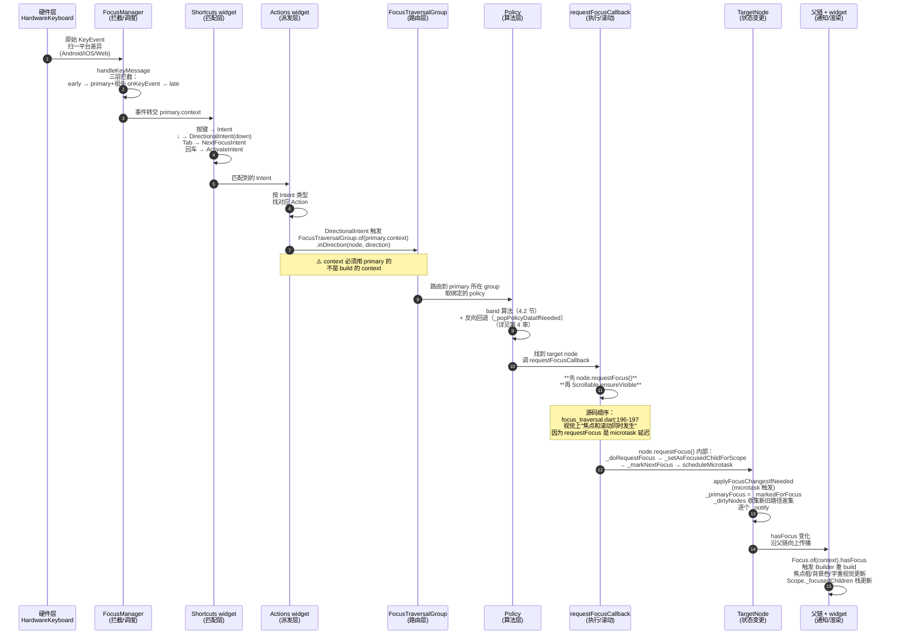
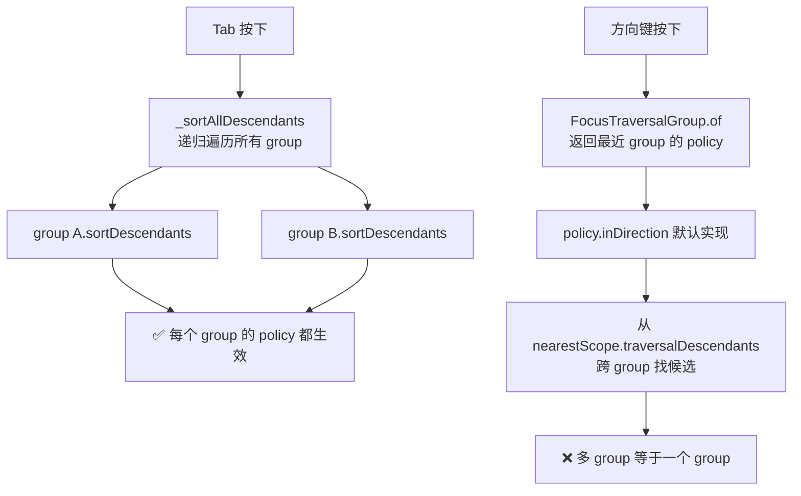

# Flutter 焦点系统原理

> 这篇文档不讲 API，讲**系统怎么运转**。
>
> 读完后能回答：用户按一下方向键，Flutter 内部走了多少步、每个部件在哪个时刻介入、为什么有时候焦点会跳错地方、为什么有时候不滚动、为什么切走再回来焦点还在。

---

## 0. 这个系统要解决的核心难题

焦点系统作为整体，要同时对付四个相互拉扯的难题。**这四个难题决定了整套架构**——理解了它们，后面所有设计都是顺推。

| 难题 | 表现 | 系统怎么应对 |
|------|------|------------|
| **输入多样** | 键盘 Tab / 方向键 / 遥控器 / 手柄 / 触屏，事件语义完全不同 | 统一入口 `FocusManager.handleKeyMessage`，把所有输入归一成「Intent」再处理 |
| **树嵌套深** | 页面套 Dialog 套 Drawer 套子页，每层都可能有自己的焦点域 | 引入 `FocusScopeNode` 作为可嵌套的「子树根」，每层独立维护焦点记忆 |
| **状态一致** | 焦点只有一个，但视觉上几十个组件都想感知"我是否有焦点" | 五个布尔分层（`canRequestFocus`/`hasFocus`/`hasPrimaryFocus`/`skipTraversal`/`descendantsAreFocusable`）+ `_dirtyNodes` 通知机制（见 3.2 节） |
| **性能敏感** | 焦点切换是同步热路径，不能每次按键遍历整棵树 | `nearestScope` 切片 + group 委托 + policy 局部算法 |

记住这张表，下面每一章都是在解释「这个部件为什么必须存在」。

---

## 1. 启动期：焦点树是怎么建起来的

Widget 树和焦点树是**两棵独立的树**。Widget 树由 `build()` 堆出来；焦点树由特定 widget 在 `mount` 时**主动挂载**节点。

### 1.1 三种会"种"节点的 widget

整个 Flutter 只有三种 widget 会在焦点树上种节点：

```
Focus                → 种一个 FocusNode（叶子）
FocusScope           → 种一个 FocusScopeNode（子树根）
FocusTraversalGroup  → 种一个 _FocusTraversalGroupNode（策略边界）
```

其他几百个 widget（`TextField`、`TextButton`、`Checkbox`...）内部都是包了 `Focus`，不直接种节点。

### 1.2 mount 时的协作

当 `Focus` widget mount，发生这些事：

```
1. createState → State.initState
2. FocusNode 构造（不带父子关系，是个孤儿）
3. didChangeDependencies（不是 build）：
   → _focusAttachment = FocusScope.of(context).attach(_focusNode)
   → FocusScope.of(context) 沿 Element 树向上找最近 FocusScopeNode 祖先
   → attach 把自己的 FocusNode 挂到那个 scope
4. 如果 autofocus=true，调用 FocusScopeNode.autofocus(_focusNode)
   → 加入 FocusManager._pendingAutofocuses 队列待 resolve
```

关键点：**子节点靠 BuildContext 在 didChangeDependencies 里向上查找确定父 scope，不是父节点主动认领，也不是在 build 里挂载**。这就是为什么 `Focus(focusNode: myNode, child: ...)` 挂在哪里，焦点就在哪个域里——挂载位置即归属。

### 1.3 多个 autofocus 抢焦点，谁赢？

页面里写了 5 个 `Focus(autofocus: true)`，谁拿到？

答案：**按 `_pendingAutofocuses` 添加顺序遍历**（即 widget didChangeDependencies 执行顺序，通常对应 Element 树深度优先），第一个执行成功的 autofocus 让所在 scope 的 `focusedChild` 非 null，**后续同一 scope 的 autofocus 请求被丢弃**（`focus_manager.dart:1840-1843` + `_Autofocus.applyIfValid` 检查 `scope.focusedChild == null`）。

这个规则埋雷的典型场景：把整个页面外层套了个 `Focus(autofocus: true)`，又把内部某个按钮设了 `autofocus: true`。外层先 didChangeDependencies，先赢，内部按钮永远不会自动聚焦。**`autofocus` 是个"请求"，不是"保证"**。

---

## 2. 事件流：一个按键的完整生命周期

这是核心章节。**理解焦点系统怎么运转，本质上就是理解一个按键从硬件到焦点变化的完整路径**。

### 2.1 完整路径（11 步）

用户按下方向键 `↓`，假设当前焦点在"按钮 A"，目标跳到"按钮 B"。系统走过的路径：



**11 步按职责分层**：

| 步 | 层 | 关键决策 |
|----|----|---------|
| 1 | 硬件 | 把平台事件归一成 Flutter KeyEvent |
| 2 | 拦截 | 决定是否交给焦点系统（early handler → primary 链 → late handler 三层） |
| 3 | 匹配 | 按键 → Intent（语义化抽象） |
| 4 | 派发 | Intent → Action（解耦按键和行为） |
| 5 | 路由 | `of(primary.context)` 决定用哪个 policy |
| 6 | 策略 | group 把请求转给绑定 policy |
| 7 | 算法 | band 几何过滤 + 最近邻选目标（+ 反向回退） |
| 8 | 执行 | 走 `requestFocusCallback`，**不裸 requestFocus** |
| 9 | 切焦点+滚动 | `requestFocusCallback` 内：**先 `node.requestFocus()` 再 `Scrollable.ensureVisible`** |
| 10 | 状态 | `_markNextFocus` → microtask → `applyFocusChangesIfNeeded`，更新全局 `primaryFocus` |
| 11 | 通知 | `_dirtyNodes` 收集差集 → `_notify` → widget 重渲染 |

### 2.2 这套设计的几个关键决策

**为什么事件要先经过 Shortcuts 再到 Actions，而不是直接 if-else 派发？**

因为**语义解耦**。开发者写 `Shortcuts` 时只关心"按键 → 意图"，写 `Actions` 时只关心"意图 → 行为"。同一个 `ActivateIntent` 可以由回车、空格、手柄 A 键、遥控器确认键触发，业务代码不关心来源。

**为什么 `FocusTraversalGroup.of(context)` 用的是 primaryFocus 的 context，不是 build 的 context？**

因为焦点策略是**跟着焦点走的，不是跟着事件源走的**。如果当前焦点在一个嵌套 group 里，`FocusTraversalGroup.of(primary.context)` 拿到的是**最近的** group 的 policy，不是外层。这是常见的 bug 源头：写代码的人用 `Builder` 的 context 拿 policy，结果拿到的是外层默认 policy，焦点策略失效。

**为什么 `requestFocusCallback` 里要先 `requestFocus()` 再 `ensureVisible`？看源码顺序是反直觉的。**

源码 `defaultTraversalRequestFocusCallback`（`focus_traversal.dart:189-204`）的实际顺序：

```dart
node.requestFocus();                    // 行 196：先切焦点
Scrollable.ensureVisible(node.context!); // 行 197：再滚动
```

看起来"切完焦点才滚动"会有视觉跳变，实际不会，因为 **`requestFocus()` 本身是异步的**——它只是 `_markNextFocus(this)` + `scheduleMicrotask(applyFocusChangesIfNeeded)`（见第 3 章），真正的状态变更和 listener 通知在 microtask 里。所以同步执行的 `ensureVisible` 会在 microtask 触发之前算好滚动偏移，最终在同一事件循环末尾，焦点变更通知和滚动调整一起生效，**视觉上是"焦点和滚动同时发生"**。

直接调 `node.requestFocus()` 而不走 `requestFocusCallback` 的问题，**不是顺序错**，而是**完全跳过了 `ensureVisible`**——没有滚动联动。这就是"焦点切了但不滚动"的根因。

---

## 3. 状态机：requestFocus 内部发生了什么

`FocusNode.requestFocus()` 看起来是同步的，实际上**走的是 microtask 异步两阶段**。

### 3.1 真实的调用链

源码（`focus_manager.dart`）的真实链路：

```
Phase 1: 请求登记（同步执行）
  node.requestFocus()
    → _doRequestFocus({findFirstFocus: true})        // 行 1129
      → _setAsFocusedChildForScope()                 // 行 1141
        遍历所有 FocusScopeNode 祖先，对每个做 LRU push
      → _markNextFocus(this)                          // 行 1147 → 1786
        FocusManager._markedForFocus = node
        → _markNeedsUpdate()                          // 行 1793 → 1805
          → scheduleMicrotask(applyFocusChangesIfNeeded)  // 行 1811

Phase 2: resolve（microtask 触发，当前事件循环末尾）
  applyFocusChangesIfNeeded()                          // 行 1831
    先处理 _pendingAutofocuses 队列                    // 行 1840-1843
    if (_markedForFocus != _primaryFocus):
      计算新旧路径差集：                              // 行 1854-1859
        nextPath.difference(previousPath) → 新增的 hasFocus 节点
        previousPath.difference(nextPath) → 失去 hasFocus 的节点
        全部加入 _dirtyNodes
      _primaryFocus = _markedForFocus                 // 行 1861
    对 _dirtyNodes 里每个节点调 _notify()              // 行 1874-1876
      → 触发 listener → setState → 重渲染
```

**为什么用 microtask 而不是同步？**

两个原因：
1. **批量处理**：同一帧里多次 `requestFocus()` 调用，microtask 只在末尾 resolve 一次，最后一次 `_markedForFocus` 生效
2. **避免 build 期通知**：listener 可能触发 `setState`，在 build 期同步触发会报错；microtask 调度保证通知发生在 build 之外

**注意"下一帧"是误传**——是 microtask（当前事件循环末尾），不是 `SchedulerBinding.scheduleFrameCallback`（下一帧）。但测试时 `WidgetTester.pump()` 会先 drain microtask 队列再执行帧回调，所以 `pump()` 一次确实够用，只是原因不是"等下一帧"。

### 3.2 五个布尔怎么算（不止三个）

| 布尔 | 含义 | 实现 |
|------|------|------|
| `canRequestFocus` | 能不能被聚焦 | 字段，开发者设置（`enabled: false` 时为 false） |
| `hasPrimaryFocus` | 是不是当前唯一焦点 | **getter**，实时查询 `_manager?.primaryFocus == this`（行 772） |
| `hasFocus` | 自己或子树里有没有焦点 | **getter**，`hasPrimaryFocus \|\| primaryFocus.ancestors.contains(this)`（行 756） |
| `skipTraversal` | 能聚焦但不参与遍历 | 字段，`traversalDescendants` 会过滤掉（行 715） |
| `descendantsAreFocusable` | 整个子树能不能聚焦 | 字段，false 时子树全部禁用（影响 `traversalDescendants`，行 712） |

**几个反直觉的点**：

- `hasPrimaryFocus` **不是字段**，是 getter。源码里没有 `_hasPrimaryFocus` 字段在 requestFocus 时被赋值。它在 `_primaryFocus` 变化时**自然反映**。
- `hasFocus` **不是递归 children 计算**（避免 O(tree) 性能），而是查 `primaryFocus.ancestors` 是否包含自己——**O(ancestors)**，因为 ancestors 通常只有几层。
- `skipTraversal` 和 `canRequestFocus` 的区别：`skipTraversal=true` 的节点能被 `requestFocus()` 聚焦（比如程序化聚焦），但不会被 Tab/方向键遍历算法到达；`canRequestFocus=false` 则完全不可聚焦。
- `descendantsAreFocusable` 是 FocusTraversalGroup widget 的参数（`focus_traversal.dart:1707`），实战中常用于禁用整块区域的焦点。

`hasFocus` 变化时，由 Phase 2 的 `_dirtyNodes` 集合触发 `_notify`——这是基于**新旧路径差集**计算的，不是父链递归。

### 3.3 _focusedChildren 栈：FocusScope 的"记忆"

`FocusScopeNode` 比普通 `FocusNode` 多一个字段（`focus_manager.dart:1311`）：

```dart
final List<FocusNode> _focusedChildren = <FocusNode>[];
FocusNode? get focusedChild =>
    _focusedChildren.isEmpty ? null : _focusedChildren.last;
```

**何时 push**：`_setAsFocusedChildForScope`（行 1173-1185）在 `requestFocus` 路径里调用。它**遍历所有 FocusScopeNode 祖先**（不是只操作最近 scope），对每个祖先做：先 remove（如果存在）再 add 到末尾（LRU 语义）。

```dart
void _setAsFocusedChildForScope() {
  FocusNode scopeFocus = this;
  for (final FocusScopeNode ancestor in ancestors.whereType<FocusScopeNode>()) {
    ancestor._focusedChildren.remove(scopeFocus);
    ancestor._focusedChildren.add(scopeFocus);
    scopeFocus = ancestor;  // 关键：上一层用这一层 scope 作为 focused child
  }
}
```

**何时 pop**：child 被 `dispose` 时移除（行 916/927/930）。**注意：child 失焦不 pop**——栈记录的是"最近聚焦过的"，不是"当前聚焦的"。

**何时用**：`scope.requestFocus()` 不带参数调用时，恢复 `focusedChild`。这就是"切走再回来焦点还在"的实现。

**为什么用栈而不是单字段？** 因为 scope 嵌套。`_setAsFocusedChildForScope` 的关键设计：处理完最近 scope 后，把 **scope 自己**作为上一层 scope 的 focused child 加入——这样外层 scope 记住的是"哪个子 scope"，子 scope 记住"哪个叶子节点"，多层记忆叠加，才能在多层嵌套场景精确恢复。

---

## 4. 策略：policy 怎么决定下一个焦点

`FocusTraversalPolicy.inDirection(currentNode, direction)` 是焦点系统的"大脑"。它拿到当前节点和方向，要算出下一个节点。

### 4.1 两套完全独立的算法

**容易搞错的关键点**：Tab 导航和方向键导航是**两套算法**，不能混用。

| 维度 | Tab（next/previous） | 方向键（inDirection） |
|------|---------------------|---------------------|
| 入口方法 | `findNextFocus` / `findFirstFocus` | `inDirection` |
| 排序依据 | `FocusOrder`（数值/命名） | 几何 `rect` |
| 算法 | `sortDescendants` 全排序 | band 算法局部过滤 |
| 适用场景 | 表单（按填表顺序）、键盘 Tab | TV / 掌机 / 车机方向键 |

**这两套算法互不知道对方**。一个 policy 可以同时支持两者，但同一个按键只能走其中一条路径。`ReadingOrderTraversalPolicy`（默认 policy）同时实现了两套。

### 4.2 方向键的 band 算法

`inDirection` 默认实现的核心思路（`focus_traversal.dart:975-1074`）：

```
输入：currentNode，direction（实际几何基准是 focusedChild.rect，不是 currentNode.rect）
输出：下一个 node

Step 0: focusedChild 为空时的兜底
  如果 nearestScope.focusedChild == null：
    → findFirstFocusInDirection（行 713-739）
    → 按方向取"最极端"的节点（如 ↓ 取 Y 最小的）
    → 直接 requestFocusCallback，return

Step 0.5: 反向回退检查（_popPolicyDataIfNeeded，行 875-944）
  如果上次按了 ↓ 现在按 ↑（反向），算法会先回退到上次的起点，
  而不是重新计算几何最近邻——这是 hysteresis 防抖
  → 如果命中回退，直接 return true

Step 1: 收集候选
  nearestScope.traversalDescendants（行 711）
  → 整个 scope 下所有 canRequestFocus && !skipTraversal 的节点
  → ⚠️ 完全无视中间的 FocusTraversalGroup 嵌套

Step 2: 几何过滤（band）
  band 基于 focusedChild.rect（不是 currentNode.rect！）：
    • up/down   → band = Rect.fromLTRB(focusedChild.rect.left, -∞, focusedChild.rect.right, +∞)
    • left/right → band = Rect.fromLTRB(-∞, focusedChild.rect.top, +∞, focusedChild.rect.bottom)

  保留候选：与 focusedChild 在主轴上是"前方"，且与 band 相交

Step 3: 优先 inBand
  在频带内的候选里，按主轴方向距离选最近

Step 4: 兜底 out-of-band
  如果 inBand 空，从所有"前方"候选里按几何最近选

Step 5: 成功后 _pushPolicyData
  记录 (direction, scope, focusedChild) 到 _policyData，供下次反向回退用
```

**为什么有 band 过滤**？因为方向键的语义是"上下左右"，不是"按列表顺序"。下方按键应该跳到**正下方**的按钮，而不是列表里下一个但位置在右上角的按钮。band 过滤就是"找视觉上下方"的几何近似。

**band 过滤的副作用**：多列布局里，左列按到底再按 down，可能因为左列最后一个的 band 不与右列相交，**不会**自动跳到右列。这是默认行为。如果你想做"左列到尾跳右列"，必须自定义 policy——这就是为什么很多 TV/车机应用要写自定义 policy。

**反向回退（Step 0.5）的实战影响**：用户按 ↓ 跳到节点 X，再按 ↑，**不会**回到几何最近的上方节点，而是回到 ↓ 之前的起点。如果中间有动画或布局变化，这个回退可能"跳到意想不到的地方"——这是文档第 7 章诊断表里"方向键焦点跳到完全不相关的位置"的真正原因之一。

### 4.3 Tab 的 sortDescendants

`findNextFocus` 调 `sortDescendants`，按 `FocusOrder` 排序：

- `NumericFocusOrder(order)` — 数值，小的在前
- `NamedFocusOrder(name)` — 字符串字典序
- `LexicalFocusOrder()` — 默认，按阅读顺序（左上到右下，深度优先）

排完序后找 currentNode 的位置，下一个就是 next。

### 4.4 group 嵌套：三套机制，三种态度

`FocusTraversalGroup` 嵌套时，**不同环节对"边界"的态度完全不同**。这是最容易踩坑的地方。

#### 4.4.1 policy 路由（`FocusTraversalGroup.of`）— 最近原则

```dart
// focus_traversal.dart:1760
static _FocusTraversalGroupNode? _getGroupNode(FocusNode node) {
  while (node.parent != null) {
    if (node is _FocusTraversalGroupNode) return node;
    node = node.parent!;  // 沿父链向上
  }
  return null;
}
```

从当前 node 沿 parent 链向上，**遇到第一个 group 节点就返回它的 policy**。嵌套时拿到的是最近的，不是最外层。这层是 group 感知的。

#### 4.4.2 方向键算法（默认 inDirection）— **完全无视 group 边界**

最反直觉的地方。看默认实现（`focus_traversal.dart:1004`）：

```dart
Iterable<FocusNode> eligibleNodes = _sortAndFilterVertically(
    direction, focusedChild.rect,
    nearestScope.traversalDescendants);  // ← 注意候选来源
```

`nearestScope.traversalDescendants`（`focus_manager.dart:711`）只过滤 `skipTraversal` 和 `canRequestFocus`，**不管中间有多少 FocusTraversalGroup 嵌套**。

**含义**：`GroupA(左列) + GroupB(右列)` 嵌套结构，从 GroupA 调 inDirection，**候选包含 GroupB 里所有节点**。group 边界对方向键算法**形同虚设**。

> **这正是「左列按到底跳右列」问题的根因**。要让方向键隔离，**唯一办法是自定义 policy 重写 `inDirection`**，自己用 `nearestScope.rect` 做 X 轴列聚类过滤（playground R002-FIX001 的做法）。
>
> ⚠️ **不要试图用 `TraversalEdgeBehavior` 隔离方向键**——它只对 Tab 的 `_moveFocus` 生效（见 4.5 节），对 `inDirection` **零影响**。这是常见误用，照做会发现根本不生效。

#### 4.4.3 Tab 算法（`_sortAllDescendants`）— 真正 group 感知

`focus_traversal.dart:429-495` 的 `_findGroups` + `visitGroups` 做了精巧的嵌套处理：

```dart
// 1. 每个节点按所属 group 分组
groups[groupNode]!.members.add(node);

// 2. group 节点本身被加到父 group 的成员列表
if (node == groupNode) {
  final parentGroup = _getGroupNode(groupNode.parent!);
  groups[parentGroup]!.members.add(groupNode);  // 作为占位
}

// 3. 每个 group 用自己的 policy 排序自己的成员
sortedMembers = groups[key]!.policy.sortDescendants(members, currentNode);

// 4. visitGroups 递归：group 节点 → 用内层已排序成员替换
void visitGroups(info) {
  for (final node in info.members) {
    if (groups.containsKey(node)) {
      visitGroups(groups[node]!);  // 展开
    } else {
      sortedDescendants.add(node);
    }
  }
}
```

**Tab 算法的行为**：
- 每个 group **用自己的 policy** 排序自己的成员（嵌套 group 可以用不同 policy）
- group 作为**整体单元**参与父 group 的排序（整个 group 在父层是一个"块"）
- 最终展开成扁平列表

#### 4.4.4 三层对比

| 层 | API | 对 group 嵌套的态度 | 设计意图 |
|----|-----|--------------------|---------|
| policy 路由 | `FocusTraversalGroup.of` | **最近原则** | 焦点策略跟着焦点走 |
| 方向键 | `policy.inDirection` 默认实现 | **完全无视** | 几何就近优先于语义边界 |
| Tab | `policy.next/previous` → `_sortAllDescendants` | **真正感知** | 阅读顺序需要层级组织 |

#### 4.4.5 实战启示

- 想用 `FocusTraversalGroup` 隔离方向键？**做不到**，必须自定义 policy
- 想让某区域有独立的 Tab 顺序？**可以**，挂一个 group + 自己的 policy
- 想用 `TraversalEdgeBehavior` 隔离方向键？**做不到**，它只影响 Tab（见 4.5 节）
- 嵌套 group 的实际价值：**只在 Tab 导航生效**；方向键场景下，多个 group 等于一个

#### 4.4.6 多 group 多 policy 实战：能给每个 group 定制自己的策略吗？

**结论：Tab 可以，方向键默认不行，方向键需要 override `inDirection` 才行。**

回到 4.4.4 的三层对比表，落到"能否给每个 group 定制自己的 policy"这件事上：

| 场景 | 挂独立 policy 是否生效 | 原因 |
|------|---------------------|------|
| **Tab 导航** | ✅ 完全生效 | `_sortAllDescendants`（`focus_traversal.dart:465-527`）通过 `_findGroups`（429-461）+ `visitGroups` 递归**逐层**调用每层 group 自己的 `sortDescendants`。每个 group 的 policy 都被真实调用 |
| **方向键（默认 `inDirection`）** | ❌ 不生效 | 默认实现（`focus_traversal.dart:975-1074`）从 `currentNode.nearestScope.traversalDescendants` 取候选，**完全不读 group 边界**。`FocusTraversalGroup.of` 虽然按最近原则路由到本 group 的 policy，但这个 policy 的 `inDirection` 默认实现照样跨 group 找节点 |
| **方向键（override `inDirection`）** | ✅ 生效 | 自己写的 `inDirection` 可以做任何事：列聚类、限定本 scope、自定义几何排序…… |

**为什么 Tab 能生效、方向键不能？**

Tab 的递归结构（`_findGroups` + `visitGroups`）天然按 group 层级组织，每层 policy 都被调用一次；方向键的默认实现只认 `nearestScope`，group 在它眼里是透明的。



**代码示例：让左导航上下键只在本列移动**

```dart
// 挂在左导航 group 上
class ColumnIsolatedPolicy extends ReadingOrderTraversalPolicy {
  @override
  bool inDirection(FocusNode currentNode, TraversalDirection direction) {
    if (direction == TraversalDirection.up ||
        direction == TraversalDirection.down) {
      // 自己做列聚类：只在 X 轴重叠的候选中找
      // nearestScope 返回 FocusScopeNode?，方向键入口已保证非空，用 !
      final scope = currentNode.nearestScope!;
      final candidates = scope.traversalDescendants.where((node) =>
        node.canRequestFocus &&
        node.rect.left < currentNode.rect.right &&
        node.rect.right > currentNode.rect.left
      );
      // ... 几何排序找最近的，找到就 requestFocusCallback + return true
      // 找不到就 return false（停留，不跨列）
    }
    // 水平方向委托 super（或自己处理跨区域逻辑）
    return super.inDirection(currentNode, direction);
  }
}
```

**避坑提示**：

1. **别指望 `FocusTraversalGroup` 隔离方向键** —— 这是 4.4.5 第一条的重申。group 只隔离 Tab，不隔离方向键
2. **override `inDirection` 时慎用 `super`** —— 默认实现的 band 算法会跨列找节点，列聚类后无候选时**不要**回退 super，否则隔离失效（见 playground R002-FIX001 的教训）
3. **`requestFocusCallback` 优于 `node.requestFocus()`** —— 自定义 policy 里聚焦节点用 `requestFocusCallback`（拿到 `Scrollable.ensureVisible` 链路），裸 `requestFocus` 不会触发滚动（见 5.2 节）
4. **每个 group 可以挂不同 policy** —— 左导航挂 `ColumnIsolatedPolicy`，右内容区挂 `ReadingOrderTraversalPolicy`，Tab 和 override 后的方向键都会按各自的 policy 工作

### 4.5 Tab 边界行为：TraversalEdgeBehavior

`TraversalEdgeBehavior`（`focus_traversal.dart:107-139`）是 `FocusScopeNode` 的字段（`focus_manager.dart:1275/1290`），控制 **Tab 导航到达 scope 边界时的行为**。**只在 `_moveFocus`（Tab 的 next/previous）里被检查，对方向键 `inDirection` 零影响**。

三种取值：

| 取值 | Tab 到达边界时 |
|------|---------------|
| `closedLoop`（默认） | 在 scope 内部循环（最后一个 → 第一个） |
| `parentScope` | 跳到父 scope 的下一个节点 |
| `leaveFlutterView` | 跳出 Flutter view，交还宿主（Web/桌面） |

源码依据：`focus_traversal.dart:562-614` 的 `_moveFocus` 根据 `nearestScope.traversalEdgeBehavior` 分支处理。

**典型用法**：
- TV/车机应用整个屏幕锁在自己内部 → `closedLoop`
- 嵌套子页要让 Tab 跨出去 → `parentScope`
- Web 应用想让 Tab 走出 Flutter 容器到浏览器地址栏 → `leaveFlutterView`

**注意**：`FocusScopeNode` 还有独立的 `directionalTraversalEdgeBehavior` 字段，看起来像是给方向键用的边界控制。但**默认 `inDirection` 实现里根本没有引用它**——只有自定义 policy 重写 `inDirection` 时才可能用到。这是个"留了接口但默认实现没消费"的设计。

---

## 5. 渲染期：焦点变化后视觉怎么更新

焦点状态变更后，要变成用户看得见的变化。

### 5.1 widget 怎么感知 hasFocus

最干净的方式：

```dart
Focus(
  focusNode: myNode,
  child: Builder(
    builder: (context) {
      final focused = Focus.of(context).hasFocus;
      return AnimatedContainer(
        decoration: BoxDecoration(
          border: focused ? Border.all(color: Colors.blue) : null,
        ),
        // ...
      );
    },
  ),
)
```

`Focus.of(context)` 注册一个依赖，`hasFocus` 变化时这个 `Builder` 会重新 build。注意 `Builder` 必须在 `Focus` 的 child 里——这样 `Focus.of` 才能找到 myNode。如果 Builder 在 Focus 外面，`Focus.of` 找到的是上层其他节点的 hasFocus，状态对不上。

**反模式**：用 `myNode.addListener(() { setState(() {}); })` 手动监听。这能工作，但容易漏 dispose、容易和 widget 生命周期错位、容易在多个 widget 共享 node 时状态不一致。**永远优先用 `Focus.of(context).hasFocus`**。

### 5.2 ensureVisible 滚动链路

`defaultTraversalRequestFocusCallback`（`focus_traversal.dart:189-204`）的实际执行：

```
defaultTraversalRequestFocusCallback(node):
  node.requestFocus();                          // 行 196：先切焦点（实际状态变更在 microtask）
  Scrollable.ensureVisible(node.context!,       // 行 197：再算滚动
      alignment: alignment ?? 1,
      alignmentPolicy: ...);
    → 找 node.context 的 ScrollableState 祖先
    → 计算目标 rect 相对 viewport 的位置
    → 调整 scrollOffset 让目标可见
```

**为什么有时候不滚？** 几个典型原因：

1. **直接调 `node.requestFocus()` 而非走 policy/callback**：完全跳过了 `ensureVisible`——这才是根因（不是顺序问题）
2. **目标 node 的 BuildContext 没有 Scrollable 祖先**：`ensureVisible` 找不到可滚容器
3. **目标 node 还没 mount/layout**：rect 是 `Rect.zero`，几何计算失败
4. **alignment 参数不合适**：默认 `alignment: 1`（结尾对齐），底部 home indicator 区域会被裁，常见修法是显式传 `alignment: 0.5`
5. **走 policy 但用了非默认 `requestFocusCallback`**：自定义 callback 可能没调 `ensureVisible`

### 5.3 FocusHighlightMode：触屏 vs 键盘的分流

焦点框是给键盘/遥控器用户看的——他们看不到光标。但触屏用户**不应该**看到焦点框，否则界面会很乱。

Flutter 用 `FocusHighlightMode` 全局切换：

```
触屏 first down 事件 → FocusHighlightMode.touch
键盘事件          → FocusHighlightMode.traditional
```

`Material` 默认会根据这个 mode 决定要不要画 focus ring。所以同一个 `TextButton`，触屏点击不显示焦点框，方向键导航会显示——**这是系统行为，不是 bug**。

自定义组件想跟随这个行为：

```dart
final FocusHighlightMode mode = FocusManager.instance.highlightMode;
final showFocusRing = mode == FocusHighlightMode.traditional;
```

---

## 6. 全貌：三棵树怎么协作

第 2 章看了**时序**（一个按键的生命周期），这一章看**结构**——Flutter 维护着三棵树，焦点系统是其中之一，三棵树通过引用协作。

```mermaid
flowchart LR
    subgraph WT[Widget Tree<br/>开发者写的 build]
        W1[MaterialApp]
        W2[PageView]
        W3[FocusTraversalGroup]
        W4[FocusScope]
        W5[Focus]
        W6[FocusTraversalGroup]
        W7[Focus]
        W1 --> W2 --> W3 --> W4 --> W5
        W4 --> W6 --> W7
    end

    subgraph FT[Focus Tree<br/>独立维护]
        N1[FocusManager.rootScope<br/>系统创建]
        N2[FocusScopeNode<br/>Page]
        N3[_FocusTraversalGroupNode]
        N4[FocusScopeNode<br/>区域A]
        N5[FocusNode 叶子]
        N6[_FocusTraversalGroupNode]
        N7[FocusNode 叶子]
        N1 --> N2 --> N3 --> N4 --> N5
        N4 --> N6 --> N7
    end

    subgraph ET[Element Tree<br/>BuildContext]
        E1[BuildContext]
        E2[BuildContext]
        E3[BuildContext]
    end

    WT -.mount 时挂载.-> FT
    FT -.node.context 反向引用.-> ET
    ET -.Focus.of 查找祖先.-> FT

    classDef tree fill:#fff,stroke:#333,stroke-width:2px
    classDef link stroke-dasharray: 5 5
```

**三棵树的职责**：

| 树 | 谁建的 | 内容 | 生命周期 |
|----|--------|------|---------|
| Widget Tree | 开发者 `build()` | 不可变描述 | 每次 rebuild 重建 |
| Focus Tree | 三种 widget 在 mount 时 | `FocusNode` / `FocusScopeNode` / `_FocusTraversalGroupNode` | 跨 rebuild 保留（保存在 State 里） |
| Element Tree | Flutter 框架 | BuildContext | 跟 Widget 1:1，diff 时迁移 |

**为什么焦点树要独立？**

Widget 树每次 rebuild 都会重建，如果焦点状态存在 widget 上，每次重建焦点都丢。所以焦点树**独立维护**，通过 `FocusNode.context` 反向引用 Element Tree——这样：
- Widget rebuild 不影响焦点状态
- FocusNode 能拿到 BuildContext 去查 `Scrollable`、`Shortcuts` 等祖先
- 焦点切换通过 BuildContext 找到 widget，触发 rebuild

**整条链路的几个不变量**：

1. `primaryFocus` 全局只有一个节点
2. `hasFocus` 是 getter，查 `primaryFocus.ancestors.contains(this)`，不是递归状态
3. `_focusedChildren` 栈只在 scope 节点上存在，叶子节点没有
4. 策略（policy）和记忆（scope）是分离的——policy 算"下一个是谁"，scope 记"上次是谁"
5. 焦点树独立于 widget 树，rebuild 不影响焦点状态

---

## 7. 常见症状的诊断速查

把原理落到实战。遇到下面这些症状，从对应的环节排查：

| 症状 | 排查环节 | 典型原因 |
|------|---------|---------|
| 方向键焦点跳到完全不相关的位置 | 第 4.2 节 Step 0.5 反向回退 | `_popPolicyDataIfNeeded` 命中 hysteresis 回退，回到上次起点而非几何最近 |
| 方向键跨过 group 边界 / 嵌套 group 方向键跨边界 | 第 4.4.2 节 | 默认 inDirection 无视 group；必须自定义 policy |
| 嵌套 group Tab 顺序错乱 | 第 4.4.3 节 Tab 算法 | 内层 group 用了不合适的 policy；调整 `FocusOrder` 或换 policy |
| 左列按到底不跳右列 | 第 4.2 节 band 副作用 | 默认行为；需自定义 policy 调整 band 或几何 |
| 焦点切换了但不滚动 | 第 5.2 节 ensureVisible | 直接调 `node.requestFocus()` 没走 callback；或目标无 Scrollable 祖先；或 alignment 不当 |
| 切走再回来焦点不在了 | 第 3.3 节 `_focusedChildren` | scope 被重建、node 被 dispose，栈丢失 |
| `autofocus` 不生效 | 第 1.3 节 autofocus 裁决 | 外层有 `Focus(autofocus:true)` didChangeDependencies 先执行抢先 |
| Tab 跨出本 scope / 不跨出 | 第 4.5 节 `TraversalEdgeBehavior` | 默认 `closedLoop`，改 `parentScope` 跨出 |
| `hasFocus` 不更新 | 第 3.2 节五个布尔 | 用了手动 listener 而非 `Focus.of(context)`；或 context 在 Focus 外 |
| 自定义 policy 不生效 | 第 4.4.1 节 group 路由 | `FocusTraversalGroup.of(context)` 的 context 不在目标 group 内 |
| 触屏看到不该有的焦点框 | 第 5.3 节 highlight mode | 自定义组件没跟随 `FocusHighlightMode` |

---

## 附录：源码索引（Flutter 3.27.x）

| 主题 | 文件:行号 |
|------|----------|
| FocusNode 定义 | `widgets/focus_manager.dart:437` |
| FocusScopeNode class | `widgets/focus_manager.dart:1261` |
| `_focusedChildren` 字段 | `widgets/focus_manager.dart:1311` |
| FocusManager 主入口 | `widgets/focus_manager.dart:1524` |
| `_doRequestFocus`（requestFocus 链路） | `widgets/focus_manager.dart:1129` |
| `_setAsFocusedChildForScope`（_focusedChildren push） | `widgets/focus_manager.dart:1173` |
| `_markNextFocus` + `_markNeedsUpdate` | `widgets/focus_manager.dart:1786, 1805` |
| `applyFocusChangesIfNeeded`（microtask resolve） | `widgets/focus_manager.dart:1831` |
| `hasFocus` getter 实现 | `widgets/focus_manager.dart:756` |
| `hasPrimaryFocus` getter 实现 | `widgets/focus_manager.dart:772` |
| `traversalDescendants` getter | `widgets/focus_manager.dart:711` |
| `handleKeyMessage` 事件拦截（三层） | `widgets/focus_manager.dart:2069` |
| `handlePointerEvent` 触屏分流 | `widgets/focus_manager.dart:2050` |
| FocusTraversalPolicy 抽象 | `widgets/focus_traversal.dart:168` |
| `defaultTraversalRequestFocusCallback`（先 requestFocus 再 ensureVisible） | `widgets/focus_traversal.dart:189-204` |
| FocusTraversalPolicy 抽象 | `widgets/focus_traversal.dart:168` |
| `inDirection` 默认实现（band 算法） | `widgets/focus_traversal.dart:975-1074` |
| `_popPolicyDataIfNeeded`（反向回退） | `widgets/focus_traversal.dart:875-944` |
| `findFirstFocusInDirection`（focusedChild==null 兜底） | `widgets/focus_traversal.dart:713-739` |
| band 几何过滤核心（垂直） | `widgets/focus_traversal.dart:1018-1027` |
| band 几何过滤核心（水平） | `widgets/focus_traversal.dart:1044-1053` |
| `_findGroups`（Tab group 分组） | `widgets/focus_traversal.dart:429-461` |
| `_sortAllDescendants` + `visitGroups`（Tab 嵌套展开） | `widgets/focus_traversal.dart:465-527` |
| `_getGroupNode`（policy 路由） | `widgets/focus_traversal.dart:1760` |
| `TraversalEdgeBehavior` enum | `widgets/focus_traversal.dart:107-139` |
| ReadingOrderTraversalPolicy | `widgets/focus_traversal.dart:1264` |
| FocusTraversalGroup widget | `widgets/focus_traversal.dart:1702` |

源码位置基于 OpenHarmony flutter_flutter 分支（3.27.5），与社区版 3.x 主线一致。
